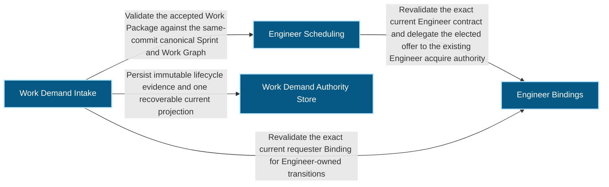
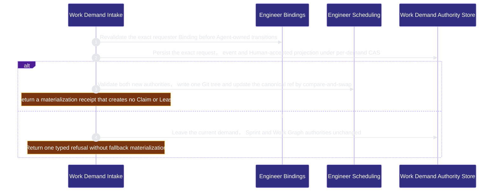

# runtime-harness/work-demand 架构文档
<!-- BEGIN ARCHCONTEXT:generated target="projection_target.entity.capability-runtime-harness-work-demand" sourceDigest="sha256:192e17844f0c2df68cffa64821e48ec677a357bd1989480ef3954a76f687c4ea" rendererVersion="archcontext.docs-renderer/v5" outputDigest="sha256:ff7b43266866c78e6b4e488acd21a1484ce086bdace242e3415ab5bf39de2726" -->
> **狀態**:`active`
> **Capability ID**:`capability.runtime-harness.work-demand`(kind `capability`)
> **Matched Prefixes**:`src/core/engineers/work-demand.ts`、`src/effects/engineers/work-demand-store.ts`、`src/effects/engineers/work-demand-materialization.ts`
> **Local Contracts**:`AGENTS.md`、`CLAUDE.md`
> **事實優先級**:倉庫當前狀態 > 本文檔機器區 > 本文檔人工區。機器區(引言、§1、§2)由 ArchContext 從架構模型與源碼度量投影生成,手改會在下次投影被覆蓋。本文檔不記錄出處;本次投影所驗證的 commit 見 `docs/architecture/.projection-manifest.json`。

Owns durable Agent-originated work requests, Human-frozen backlog projections and atomic Sprint plus Work Graph materialization without creating execution authority.

## 1. P1:能力架構地圖

### 1.1 架構圖

- Proof: `proven` (`sha256:7f26c078e32e16ba967f44fbef6b1fde73fce7388d7a7c92f7fcbf2a025951fe`).
- Semantic nodes: `4`; declared relations: `4`.

### 1.2 模組職責表

| 宣告入口 | 錨點 | 職責 |
| --- | --- | --- |
| `entrypoint.work-demand.event` | `src/core/engineers/work-demand.ts#buildWorkDemandEvent` | `sink.work-demand.digest` → `src/core/messages/mechanics.ts#canonicalMessageDigest` |
| `entrypoint.work-demand.binding` | `src/effects/engineers/work-demand-store.ts#validateEngineer` | `sink.work-demand.binding` → `src/effects/engineers/binding-store.ts#readEngineerBindingStatus` |
| `entrypoint.work-demand.materialize` | `src/effects/engineers/work-demand-materialization.ts#materializeWorkDemand` | `sink.work-demand.graph` → `src/core/engineers/scheduling.ts#projectWorkGraph` |

### 1.3 規模信號

- 規模量級:`2–5` 個文件 / `500–1000` 行
- 匹配前綴:`src/core/engineers/work-demand.ts`、`src/effects/engineers/work-demand-store.ts`、`src/effects/engineers/work-demand-materialization.ts`
- 推導:掃描 `source.include` 減 `source.exclude`,跳過 `.git/` 與 `node_modules/`,再按 1–2–5 階梯分桶。精確計數不入本文檔:量級足以回答「這個能力有多大」,而逐行計數會讓覆蓋範圍內任何一次源碼改動都改寫本文檔。

### 1.4 依賴邊界

出向關係:

- `calls` → `capability.runtime-harness.engineer-bindings` — Revalidate the exact current requester Binding for Engineer-owned transitions
- `calls` → `capability.runtime-harness.engineer-scheduling` — Validate the accepted Work Package against the same-commit canonical Sprint and Work Graph
- `calls` → `component.work-demand.primary` — Persist immutable lifecycle evidence and one recoverable current projection

入向關係:

- 無。

## 2. P2:端到端數據流

> **Proof**: `proven` (`sha256:7f26c078e32e16ba967f44fbef6b1fde73fce7388d7a7c92f7fcbf2a025951fe`); selectors `3/3`.

<!-- END ARCHCONTEXT:generated target="projection_target.entity.capability-runtime-harness-work-demand" -->

## 3. P3:設計決策與不變量

### 3.1 必须保持的不变量

1. **请求文本和提示是不可信输入。** `requested_urgency` 和 `dependency_hints` 只做有界校验（`src/core/engineers/work-demand.ts:191-200`）。它们不进入调度决定。Human 接受时冻结真正的 Task 与 Work Package 字节。
2. **Engineer 只能提出、提交和撤回自己的需求。** `propose`/`submit`/`cancel` 要求请求方 Engineer 的精确 fence；Human 只可 `cancel`。其他转换（包括 `accept` 和 `materialize`）只接受 Human（`work-demand.ts:240-247`）。
3. **Engineer 转换在 Binding 锁内重新校验 Binding。** Binding 在中途变化返回 `work_demand_store_conflict`（`src/effects/engineers/work-demand-store.ts:109-110`）。
4. **物化是一次原子 Git 提交。** `materializeWorkDemand` 在临时 index 中同时写入 Sprint 行和 Work Graph，生成一个 commit，先持久化 publication intent，再用 `update-ref` 对目标 ref 做 CAS（`src/effects/engineers/work-demand-materialization.ts:34-60`）。调度器在这个 commit 之前看不到任务（PR #302）。
5. **物化收据不创建执行权。** 收据只证明工作已创建，不创建 Claim、Lease 或 WorkEnvelope（PR #302）。
6. **崩溃后只沿 publication intent 恢复。** 已有 intent 时，只在目标 ref 仍等于 `expected_target_commit` 时重做 CAS。目标已移动则返回 `work_demand_materialization_stale`（`work-demand-materialization.ts:39-45`）。

### 3.2 关键权衡

| 决策 | 权衡 |
| --- | --- |
| 本能力自己写 Sprint 和 Work Graph commit | 任务出现与 Work Package 出现是同一个原子事件；代价是本能力直接写 workflow-state 拥有的 Sprint 文件和 `.work-graph.v1.json`，只靠 ref CAS 防并发 |
| 提案 idempotency 在全局 fence | 同一需求不会被提出两次（PR #302）；代价是 `propose` 必须使用需求自带的 `idempotency_key`（`work-demand-store.ts:102`） |

### 3.3 10x 规模下先坏的点

- `listWorkDemandStatuses` 枚举 Git common dir 下的每个需求目录（`work-demand-store.ts:114`）。需求数量增长后它先受压。单需求锁和原子 ref 更新仍然正确。届时可以加一个可重建的索引，不改变权威文件。

### 3.4 开放问题

- interface-change 的 `materialize` 只验证已提交的规划字节，由目标 Engineer 触发（`src/effects/engineers/interface-change-store.ts:296-318`）。本能力的 `materialize` 由 Human 触发，并自己写入 commit。两个能力用同一个词表示不同语义。源码和 PR 没有说明是否要统一。

## 4. 歷史決策記錄(append-only)

| 日期 | 决策 | 依据 |
| --- | --- | --- |
| 2026-09-04 | 建立类型化 `WorkDemandV1` 生命周期：提出、Human 接受、原子 Git 物化 | PR #302（closes #285），commit `97fc7c5c` |

## Optimization Backlog

- after arch-context#296：`work-demand.ts`、`work-demand-store.ts` 和 `work-demand-materialization.ts` 同时被 engineer-bindings 的 `src/{core,effects}/engineers/**` 认领。目标单一所有者是本能力（`ownership-proposal` §2）。
- 本能力没有自己的 CLI 文件。Human 入口在 engineer-bindings 的 `src/cli/commands/engineer.ts`，Engineer 入口在 mcp-sidecar 的 `src/cli/mcp/engineer-tools.ts`（`proposeWorkDemandAsEngineer`、`transitionWorkDemandAsEngineer`）。集成步骤声明了 mcp-sidecar primary → work-demand。
- 本能力调用 `src/core/state/sprint-backlog-rows.ts`、`src/core/state/coordination-identity.ts`、`src/effects/state/coordination-canonical-source.ts` 和 `src/effects/state/collect-board-inputs.ts`。集成步骤声明了 work-demand → workflow-state（`writes`）与 → execution-primitives。
- P2 flow 的 `buildWorkDemandEvent` 步骤指向本能力的 store 组件，但它的 sink `canonicalMessageDigest` 位于 engineer-messages 所有的 `src/core/messages/mechanics.ts`。归属见 engineer-messages 的 Backlog。
- 到 mcp-sidecar 的 capability 级回边：`work-demand-store.ts:17` 导入 `src/effects/repo-registry.ts`（repo-policy-registry 组件）。mcp-sidecar primary 又调用本能力。节点级没有环。模型不声明本方向。
