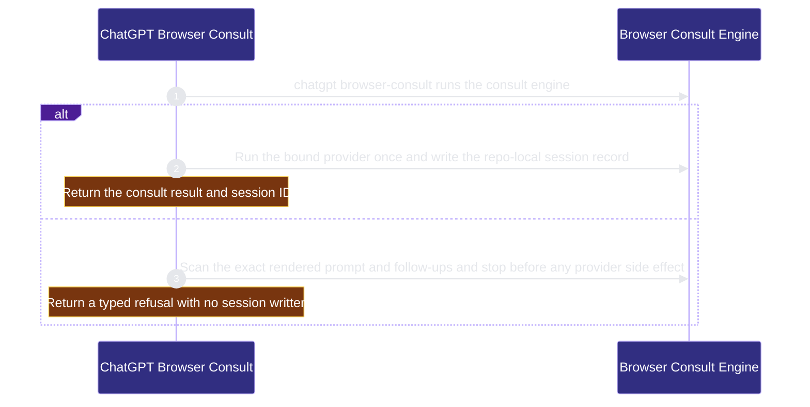

# runtime-mcp/chatgpt-browser 架構文檔

<!-- BEGIN ARCHCONTEXT:generated target="projection_target.entity.capability-runtime-mcp-chatgpt-browser" sourceDigest="sha256:ef1adc792ef7bfc073edb02070ee1f8e74d505020c9ad6292e8fb908b3efd095" rendererVersion="archcontext.docs-renderer/v5" outputDigest="sha256:21aede1b7c199588dd7c90886afdc992f001738e9ea41ddd585ad74ceded73e1" -->
> **狀態**:`active`
> **Capability ID**:`capability.runtime-mcp.chatgpt-browser`(kind `capability`)
> **Matched Prefixes**:`src/cli/chatgpt-browser/**`、`src/cli/chatgpt-skill/**`、`src/cli/commands/chatgpt.ts`、`docs/repo-harness-chatgpt-browser-engine.md`
> **Local Contracts**:`AGENTS.md`、`CLAUDE.md`
> **事實優先級**:倉庫當前狀態 > 本文檔機器區 > 本文檔人工區。機器區(引言、§1、§2)由 ArchContext 從架構模型與源碼度量投影生成,手改會在下次投影被覆蓋。本文檔不記錄出處;本次投影所驗證的 commit 見 `docs/architecture/.projection-manifest.json`。

Runs local ChatGPT Web consult sessions through a pinned Oracle browser provider and projects the ChatGPT skill to hosts.

## 1. P1:能力架構地圖

### 1.1 架構圖

- Proof: `proven` (`sha256:0c596c612efbcc3bf8aea941c1c6f3a8ddcfe5270915dd36c4b6e21763d32c0c`).
- Semantic nodes: `2`; declared relations: `1`.

### 1.2 模組職責表

| 宣告入口 | 錨點 | 職責 |
| --- | --- | --- |
| `entrypoint.chatgpt-browser.primary` | `src/cli/commands/chatgpt.ts#buildChatgptCommand` | `sink.chatgpt-browser.primary` → `src/cli/chatgpt-browser/engine.ts#runBrowserConsult` |

組件入口:

| 組件 | 宣告入口 | 錨點 | 職責 |
| --- | --- | --- | --- |
| `component.chatgpt-browser.primary` | `entrypoint.chatgpt-browser.consult` | `src/cli/chatgpt-browser/engine.ts#runBrowserConsult` | `sink.chatgpt-browser.secret-scan` → `src/cli/chatgpt-browser/secret-scan.ts#scanPromptBundle` |

### 1.3 規模信號

- 規模量級:`10–20` 個文件 / `2000–5000` 行
- 匹配前綴:`src/cli/chatgpt-browser/**`、`src/cli/chatgpt-skill/**`、`src/cli/commands/chatgpt.ts`、`docs/repo-harness-chatgpt-browser-engine.md`
- 排除前綴:`src/cli/chatgpt-browser/file-policy.ts`
- 推導:掃描 `source.include` 減 `source.exclude`,跳過 `.git/` 與 `node_modules/`,再按 1–2–5 階梯分桶。精確計數不入本文檔:量級足以回答「這個能力有多大」,而逐行計數會讓覆蓋範圍內任何一次源碼改動都改寫本文檔。

### 1.4 依賴邊界

出向關係:

- `calls` → `component.chatgpt-browser.primary` — Run a ChatGPT Web consult

入向關係:

- `calls` ← `component.global-runtime-reconciliation.cli-root` — Register the chatgpt command
- `calls` ← `component.mcp-sidecar.host-setup` — Read the canonical ChatGPT bridge reference from the packaged skill source
- `calls` ← `component.mcp-sidecar.primary` — Run the opt-in browser consult tools through the ChatGPT browser engine

組件出向關係:

- `component.chatgpt-browser.primary`:
  - 無。

### 1.5 組件結構

| 組件 | 名稱 | 規模量級 | 宣告入口 |
| --- | --- | --- | --- |
| `component.chatgpt-browser.primary` | Browser Consult Engine | `10–20` 個文件 / `2000–5000` 行 | `entrypoint.chatgpt-browser.consult` |

## 2. P2:端到端數據流

> **Proof**: `proven` (`sha256:0c596c612efbcc3bf8aea941c1c6f3a8ddcfe5270915dd36c4b6e21763d32c0c`); selectors `2/2`.

<!-- END ARCHCONTEXT:generated target="projection_target.entity.capability-runtime-mcp-chatgpt-browser" -->

## 3. P3:設計決策與不變量

### 3.1 必须保持的不变量

1. **不处理登录秘密。** 引擎不索取用户名、密码、SSO secret、2FA code、cookie 或 browser token（`docs/repo-harness-chatgpt-browser-engine.md` "What It Does Not Do"）。`browser-setup` 只在 `.repo-harness/chatgpt-browser.local.json` 记录 profile 绑定元数据。
2. **只发送显式选择的仓库文件。** prompt bundle 只由显式输入文件组成。输入和输出路径都经过 browser file policy 检查（`src/cli/chatgpt-browser/file-policy.ts`，它调用 MCP 的 `resolveMcpPath`）。
3. **secret scan 在任何副作用之前。** 调用方要求 secret scan 时，`runBrowserConsult` 先扫描精确渲染的 prompt 和 follow-up，再写 session 或启动 provider（`src/cli/chatgpt-browser/engine.ts:463-464`）。Gitleaks 缺失、版本低于 8.19 或扫描失败时，consult 失败（`src/cli/chatgpt-browser/secret-scan.ts:73-94`）。
4. **不自动换 provider。** Oracle 可能在捕获失败前已经提交了 prompt。静默重试会重复提问（引擎文档 "What It Does Not Do"）。
5. **repo 内的 session 记录是审计记录。** ChatGPT Web 不是事实来源。每个结果都写入 `.ai/harness/chatgpt/sessions/<sessionId>/`（`engine.ts` 中的五处 `writeBrowserSession`）。
6. **Oracle 版本精确匹配。** `REQUIRED_ORACLE_VERSION` 是 `0.20.0`（`src/cli/chatgpt-browser/oracle-provider.ts:69`）。PR #291 说明了为什么用精确匹配：`--browser-chrome-profile` 是隐藏 flag，没有稳定性承诺。范围比较会接受未验证的版本。
7. **绑定 profile 必须明确。** 没有显式 profile 目录的绑定会被拒绝。否则 Oracle 会退回到 `Local State` 的 `last_used` profile（引擎文档 "First-Time Setup"）。
8. **提交后超时可以恢复。** Oracle 自己的元数据记录 prompt 已提交时，超时结果是 `recoverable`（`ORACLE_TIMEOUT_AFTER_SUBMIT`，`oracle-provider.ts:716`），可以用 follow-up 继续。只分配了 session ID 不算提交（PR #560）。
9. **ChatGPT skill 只能显式安装。** `chatgpt install-skill` 为每个 host 建一个指向打包源的 symlink。已有目录、断开的 symlink 和指向其他源的 symlink 都不会被覆盖（引擎文档 "First-Time Setup"）。

### 3.2 关键权衡

| 决策 | 权衡 |
| --- | --- |
| Oracle 是默认 provider，native CDP 已弃用 | 浏览器引擎由 Oracle 维护。代价是 repo-harness 依赖一个要求 `node >=24` 的外部二进制。`browser-doctor --provider oracle --json` 是这个边界的判定者。 |
| Oracle 可选、固定版本，并由 doctor 给出修复动作 | 默认 install 和 dry-run 不安装也不升级 Oracle。代价是用户第一次使用 GPT Pro consult 时要按 `agent_actions` 手动修复。 |
| 用 `--copy-profile` 复制绑定的 Chrome profile（PR #290） | 不读取 cookie 文件，也不修改用户 profile。代价是每次运行都复制 profile，并且依赖 Oracle 的隐藏 flag。 |
| MCP browser 工具默认关闭，只在 `--enable-chatgpt-browser` 时暴露（`src/cli/mcp/tools.ts:1128`） | 远端 connector 默认不能驱动本地浏览器。代价是 MCP 侧和 CLI 侧各有一个入口，二者共用同一个引擎。 |
| native provider 在有排队 follow-up 时启动前就失败（`NATIVE_FOLLOWUPS_UNSUPPORTED`，PR #560） | 不会出现"报告完成但丢掉了 follow-up"。代价是使用 native 的脚本必须逐轮调用 `browser-followup`。 |

### 3.3 组件与依赖

本 capability 只有一个组件 `component.chatgpt-browser.primary`（Browser Consult Engine），12 个代码文件约 3644 行，加 1 份引擎文档（359 行）。规模在拆分阈值以下。

入向调用来自 mcp-sidecar：primary 组件的 5 个 browser 工具（`tools.ts:1128-1159`），以及 host-setup 读取 bridge 参考（`src/cli/mcp/setup.ts:69-80`）。出向依赖只有 `file-policy.ts`。这个文件目前归 mcp-sidecar 所有（见 Optimization Backlog）。

### 3.4 开放问题

- native provider 已弃用，文档说"will be removed"。移除时间和触发条件没有记录。
- 归属提议 §6 提出另一种方案：把本 capability 作为 mcp-sidecar 的组件，让 2-cycle 留在内部。用户已决定保持独立 capability（2026-10-11）。如果 `file-policy.ts` 的反向边不消除，这个选择是否需要复审？没有记录。

## 4. 歷史決策記錄(append-only)

### 2026-10-11 建立 capability 节点

- 新建 `capability.runtime-mcp.chatgpt-browser`、`component.chatgpt-browser.primary`、`relation.chatgpt-browser.primary` 和 `flow.chatgpt-browser.primary`。用户决定它与 strategy-reflection 各自独立，不并入 mcp-sidecar。
- include 用 9 个显式文件列出 `src/cli/chatgpt-browser/` 下的代码，不包括 `file-policy.ts`。原因：mcp-sidecar 精确持有 `file-policy.ts`，而 include 收窄已推迟。目录 glob 会让这个文件变成重复归属。
- flow 证明 `chatgpt` 命令 → `runBrowserConsult` 的成功路径，以及 secret scan 拒绝路径。

## Optimization Backlog

- 在 arch-context#296 之后，mcp-sidecar 移除 `src/cli/chatgpt-browser/file-policy.ts` 的精确条目。然后把本 capability 的 9 个显式文件换成 `src/cli/chatgpt-browser/**`。在此之前，这个目录里新加的文件没有归属。
- 重构证据：`file-policy.ts` 调用 MCP 的 `resolveMcpPath`（`src/cli/mcp/paths.ts`）和 MCP 类型。文件移入本 capability 后，这是一条 chatgpt-browser → mcp-sidecar 的反向边，与 mcp-sidecar → chatgpt-browser 组成 2-cycle。路径包含检查可以移到共享位置。没有声明为 intended relation。
- `assets/skills/repo-harness-chatgpt/**` 归 action-commands 的 bundled-skills 组件。它与本 capability 的 skill 投影器分属两个 capability。
