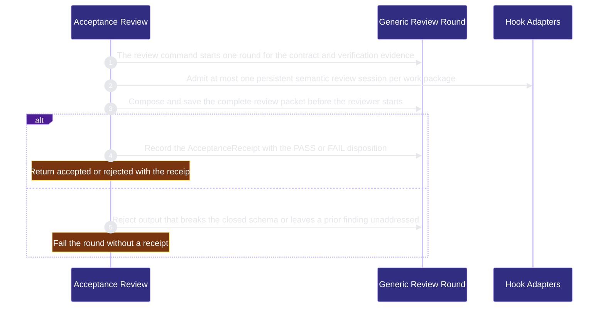

# verification/acceptance-review 架構文檔

<!-- BEGIN ARCHCONTEXT:generated target="projection_target.entity.capability-verification-acceptance-review" sourceDigest="sha256:95cf4927c3167df20f6ef6468d82cf58753688ef51f7d02095f186655e3919be" rendererVersion="archcontext.docs-renderer/v5" outputDigest="sha256:dc1f96881d6af869e79cb94cc55c0452621fc8b78a24eba7c9b58d72c6702fda" -->
> **狀態**:`active`
> **Capability ID**:`capability.verification.acceptance-review`(kind `capability`)
> **Matched Prefixes**:`src/core/review/**`、`src/effects/review/**`、`src/cli/commands/review.ts`、`scripts/acceptance-receipt.ts`、`scripts/change-assessment.ts`
> **Local Contracts**:`AGENTS.md`、`CLAUDE.md`
> **事實優先級**:倉庫當前狀態 > 本文檔機器區 > 本文檔人工區。機器區(引言、§1、§2)由 ArchContext 從架構模型與源碼度量投影生成,手改會在下次投影被覆蓋。本文檔不記錄出處;本次投影所驗證的 commit 見 `docs/architecture/.projection-manifest.json`。

Runs the generic acceptance review through a persistent reviewer task agent and records one structured acceptance receipt.

## 1. P1:能力架構地圖

### 1.1 架構圖

- Proof: `proven` (`sha256:a1dff2d2a2be9197ed5a6543ae73fd6a654c790664501f8eb7b794cca651a7ff`).
- Semantic nodes: `3`; declared relations: `2`.

### 1.2 模組職責表

| 宣告入口 | 錨點 | 職責 |
| --- | --- | --- |
| `entrypoint.acceptance-review.primary` | `src/cli/commands/review.ts#buildReviewCommand` | `sink.acceptance-review.primary` → `src/effects/review/generic-review.ts#runReviewRound`、`sink.acceptance-review.circuit-admission` → `src/cli/hook/circuit-breaker.ts#recordCircuitAttempt` |
| `entrypoint.acceptance-review.round` | `src/effects/review/generic-review.ts#runReviewRound` | `sink.acceptance-review.packet` → `src/core/review/review-packet.ts#composeReviewPacket`、`sink.acceptance-review.validate-output` → `src/core/review/generic-review.ts#validateReviewOutput`、`sink.acceptance-review.record-receipt` → `scripts/acceptance-receipt.ts#recordAcceptance` |

### 1.3 規模信號

- 規模量級:`10–20` 個文件 / `2000–5000` 行
- 匹配前綴:`src/core/review/**`、`src/effects/review/**`、`src/cli/commands/review.ts`、`scripts/acceptance-receipt.ts`、`scripts/change-assessment.ts`
- 推導:掃描 `source.include` 減 `source.exclude`,跳過 `.git/` 與 `node_modules/`,再按 1–2–5 階梯分桶。精確計數不入本文檔:量級足以回答「這個能力有多大」,而逐行計數會讓覆蓋範圍內任何一次源碼改動都改寫本文檔。

### 1.4 依賴邊界

出向關係:

- `calls` → `capability.runtime-harness.hook-adapters` — Admit at most one persistent semantic review session per work package through the circuit breaker
- `calls` → `component.acceptance-review.primary` — Run one generic acceptance review round for a contract

入向關係:

- `reads` ← `capability.runtime-harness.bound-task-freezes` — Inspect acceptance evidence and the review subject for a frozen task
- `calls` ← `component.contract-assets.contract-worktree-lifecycle` — Locate the acceptance receipt and the protected Git runtime
- `calls` ← `component.contract-assets.planning-helpers` — Read the acceptance policy for planning helpers
- `calls` ← `capability.runtime-harness.engineer-scheduling` — Compute the acceptance authority fingerprint for a dependency
- `calls` ← `component.global-runtime-reconciliation.archctx-closure` — Build the module review prompt from the committed architecture model
- `calls` ← `component.global-runtime-reconciliation.cli-root` — Register the review command
- `calls` ← `component.integration-acceptance.primary` — Locate the acceptance receipt for an integration candidate
- `calls` ← `component.operator.architecture-view` — Report module CLI failures with the typed module read error of the review prompt builder
- `calls` ← `component.operator.primary` — Raise and map the typed module read errors that the module review prompt builder declares
- `depends-on` ← `component.operator.view-projections` — Decode the module review prompt shape that the review prompt builder declares

## 2. P2:端到端數據流

> **Proof**: `proven` (`sha256:a1dff2d2a2be9197ed5a6543ae73fd6a654c790664501f8eb7b794cca651a7ff`); selectors `5/5`.

<!-- END ARCHCONTEXT:generated target="projection_target.entity.capability-verification-acceptance-review" -->

## 3. P3:設計決策與不變量

### 3.1 必须保持的不变量

1. **一个验收来源。** `acceptancePolicySource()` 只返回 `'generic-review'`（`scripts/acceptance-receipt.ts:451`）。旧的 Claude 专用 review 命令只保留一个隐藏 stub，它返回 `UPGRADE_REQUIRED` 并以 1 退出（`src/cli/index.ts:811`）。旧的 direct cross-review 运行路径已删除，没有 alias（PR #484）。
2. **每个工作包最多一个持久 reviewer。** review 命令在启动 session 前调用 `recordCircuitAttempt`，guard 是 `one-semantic-review-per-work-package`（`src/cli/commands/review.ts:27`）。预算用完时命令失败，不启动新的 reviewer。
3. **reviewer 不能复用 owner pane。** 绑定的 pane 等于 owner pane 时，round 失败（`src/effects/review/generic-review.ts:261`）。
4. **packet 先保存，reviewer 后启动。** `composeReviewPacket` 在任何 reviewer pane 启动前生成完整 packet（`src/core/review/review-packet.ts:16`）。packet 上限是 10 MiB UTF-8（`review-packet.ts:25`）。启动失败后 packet 保留。内容不变的重试复用原字节；内容改变的重试在再次启动前失败（PR #578）。
5. **reviewer 输出使用封闭 schema。** `validateReviewOutput` 要求字段集合完全一致，并检查 identity 字段。它拒绝冲突的 PASS，也拒绝没有处理的旧 finding（`src/core/review/generic-review.ts:29`）。
6. **receipt 只在稳定状态下记录。** 在 `recordAcceptance` 前，round 再次检查 `close.request`，并比较两个 worktree 的指纹。worktree 改变时 round 失败（`generic-review.ts:288`、`generic-review.ts:289`）。cancel 与 accept 的线性化点写在 `generic-review.ts:284` 的注释里。
7. **隔离失败不能降级。** reviewer 在 macOS Seatbelt launcher 里运行（`src/effects/review/review-isolation.ts:160`）。隔离不可用时结果是 `unsupported`，不能退回到无隔离运行（PR #476 回滚说明）。
8. **只有可验证模型的 harness 能生成 receipt。** Claude reviewer 或没有观测到实际模型时，round 以 `review_actual_model_unverified` 失败（`generic-review.ts:85`）。
9. **脚本是源，模板是投影。** `assets/templates/helpers/acceptance-receipt.ts` 与 `scripts/acceptance-receipt.ts` 只差 import 路径。`scripts/sync-helper-sources.ts` 检查投影漂移。

### 3.2 关键权衡

| 决策 | 权衡 |
| --- | --- |
| reviewer 通过 Herdr task agent 和 OAR host 运行 | 产品代码不构造 vendor argv，也不解析 native 输出（PR #476）。代价是 review 依赖 Herdr 和 OAR 版本，CI 需要先构建 OAR host bundle（`.github/workflows/ci.yml:110`）。 |
| Codex 使用独立的 `CODEX_HOME`，只复制 `auth.json` | 真实的 `~/.codex` 没有写权限（PR #476）。代价是复制的凭据必须在 close、cancel 和失败时删除；删除失败报告为 `cleanup_pending`（`review-isolation.ts:84`）。 |
| 每个 contract 最多 3 轮，每轮最多 30 分钟 | `REVIEW_MAX_ROUNDS = 3`，`REVIEW_TIMEOUT_MS = 1_800_000`（`src/core/review/generic-review.ts:6`）。轮数和成本有上限。代价是第 3 轮后必须由人决定下一步。 |
| change assessment 只用最终 subject 和 policy base | 选择结果可以复算，hook 历史和模型输出不能改变路由（`evals-checks.md` 的 Change Assessment v1 小节）。代价是缺少 policy 或 base 时验证直接失败。 |
| module review prompt builder 放在本 capability | `src/core/review/**` 整个目录归一个 owner，不需要 `source.exclude`（brief 规则 6）。代价是 operator 和 module CLI 对本 capability 有依赖。拆分计划见 Optimization Backlog。 |

### 3.3 开放问题

- `scripts/acceptance-receipt.ts` 有 1994 行。它包含 receipt、waiver、archive projection 和 verification observation 四类权威。这些职责为什么在一个文件里，没有记录。
- PR #476 记录 reviewer 隔离只保护写入，不限制读取真实 `~/.codex` 和网络。这个残余风险是否被接受，以及由谁复核，没有记录。

## 4. 歷史決策記錄(append-only)

### Generic review 取代 Claude 专用 review 命令（2026-10-03，PR #476、PR #484）

- `repo-harness review` 通过 Herdr task-agent 和 OAR SDK 运行 fleet `deep-reasoner` 角色。
- 旧的 Claude 专用 review 命令只留下 fail-closed stub。PR #484 删除三个 direct cross-review 文件。

### packet 先于 reviewer 启动保存（2026-10-06，PR #578）

- P2 顺序：生成 packet，保存，准备隔离和凭据，启动 reviewer，复查 context，然后提交请求。
- 不重放未知的投递。

### 建立 capability 节点（2026-10-11）

- 新建 `capability.verification.acceptance-review` 和 `component.acceptance-review.primary`。
- include 使用 `src/core/review/**` 和 `src/effects/review/**` 两个目录 glob。在 main 上，这两个目录的文件都没有 owner。operator 分支上有一个未合并的 `module-review-prompt.ts` 显式条目。该条目已删除，文件归本 capability。
- flow `flow.acceptance-review.primary` 的 5 个 selector 都是 CodeGraph 中的直接调用。

## Optimization Backlog

- 在 arch-context#296 之后拆分目录：`src/core/review/module-review-prompt.ts` 归 operator 的 architecture-view 组件；`src/effects/review/diff-fingerprint.ts` 归 workflow-state（归属提议 §4）。拆分前，operator 与 module CLI 对本 capability 的关系是归属造成的，不是职责依赖。
- `scripts/acceptance-receipt.ts`（1994 行）可以按 receipt、waiver、archive projection 和 verification observation 拆分。拆分前需要先确认 §3.3 的原因。
- 本 capability 现在只有一个组件。源码有三个可分的职责：review round（`src/effects/review/generic-review.ts`）、change assessment（`src/*/review/change-assessment.ts`）和 receipt（`scripts/acceptance-receipt.ts`）。需要独立 owner 时再拆。
