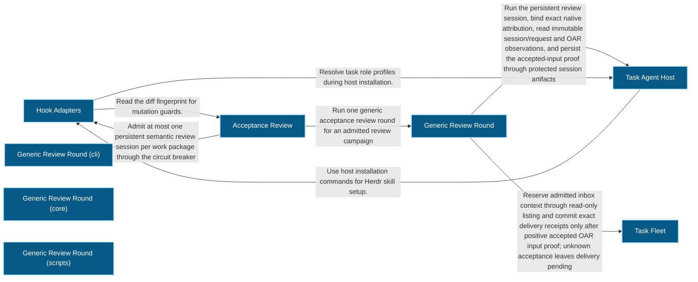
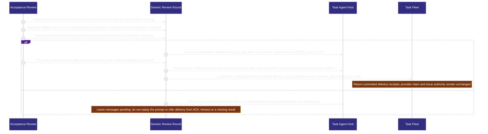
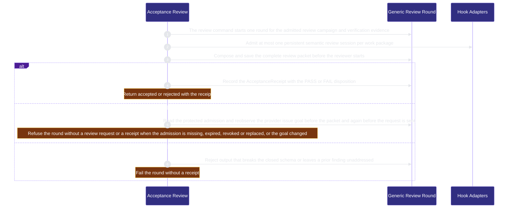

# verification/acceptance-review 架構文檔

<!-- BEGIN ARCHCONTEXT:generated target="projection_target.entity.capability-verification-acceptance-review" rendererVersion="archcontext.docs-renderer/v6" outputDigest="sha256:ab3f4890cb5fcc2f05efb065597228491367b19d82d6c14413a4cc5cbaf70416" -->
> **狀態**:`active`
> **Capability ID**:`capability.verification.acceptance-review`(kind `capability`)
> **Matched Prefixes**:`src/core/review/**`、`src/effects/review/**`、`src/cli/commands/review.ts`、`scripts/acceptance-receipt.ts`、`scripts/change-assessment.ts`、`src/effects/admission/admission-store.ts`、`src/effects/admission/admission-source.ts`、`src/effects/admission/issue-goal.ts`、`src/effects/admission/control-admission.ts`
> **Local Contracts**:`AGENTS.md`、`CLAUDE.md`
> **事實優先級**:倉庫當前狀態 > 本文檔機器區 > 本文檔人工區。機器區(引言、§1、§2)由 ArchContext 從架構模型與源碼度量投影生成,手改會在下次投影被覆蓋。本文檔不記錄出處;本次投影所驗證的 commit 見 `docs/architecture/.projection-manifest.json`。

Runs the generic acceptance review through a persistent reviewer task agent and records one structured acceptance receipt.

## 1. P1:能力架構地圖

### 1.1 架構圖

- Proof: `proven` (`sha256:a092a9e918c17dbf2802a57aa9ce98dc1624c68ebe89983d9af7092fa7fb54bb`).
- Semantic nodes: `8`; declared relations: `7`.

### 1.2 模組職責表

| 宣告入口 | 錨點 | 職責 |
| --- | --- | --- |
| `entrypoint.acceptance-review.primary` | `src/cli/commands/review.ts#buildReviewCommand` | `sink.acceptance-review.primary` → `src/effects/review/generic-review.ts#runReviewRound`、`sink.acceptance-review.circuit-admission` → `src/cli/hook/circuit-breaker.ts#recordCircuitAttempt` |
| `entrypoint.acceptance-review.round` | `src/effects/review/generic-review.ts#runReviewRound` | `sink.acceptance-review.observe-admission` → `src/effects/review/acceptance-receipt.ts#acceptanceContext`、`sink.acceptance-review.packet` → `src/core/review/review-packet.ts#composeReviewPacket`、`sink.acceptance-review.validate-output` → `src/core/review/generic-review.ts#validateReviewOutput`、`sink.acceptance-review.record-receipt` → `src/effects/review/acceptance-receipt.ts#recordAcceptance`、`sink.acceptance-review.reserve-inbox` → `src/effects/review/pre-prompt-inbox.ts#preparePrePromptInbox`、`sink.acceptance-review.commit-inbox` → `src/effects/review/pre-prompt-inbox.ts#commitPrePromptInbox` |
| `entrypoint.acceptance-review.inbox-host` | `src/effects/review/oar-review-host.ts#runHostFileRequest` | `sink.acceptance-review.consume-inbox` → `src/effects/review/pre-prompt-inbox-consumer.ts#consumePrePromptInbox`、`sink.acceptance-review.accepted-inbox` → `src/effects/review/pre-prompt-inbox-consumer.ts#recordPrePromptInboxAccepted` |
| `entrypoint.acceptance-review.inbox-proof` | `src/effects/review/pre-prompt-inbox-consumer.ts#recordPrePromptInboxAccepted` | `sink.acceptance-review.persist-inbox-proof` → `src/effects/terminal/task-session-io.ts#writeSessionArtifact` |
| `entrypoint.acceptance-review.inbox-commit` | `src/effects/review/pre-prompt-inbox.ts#commitPrePromptInbox` | `sink.acceptance-review.inbox-session` → `src/effects/terminal/task-session-reader.ts#readTaskAgent`、`sink.acceptance-review.inbox-oar-proof` → `src/effects/terminal/task-runtime-observation.ts#readOarObservation`、`sink.acceptance-review.deliver-inbox` → `src/effects/fleet/task-inbox.ts#deliverTaskInbox` |

組件入口:

- 組件均未宣告 `source.entrypoints`。

### 1.3 規模信號

- 規模量級:`20–50` 個文件 / `5000–10000` 行
- 匹配前綴:`src/core/review/**`、`src/effects/review/**`、`src/cli/commands/review.ts`、`scripts/acceptance-receipt.ts`、`scripts/change-assessment.ts`、`src/effects/admission/admission-store.ts`、`src/effects/admission/admission-source.ts`、`src/effects/admission/issue-goal.ts`、`src/effects/admission/control-admission.ts`
- 推導:掃描 `source.include` 減 `source.exclude`,跳過 `.git/` 與 `node_modules/`,再按 1–2–5 階梯分桶。精確計數不入本文檔:量級足以回答「這個能力有多大」,而逐行計數會讓覆蓋範圍內任何一次源碼改動都改寫本文檔。

### 1.4 依賴邊界

出向關係:

- `calls` → `external.claude-code` — Run Claude Code as a sandboxed reviewer in the OAR review host.
- `calls` → `external.codex` — Run Codex as a sandboxed reviewer in the OAR review host.
- `deployed-on` → `process.oar-review-host` — Acceptance review runs review sessions in the OAR review host.
- `calls` → `capability.runtime-harness.hook-adapters` — Admit at most one persistent semantic review session per work package through the circuit breaker
- `depends-on` → `capability.runtime-harness.mcp-sidecar` — Apply secret patterns to module review context.
- `depends-on` → `capability.runtime-harness.operator` — Use the architecture module view in review prompts.
- `calls` → `component.acceptance-review.primary` — Run one generic acceptance review round for an admitted review campaign

入向關係:

- `calls` ← `component.contract-assets.contract-worktree-lifecycle` — Locate the acceptance receipt and the protected Git runtime
- `calls` ← `component.contract-assets.planning-helpers` — Read the acceptance policy for planning helpers
- `calls` ← `capability.runtime-harness.engineer-scheduling` — Compute the acceptance authority fingerprint for a dependency
- `depends-on` ← `capability.verification.evals-checks` — Test Acceptance Review behavior through its source modules.
- `depends-on` ← `capability.runtime-harness.external-source-intake` — Read protected review admission sources for current source-binding validation
- `calls` ← `component.global-runtime-reconciliation.archctx-closure` — Build the module review prompt from the committed architecture model
- `calls` ← `component.global-runtime-reconciliation.cli-root` — Register the review command
- `depends-on` ← `capability.runtime-harness.hook-adapters` — Read the diff fingerprint for mutation guards.
- `calls` ← `component.integration-acceptance.primary` — Locate the acceptance receipt for an integration candidate
- `depends-on` ← `capability.runtime-harness.operator` — Read and reobserve protected current review admission for exact session discovery and current goal context
- `depends-on` ← `component.operator.view-projections` — Decode the module review prompt shape that the review prompt builder declares
- `depends-on` ← `capability.organization.publication` — Read the acceptance receipt for publication evidence.
- `depends-on` ← `capability.workflow-engine.workflow-state` — Read the diff fingerprint for Effective State.

組件出向關係:

- `component.acceptance-review.primary`:
  - `calls` → `capability.runtime-harness.evidence-ledger` — Canonicalize review records and load verification execution results
  - `calls` → `capability.workflow-engine.execution-primitives` — Hold an exclusive directory lock around one generic review run
  - `calls` → `capability.runtime-harness.task-agent-host` — Run the persistent review session, bind exact native attribution, read immutable session/request and OAR observations, and persist the accepted-input proof through protected session artifacts
  - `calls` → `capability.organization.task-fleet` — Reserve admitted inbox context through read-only listing and commit exact delivery receipts only after positive accepted OAR input proof; unknown acceptance leaves delivery pending
  - `reads` → `capability.workflow-engine.workflow-state` — Observe Git and files read-only and resolve the workflow profile for the review subject
- `component.acceptance-review.primary-cli`:
  - 無。
- `component.acceptance-review.primary-core`:
  - 無。
- `component.acceptance-review.primary-scripts`:
  - 無。

### 1.5 組件結構

| 組件 | 名稱 | 規模量級 | 宣告入口 |
| --- | --- | --- | --- |
| `component.acceptance-review.primary` | Generic Review Round | `10–20` 個文件 / `2000–5000` 行 | 未宣告 |
| `component.acceptance-review.primary-cli` | Generic Review Round (cli) | `1–2` 個文件 / `100–200` 行 | 未宣告 |
| `component.acceptance-review.primary-core` | Generic Review Round (core) | `5–10` 個文件 / `2000–5000` 行 | 未宣告 |
| `component.acceptance-review.primary-scripts` | Generic Review Round (scripts) | `2–5` 個文件 / `200–500` 行 | 未宣告 |

## 2. P2:端到端數據流

> **Proof**: `proven` (`sha256:a092a9e918c17dbf2802a57aa9ce98dc1624c68ebe89983d9af7092fa7fb54bb`); selectors `14/14`.

<!-- END ARCHCONTEXT:generated target="projection_target.entity.capability-verification-acceptance-review" -->

## 3. P3:設計決策與不變量

### 3.1 必须保持的不变量

1. **一个验收来源。** `acceptancePolicySource()` 只返回 `'generic-review'`（`src/core/review/acceptance-receipt.ts#acceptancePolicySource`）。旧的 direct cross-review 运行路径已删除，没有 alias（PR #484）。
2. **每个工作包最多一个持久 reviewer。** review 命令在启动 session 前调用 `recordCircuitAttempt`，guard 是 `one-semantic-review-per-work-package`（`src/cli/commands/review.ts:27`）。预算用完时命令失败，不启动新的 reviewer。
3. **reviewer 不能复用 owner pane。** 绑定的 pane 等于 owner pane 时，round 失败（`src/effects/review/generic-review.ts:261`）。
4. **packet 先保存，reviewer 后启动。** `composeReviewPacket` 在任何 reviewer pane 启动前生成完整 packet（`src/core/review/review-packet.ts:16`）。packet 上限是 10 MiB UTF-8（`review-packet.ts:25`）。启动失败后 packet 保留。内容不变的重试复用原字节；内容改变的重试在再次启动前失败（PR #578）。
5. **reviewer 输出使用封闭 schema。** `validateReviewOutput` 要求字段集合完全一致，并检查 identity 字段。它拒绝冲突的 PASS，也拒绝没有处理的旧 finding（`src/core/review/generic-review.ts:29`）。
6. **receipt 只在稳定状态下记录。** 在 `recordAcceptance` 前，round 再次检查 `close.request`，并比较两个 worktree 的指纹。worktree 改变时 round 失败（`src/effects/review/generic-review.ts:368`、`src/effects/review/generic-review.ts:369`）。cancel 与 accept 的线性化点写在 `src/effects/review/generic-review.ts:364-367` 的注释里。
7. **隔离失败不能降级。** reviewer 在 macOS Seatbelt launcher 里运行（`src/effects/review/review-isolation.ts:160`）。隔离不可用时结果是 `unsupported`，不能退回到无隔离运行（PR #476 回滚说明）。
8. **未观测的模型记为 null，不授予跨模型声明。** OAR host 用同一条规则（`src/effects/terminal/task-runtime-observation.ts#oarActualModel`）记录 reviewer 和 task agent 每轮结束时的模型；Claude 一律为 null。null reviewer 模型仍可生成 receipt。Receipt protocol 4 记录绑定作者 session 的摘要、作者模型集合和 `model_relation`；家族对照表只在 `src/core/review/acceptance-receipt.ts#modelFamily`。只有 `different-family` 算跨模型 review；作者未绑定、某轮未结束或模型为 null 时为 `unknown`。validator 不重算家族。
9. **receipt 库代码在 `src`。** 纯规则在 `src/core/review/acceptance-receipt.ts`。存储、上下文观察和 CLI 逻辑在 `src/effects/review/acceptance-receipt.ts`。`scripts/acceptance-receipt.ts` 是薄 CLI 外壳：它重新导出 effects 模块，并调用 `runAcceptanceReceiptCli`。`src` 不导入 `scripts/`（`scripts/check-state-boundaries.ts` 检查这条规则）。`assets/templates/helpers/` 只投影 `capability-resolver.ts`。
10. **round 只在当前 review admission 下运行。** `review admit --request <file>` 写入上游 Bot 已授权的 approval。`review revoke --request <file>` 撤销它。revoke 请求指定 repository、issue 和 campaign，以及预期的 `grant_sha256` 和 revision。两个命令都按 `expectedRevision` 做 CAS，revoke 还要求当前 grant 等于预期的 grant（`src/effects/admission/admission-store.ts#revokeActiveReviewAdmission`）。round 用 `acceptanceContext` 读 protected admission，并重新观察 GitHub issue goal（`src/effects/review/acceptance-receipt.ts`）。发送请求前，round 再读一次。admission 缺失、过期、被撤销或被替换时，round 失败。goal 改变时，round 也失败。失败的 round 不发送请求，也不写 receipt。
11. **每个 receipt 有一条不可变记录。** 每次后来的 review 都替换 `acceptance.latest.json`。写 verification observation 时，`persistAcceptanceReceiptRecord` 用该 receipt 自己的字节写一条记录，路径是 `~/.repo-harness/gates/<hash>/acceptance-receipts/<digest>.json`（`src/effects/review/acceptance-receipt.ts#acceptanceReceiptRecordPath`）。写入只创建新文件。同一摘要已有不同字节时，写入失败。`readAcceptanceReceiptRecord` 拒绝非普通文件、symlink 和超过 1 MiB 的记录，并检查字节摘要。

### 3.2 关键权衡

| 决策 | 权衡 |
| --- | --- |
| reviewer 通过 Herdr task agent 和 OAR host 运行 | 产品代码不构造 vendor argv，也不解析 native 输出（PR #476）。代价是 review 依赖 Herdr 和 OAR 版本，CI 需要先构建 OAR host bundle（`.github/workflows/ci.yml:110`）。 |
| Codex 使用独立的 `CODEX_HOME`，只复制 `auth.json` | 真实的 `~/.codex` 没有写权限（PR #476）。代价是复制的凭据必须在 close、cancel 和失败时删除；删除失败报告为 `cleanup_pending`（`review-isolation.ts:84`）。 |
| 每个 review campaign 最多 3 轮，每轮最多 30 分钟 | `REVIEW_MAX_ROUNDS = 3`，`REVIEW_TIMEOUT_MS = 1_800_000`（`src/core/review/generic-review.ts:6`）。轮数和成本有上限。代价是第 3 轮后必须由人决定下一步。 |
| change assessment 只用最终 subject 和 policy base | 选择结果可以复算，hook 历史和模型输出不能改变路由（`evals-checks.md` 的 Change Assessment v1 小节）。代价是缺少 policy 或 base 时验证直接失败。 |
| module review prompt builder 放在本 capability | `src/core/review/**` 整个目录归一个 owner，不需要 `source.exclude`（brief 规则 6）。代价是 operator 和 module CLI 对本 capability 有依赖。拆分计划见 Optimization Backlog。 |

### 3.3 开放问题

- `src/effects/review/acceptance-receipt.ts` 约 1,200 行。它包含 receipt、waiver、archive projection 和 verification observation 四类权威，还包含 CLI 逻辑。这些职责为什么在一个文件里，没有记录。
- PR #476 记录 reviewer 隔离只保护写入，不限制读取真实 `~/.codex` 和网络。这个残余风险是否被接受，以及由谁复核，没有记录。

## 4. 歷史決策記錄(append-only)

### Generic review 取代 Claude 专用 review 命令（2026-10-03，PR #476、PR #484）

- `repo-harness review` 通过 Herdr task-agent 和 OAR SDK 运行 fleet `deep-reasoner` 角色。
- 旧的 Claude 专用 review 命令只留下 fail-closed stub。PR #484 删除三个 direct cross-review 文件。

### packet 先于 reviewer 启动保存（2026-10-06，PR #578）

- P2 顺序：生成 packet，保存，准备隔离和凭据，启动 reviewer，复查 context，然后提交请求。
- 不重放未知的投递。

### 建立 capability 节点（2026-10-11）

- 新建 `capability.verification.acceptance-review` 和 `component.acceptance-review.primary`。
- include 使用 `src/core/review/**` 和 `src/effects/review/**` 两个目录 glob。在 main 上，这两个目录的文件都没有 owner。operator 分支上有一个未合并的 `module-review-prompt.ts` 显式条目。该条目已删除，文件归本 capability。
- flow `flow.acceptance-review.primary` 的 5 个 selector 都是 CodeGraph 中的直接调用。

## Optimization Backlog

- 在 arch-context#296 之后拆分目录：`src/core/review/module-review-prompt.ts` 归 operator 的 architecture-view 组件；`src/effects/review/diff-fingerprint.ts` 归 workflow-state（归属提议 §4）。拆分前，operator 与 module CLI 对本 capability 的关系是归属造成的，不是职责依赖。
- `src/effects/review/acceptance-receipt.ts` 可以按 receipt、waiver、archive projection 和 verification observation 拆分。拆分前需要先确认 §3.3 的原因。
- 本 capability 现在只有一个组件。源码有三个可分的职责：review round（`src/effects/review/generic-review.ts`）、change assessment（`src/*/review/change-assessment.ts`）和 receipt（`src/core/review/acceptance-receipt.ts`、`src/effects/review/acceptance-receipt.ts`）。需要独立 owner 时再拆。
