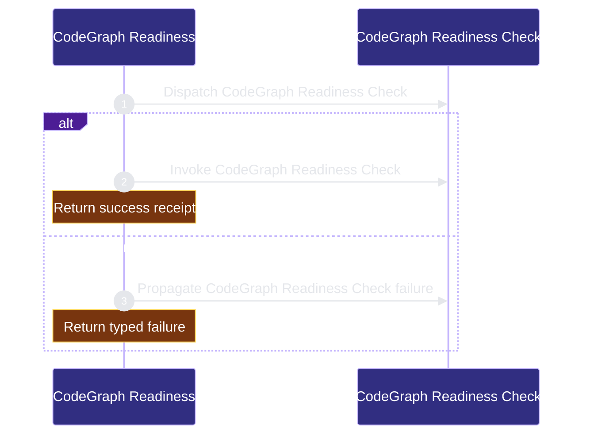

# verification/codegraph-readiness 架构文档
<!-- BEGIN ARCHCONTEXT:generated target="projection_target.entity.capability-verification-codegraph-readiness" sourceDigest="sha256:cee96bdc4be34765f0ef0b61417bdec56ca19878e0e294e991eeaa457551d300" rendererVersion="archcontext.docs-renderer/v5" outputDigest="sha256:e858431853aa390dd9a8baee74cce9cc14d1f8626426a23d22ead8d0d38fb04c" -->
> **狀態**:`active`
> **Capability ID**:`capability.verification.codegraph-readiness`(kind `capability`)
> **Matched Prefixes**:`scripts/ensure-codegraph.sh`、`src/cli/tools/codegraph.ts`、`src/cli/mcp/codegraph-adapter.ts`、`tests/cli/codegraph-resolver.test.ts`、`docs/architecture/modules/verification/codegraph-readiness.md`、`src/cli/commands/tools.ts`
> **Local Contracts**:`AGENTS.md`、`CLAUDE.md`
> **事實優先級**:倉庫當前狀態 > 本文檔機器區 > 本文檔人工區。機器區(引言、§1、§2)由 ArchContext 從架構模型與源碼度量投影生成,手改會在下次投影被覆蓋。本文檔不記錄出處;本次投影所驗證的 commit 見 `docs/architecture/.projection-manifest.json`。

Resolves and verifies the repository CodeGraph runtime and index readiness.

## 1. P1:能力架構地圖

### 1.1 架構圖


- Proof: `proven` (`sha256:272869a741b414a399c49e3b3151dfb86771675452d083287682304fec3721e6`).
- Semantic nodes: `2`; declared relations: `1`.

### 1.2 模組職責表

| 宣告入口 | 錨點 | 職責 |
| --- | --- | --- |
| `entrypoint.codegraph-readiness.primary` | `src/cli/tools/codegraph.ts#ensureCodegraph` | `sink.codegraph-readiness.primary` → `src/cli/tools/codegraph.ts#checkCodegraph` |

### 1.3 規模信號

- 規模量級:`5–10` 個文件 / `1000–2000` 行
- 匹配前綴:`scripts/ensure-codegraph.sh`、`src/cli/tools/codegraph.ts`、`src/cli/mcp/codegraph-adapter.ts`、`tests/cli/codegraph-resolver.test.ts`、`docs/architecture/modules/verification/codegraph-readiness.md`、`src/cli/commands/tools.ts`
- 推導:掃描 `source.include` 減 `source.exclude`,跳過 `.git/` 與 `node_modules/`,再按 1–2–5 階梯分桶。精確計數不入本文檔:量級足以回答「這個能力有多大」,而逐行計數會讓覆蓋範圍內任何一次源碼改動都改寫本文檔。

### 1.4 依賴邊界

出向關係:

- `calls` → `component.codegraph-readiness.primary` — Verify CodeGraph readiness

入向關係:

- `calls` ← `component.contract-assets.template-projection` — Ensure CodeGraph readiness during init
- `calls` ← `component.general-repo-access.primary` — Read CodeGraph index metadata through the adapter after path authorization
- `calls` ← `component.global-runtime-reconciliation.cli-root` — Probe CodeGraph readiness for doctor
- `calls` ← `component.global-runtime-reconciliation.primary` — Configure the exact CodeGraph CLI and MCP registration
- `calls` ← `component.mcp-sidecar.coding-profile` — Refresh the CodeGraph index after coding mutations
- `calls` ← `component.mcp-sidecar.primary` — Construct the CodeGraph index adapter with repo-local binaries refused

## 2. P2:端到端數據流

> **Proof**: `proven` (`sha256:272869a741b414a399c49e3b3151dfb86771675452d083287682304fec3721e6`); selectors `1/1`.


<!-- END ARCHCONTEXT:generated target="projection_target.entity.capability-verification-codegraph-readiness" -->
## 3. P3：设计决策与不变量

### 3.1 必须保持的不变量

1. **只读检查不改任何东西。** `--check` 路径不运行 `bun install`、`codegraph init`、`codegraph sync` 或 `codegraph install`。`tests/cli/codegraph-resolver.test.ts:45` 用一个在 init、sync、install 上 exit 2 的假 codegraph 钉住这一点，并在 `:105-107` 断言日志里没有这些命令。
2. **探测只有一个权威。** readiness 判定来自 `scripts/check-agent-tooling.sh` 的 `detectCodeGraph`（`:1689`）。`src/cli/tools/codegraph.ts` 是它的消费者和格式化层。在 TS 侧重新实现"找二进制、读配置"会形成第二个权威。
3. **本地依赖优先于全局。** 解析顺序是 `AGENTIC_DEV_CODEGRAPH_LOCAL_BIN`、平台包 `node_modules/@colbymchenry/codegraph-<platform>-<arch>/bin/codegraph`、`node_modules/.bin/codegraph`，最后是 PATH 上的 `codegraph`（`check-agent-tooling.sh:1605-1625`）。`AGENTIC_DEV_CODEGRAPH_ALLOW_REPO_LOCAL=0` 和 `AGENTIC_DEV_CODEGRAPH_ALLOW_GLOBAL=0` 可以关掉其中一侧。
4. **host 配置只在显式命令下写入。** 只有 `tools configure codegraph` 和 `init --configure-codegraph-mcp` 改写 host MCP 配置。`install` 和默认 ensure/check 路径不写。
5. **全局配置写入受 host 锁和归属回执保护。** `--location global` 时，`tools configure` 在 runtime host 事务锁内运行（`src/cli/commands/tools.ts:155-158`）。`configureCodegraph` 再通过 `withConfigurationMutation` 记录配置归属（`src/cli/tools/codegraph.ts:716-721`）。卸载因此能精确还原（`46405ed9`，complete user configuration uninstall）。
6. **MCP 执行面不信任仓库内的可执行文件。** mcp-sidecar 的 coding runtime 以 `allowRepoLocalBin: false` 构造适配器（`src/cli/mcp/server.ts:138-141`）。PATH 中位于仓库内的目录被剔除，仓库内的显式 bin 覆盖被拒绝（`src/cli/mcp/codegraph-adapter.ts:94-109`）。被索引的仓库不能控制索引器。
7. **下游生成仓库默认使用全局 MCP。** 本仓库把 CodeGraph 作为 devDependency 是自托管特例。下游仓库只有在本地 policy 显式选择时才使用 vendored 依赖。

### 3.2 关键权衡

| 决策 | 权衡 |
| --- | --- |
| `scripts/ensure-codegraph.sh` 只是 16 行的 bun shim，逻辑在 TS 侧 | hooks、文档和 `check-agent-tooling.sh` 的 `ensure_command` 可以引用一个稳定路径，逻辑仍可测试。代价是多一层 `exec`，并且 bun 缺失时直接失败。 |
| host 配置原地修改（TOML 正则、JSON 解析后序列化），保留其余内容和尾随换行（`codegraph.ts:310`、`:344`、`:435`） | 用户文件的其他部分不变。代价是 TOML section 正则对非常规排版脆弱。找不到 section 时结果是 `skipped`，不猜测。 |
| `configureCodegraph` 把失败写进 `actions[]`，不抛异常 | 它同时处理 codex 和 claude 两个目标。一个 host 失败不吞掉另一个 host 的结果。代价是调用方必须检查每个 action 的 `status`（`tools.ts:160`）。 |
| 状态探测用短超时（`codegraph status .` 1.5 秒，`check-agent-tooling.sh:1711`） | 只读检查快，并且有上限。代价是索引变大后状态可能退化为 `unavailable`，整体 status 变成 `partial`。 |

### 3.3 10x 规模下先垮的点

- **`discoverRepo` 的全量文件列表。** 适配器把 `codegraph files --format flat --json` 的输出整体解析到内存。上限只有 `MAX_STDOUT_BYTES = 10 MiB` 和 5 秒默认超时（`codegraph-adapter.ts:62-63`）。文件数上一个数量级后，先撞到这两个常量，结果是 `INDEX_UNAVAILABLE`。每次 manifest 或 snapshot 构建都重新调用，没有跨调用缓存。
- **`revisionFor` 的排序和全量 JSON 序列化**（`codegraph-adapter.ts:130`）在同一路径上重复执行。
- readiness 链本身不随仓库规模增长。先垮的是 `codegraph status .` 的 1.5 秒超时。

### 3.4 归属与开放问题（2026-10-11）

- `src/cli/commands/tools.ts` 原本没有归属，现在加入本 capability。它的子命令只有 `tools ensure codegraph` 和 `tools configure codegraph`（`tools.ts:108-165`）。
- `src/cli/mcp/codegraph-adapter.ts` 同时被本 capability 和 mcp-sidecar 的 `src/cli/mcp/**` 声明。按最长前缀，registry 判给本 capability。重复归属等待 include 收窄（arch-context#296）。
- 本 capability 的 include 包含它自己的投影文档 `docs/architecture/modules/verification/codegraph-readiness.md`。其他 capability 不拥有自己的投影页。归属提议 §1f 建议删除这一条。按用户决定，收窄推迟。
- 开放问题：`src/cli/mcp/coding-tools.ts:79` 用默认参数构造适配器，`allowRepoLocalBin` 默认为 true（`codegraph-adapter.ts:224`）。这条路径是否在生产中可达？没有验证。如果可达，§3.1 第 6 条在这条路径上不成立。

## 4. 历史决策记录（append-only）

原模块文档（`Last Updated: 2026-05-28`）全文逐字保留，未作翻译或改写：

````markdown
# CodeGraph Readiness

> **Domain**: verification
> **Capability**: codegraph-readiness
> **Status**: Active slice
> **Last Updated**: 2026-05-28

## Responsibility

Make CodeGraph readiness observable through the repo tooling surface without
changing host adapter installation semantics.

## Boundaries

- `scripts/check-agent-tooling.sh` is the read-only detector and reports
  local/global binary resolution, MCP registration, project index status, and
  update status.
- `scripts/ensure-codegraph.sh` is the mutating entrypoint for local dependency
  installation and index init/sync.
- `src/cli/tools/codegraph.ts` owns CLI resolution and
  `src/cli/mcp/codegraph-adapter.ts` owns MCP index integration.
- `repo-harness install --target codex|claude|both` remains host adapter
  installation only.
- MCP config writes stay explicit and out of the default ensure/check path.

## Runtime Flow

```text
bun install
  -> node_modules/.bin/codegraph
  -> scripts/check-agent-tooling.sh --json reports source=local

scripts/ensure-codegraph.sh --check --json
  -> scripts/check-agent-tooling.sh --json --host codex
  -> read-only report

scripts/ensure-codegraph.sh --init|--sync
  -> local CodeGraph binary first
  -> global fallback only when local is absent
  -> no MCP config writes
```

## Invariants

- Read-only checks must not run `bun install`, `codegraph init`,
  `codegraph sync`, or `codegraph install`.
- Repo-local `node_modules/.bin/codegraph` wins over global `codegraph`.
- Generated downstream repos keep the global MCP default unless local policy
  explicitly opts into a vendored dependency.
- `_ref/` CodeGraph checkouts are reference material only and are not part of
  the committed readiness surface.

## Verification

- `bun test tests/check-agent-tooling.test.ts tests/cli/codegraph-resolver.test.ts`
- `bash scripts/ensure-codegraph.sh --check --json`
- `bash scripts/check-agent-tooling.sh --host both --strict-readiness --json`
````

### 与当前源码的偏差记录（2026-08-08 复核）

以下三处历史 prose 与 main@13686d8d 源码不一致，按事实优先级以源码为准：

1. "`scripts/ensure-codegraph.sh` is the mutating entrypoint" — 该脚本当前只有 16 行，是 `repo-harness tools ensure codegraph` 的 bun shim；变更逻辑在 `src/cli/tools/codegraph.ts#ensureCodegraph`。
2. "`src/cli/mcp/codegraph-adapter.ts` owns MCP index integration" — 该文件是 repo-harness **自身 MCP server** 读取 CodeGraph 索引的适配器（`discoverRepo`/`refreshRepo`），与 host MCP 配置注册无关；host MCP 配置由 `configureCodegraph` 负责。
3. "Repo-local `node_modules/.bin/codegraph` wins over global" — 方向正确但不完整：平台包 `node_modules/@colbymchenry/codegraph-<platform>-<arch>/bin/codegraph` 排在 `node_modules/.bin/codegraph` 之前（`check-agent-tooling.sh:1406`-`:1407`），本仓实测解析到的正是平台包路径。

### 2026-10-11 归属扩展

- include 增加 `src/cli/commands/tools.ts`。没有删除任何条目。
- mcp-sidecar 的 primary 和 coding-profile 组件、general-repo-access 的 primary 组件声明了到本 capability 的 relation（适配器构造、索引刷新、元数据读取）。

## 5. Verification

- `bun test tests/check-agent-tooling.test.ts tests/cli/codegraph-resolver.test.ts`
- `bash scripts/ensure-codegraph.sh --check --json`
- `bash scripts/check-agent-tooling.sh --host both --strict-readiness --json`

## Optimization Backlog

- 在 arch-context#296 之后：从 mcp-sidecar 删除 `codegraph-adapter.ts` 的重叠声明；删除本 capability 对自己投影页的 include；删除 `tests/cli/codegraph-resolver.test.ts` 条目（测试归 evals-checks）。
- 确认 `coding-tools.ts:79` 的默认适配器是否可达。如果可达，改为 `allowRepoLocalBin: false`。
