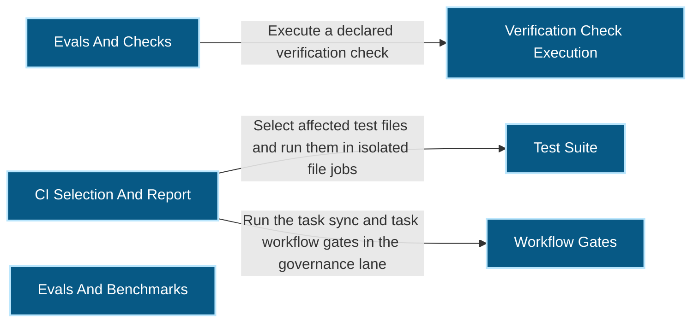
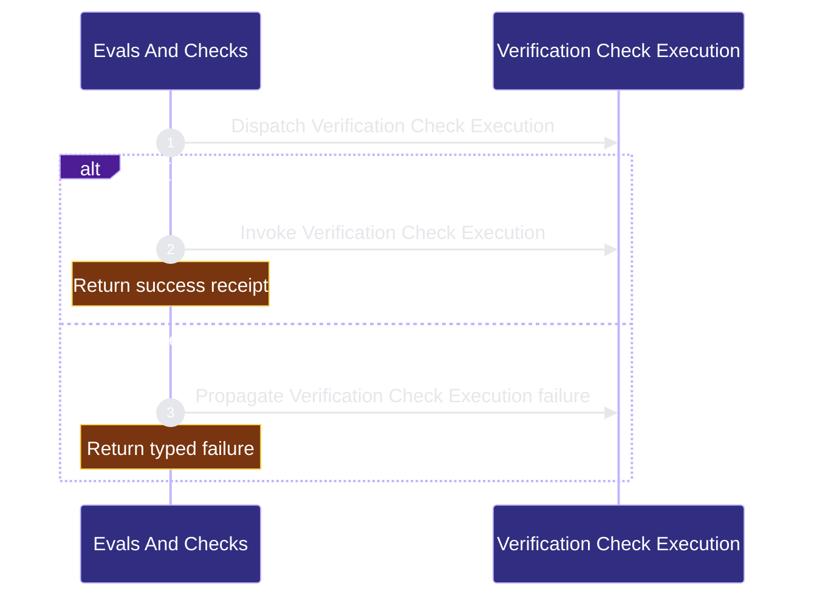

# verification/evals-checks 架构文档
<!-- BEGIN ARCHCONTEXT:generated target="projection_target.entity.capability-verification-evals-checks" sourceDigest="sha256:27f09b3a3deb5f9a4fd96730f82d0d2b533fb6d63335da59076235fe8eaac5ec" rendererVersion="archcontext.docs-renderer/v5" outputDigest="sha256:08fbc80b50531fffc33a224016183363744f2a8d1c96702ad136702e3d441edf" -->
> **狀態**:`active`
> **Capability ID**:`capability.verification.evals-checks`(kind `capability`)
> **Matched Prefixes**:`tests/**`、`evals/**`、`scripts/run-skill-evals.ts`、`scripts/run-harness-profile-benchmark.ts`、`scripts/validate-harness-profile-benchmark.ts`、`scripts/run-bounded-verifier-command.ts`、`scripts/verify-contract.sh`、`scripts/verify-sprint.sh`、`scripts/check-task-workflow.sh`、`scripts/check-task-sync.sh`、`scripts/check-agent-tooling.sh`、`scripts/check-brain-manifest.sh`、`scripts/sync-brain-docs.sh`、`bunfig.toml`、`.github/**`、`scripts/test-file-durations.json`、`scripts/verification-plan.ts`、`scripts/migrate-verification-plan.ts`、`scripts/check-ci.sh`、`scripts/select-ci-coverage.ts`、`scripts/replay-ci-coverage.ts`、`scripts/report-ci.ts`、`scripts/select-test-suite.ts`、`scripts/ci-documentation-consumers.ts`、`scripts/harness-trace-grade.sh`
> **Local Contracts**:`AGENTS.md`、`CLAUDE.md`
> **事實優先級**:倉庫當前狀態 > 本文檔機器區 > 本文檔人工區。機器區(引言、§1、§2)由 ArchContext 從架構模型與源碼度量投影生成,手改會在下次投影被覆蓋。本文檔不記錄出處;本次投影所驗證的 commit 見 `docs/architecture/.projection-manifest.json`。

Runs repository verification, contract gates, benchmarks, and evaluation suites.

## 1. P1:能力架構地圖

### 1.1 架構圖

- Proof: `proven` (`sha256:0ed2913c65b58f8fa427ec2d6dc8488b5a1088043659a19cb304ccff330526ed`).
- Semantic nodes: `6`; declared relations: `3`.

### 1.2 模組職責表

| 宣告入口 | 錨點 | 職責 |
| --- | --- | --- |
| `entrypoint.evals-checks.primary` | `src/effects/evidence/verification-execution.ts#executeVerificationContract` | `sink.evals-checks.primary` → `src/effects/evidence/verification-execution.ts#executeCheck` |

組件入口:

- 組件均未宣告 `source.entrypoints`。

### 1.3 規模信號

- 規模量級:`500–1000` 個文件 / `100k–200k` 行
- 匹配前綴:`tests/**`、`evals/**`、`scripts/run-skill-evals.ts`、`scripts/run-harness-profile-benchmark.ts`、`scripts/validate-harness-profile-benchmark.ts`、`scripts/run-bounded-verifier-command.ts`、`scripts/verify-contract.sh`、`scripts/verify-sprint.sh`、`scripts/check-task-workflow.sh`、`scripts/check-task-sync.sh`、`scripts/check-agent-tooling.sh`、`scripts/check-brain-manifest.sh`、`scripts/sync-brain-docs.sh`、`bunfig.toml`、`.github/**`、`scripts/test-file-durations.json`、`scripts/verification-plan.ts`、`scripts/migrate-verification-plan.ts`、`scripts/check-ci.sh`、`scripts/select-ci-coverage.ts`、`scripts/replay-ci-coverage.ts`、`scripts/report-ci.ts`、`scripts/select-test-suite.ts`、`scripts/ci-documentation-consumers.ts`、`scripts/harness-trace-grade.sh`
- 排除前綴:`tests/cli/adoption-plan.test.ts`、`tests/fixtures/adoption/**`、`tests/architecture-projection-provider.test.ts`、`tests/cli/global-runtime-init.test.ts`、`tests/cli/global-runtime.test.ts`、`tests/cli/mcp-codegraph-contract.test.ts`、`tests/cli/mcp-policy.test.ts`、`tests/cli/mcp-reader-tools.test.ts`、`tests/cli/mcp-tools.test.ts`、`tests/cli/codegraph-resolver.test.ts`
- 推導:掃描 `source.include` 減 `source.exclude`,跳過 `.git/` 與 `node_modules/`,再按 1–2–5 階梯分桶。精確計數不入本文檔:量級足以回答「這個能力有多大」,而逐行計數會讓覆蓋範圍內任何一次源碼改動都改寫本文檔。

### 1.4 依賴邊界

出向關係:

- `calls` → `component.evals-checks.primary` — Execute a declared verification check

入向關係:

- 無。

組件出向關係:

- `component.evals-checks.ci-selection`:
  - `calls` → `capability.workflow-engine.inspection-migration` — Run test files through the shared runner in scripts/lib/ci-run-tests.sh
  - `calls` → `component.evals-checks.test-suite` — Select affected test files and run them in isolated file jobs
  - `calls` → `component.evals-checks.workflow-gates` — Run the task sync and task workflow gates in the governance lane
- `component.evals-checks.evals-and-benchmarks`:
  - `calls` → `capability.workflow-engine.execution-primitives` — Take the expensive-run lock before a costly benchmark profile runs
  - `reads` → `capability.runtime-harness.hook-adapters` — Read hook event telemetry records to measure hook cost in profile benchmarks
- `component.evals-checks.primary`:
  - `calls` → `capability.workflow-engine.contract-assets` — Consume trusted PR checks for a base ref through the merge gate without rerunning commands
  - `calls` → `capability.runtime-harness.evidence-ledger` — Validate and execute verification plans through the evidence verification modules
- `component.evals-checks.test-suite`:
  - 無。
- `component.evals-checks.workflow-gates`:
  - 無。

### 1.5 組件結構

| 組件 | 名稱 | 規模量級 | 宣告入口 |
| --- | --- | --- | --- |
| `component.evals-checks.ci-selection` | CI Selection And Report | `10–20` 個文件 / `1000–2000` 行 | 未宣告 |
| `component.evals-checks.evals-and-benchmarks` | Evals And Benchmarks | `100–200` 個文件 / `10k–20k` 行 | 未宣告 |
| `component.evals-checks.primary` | Verification Check Execution | `5–10` 個文件 / `500–1000` 行 | 未宣告 |
| `component.evals-checks.test-suite` | Test Suite | `500–1000` 個文件 / `100k–200k` 行 | 未宣告 |
| `component.evals-checks.workflow-gates` | Workflow Gates | `5–10` 個文件 / `2000–5000` 行 | 未宣告 |

## 2. P2:端到端數據流

> **Proof**: `proven` (`sha256:0ed2913c65b58f8fa427ec2d6dc8488b5a1088043659a19cb304ccff330526ed`); selectors `1/1`.

<!-- END ARCHCONTEXT:generated target="projection_target.entity.capability-verification-evals-checks" -->
## 3. P3：设计决策与不变量
### 3.1 必须保持的不变量

1. **PR 只跑 typecheck 和受影响测试，main 每天跑全量。** `ci.yml` 的 `affected` 模式运行 `bash scripts/check-ci.sh affected`（`.github/workflows/ci.yml:154`）。`schedule` 每天触发一次（`ci.yml:8`）。来源：PR #483、PR #625。文档路径只选 `scripts/ci-documentation-consumers.ts` 扫出的测试。全部路径都是文档时，PR 跳过跨平台 HOME isolation 和原生 OAR 任务。daily 仍然覆盖这两项。
2. **覆盖选择不确定时失败。** `selectCoverage` 是纯函数（`scripts/select-ci-coverage.ts`）。缺少端点、diff 不可用和 checkout 不匹配时，selection 失败。没有消费者的未知路径也失败（`selectAffectedTests`）。selection 不用全量覆盖代替未知覆盖。
3. **一个测试清单和一个调度。** `scripts/select-test-suite.ts` 拥有本地和 CI 的测试清单与调度（PR #504）。调度输入是实测时长 `scripts/test-file-durations.json`（`select-test-suite.ts:61`）。PR 的 `verify` 是三个 matrix shard：`shardTestFiles` 按实测时长把受影响文件分成互不重叠的三份，shard 0 另跑 typecheck（`CI_SHARD`，`scripts/check-ci.sh`）。
4. **每个测试文件都在隔离的 HOME 和 TMPDIR 里运行。** `bunfig.toml` 预加载 `tests/preload-home-isolation.ts`。HOME 或 TMPDIR 不在临时目录时，预加载拒绝运行（`preload-home-isolation.ts:37`）。来源：PR #518。
5. **本地显式验证只做两件事。** `verify-sprint.sh` 先运行 typecheck，再运行调用方给出的测试文件。测试路径必须在 `tests/` 下，不能逃出仓库（`scripts/verify-sprint.sh:28`）。`--base` 交给 `merge-gate.ts` 消费可信 PR 检查，不重跑命令（`verify-sprint.sh:22`）。
6. **contract preflight 只校验元数据。** `verify-contract.sh --contract <file> --preflight` 校验 Task Profile、Allowed Paths 和 Review File，不运行测试，不写 Status，不生成 receipt（`scripts/verify-contract.sh:6`）。其他参数交给 `verify-sprint.sh`。
7. **workflow gate 只做诊断。** `check-task-workflow.sh` 只报告 JSON 是否可读，并总是以 0 退出（`scripts/check-task-workflow.sh:25`）。`check-task-sync.sh` 不再要求 plan、contract、review、notes、digest 行或 waiver（`scripts/check-task-sync.sh:23`）。
8. **昂贵 benchmark 串行。** profile benchmark 在执行前获取 expensive-run lock（`scripts/run-harness-profile-benchmark.ts:1501`）。
9. **有界命令按进程组回收。** `run-bounded-verifier-command.ts` 用绝对截止时间运行命令，并在强制 SIGKILL 后继续确认进程组已消失（`scripts/run-bounded-verifier-command.ts:43`）。

### 3.2 关键权衡

| 决策 | 权衡 |
| --- | --- |
| 全量测试从 PR 移到每日 main | PR 等待时间短。代价是没被影响面选中的回归要到每日运行才发现。修复任务和可回滚 commit 兜底（PR #483 风险说明）。 |
| 8 个 file worker 按实测时长从长到短调度 | 全量运行 459 个文件用时约 13 分钟（PR #504）。代价是新文件没有时长数据，排在已测文件之后。 |
| 所有测试归一个组件（`tests/**`） | 不需要约 700 个显式条目，也不需要移动测试树（归属提议 §3）。代价是测试与被测 capability 的关系不在模型里。有 13 个测试文件同时被其他 capability 声明，仍是多归属文件。 |
| workflow gate 降为诊断 | 普通任务不再被阶段工件阻塞（PR #483）。代价是脚本名仍叫 "check"，但它们不能阻止任何操作。 |
| 验证执行代码暂归 evidence 目录 | `src/*/evidence/**` 整体归 evidence-ledger（brief 规则 6）。代价是本 capability 的 P2 selector 指向 evidence 目录里的代码（见 §3.4）。 |

### 3.3 组件拆分（2026-10-11）

数据来源：`archctx refactor scan --json`（archctx 0.7.0）。footprint 写在各 component 节点的 `source.include` 里。

| 组件 | footprint | 文件 / 行 | 职责 |
| --- | --- | --- | --- |
| `component.evals-checks.primary`（Verification Check Execution） | `verification-plan.ts`、`migrate-verification-plan.ts`、`run-bounded-verifier-command.ts`、`verify-contract.sh`、`verify-sprint.sh` | 5 / 643 | Verification Plan CLI、有界命令、本地验证入口 |
| `component.evals-checks.test-suite`（expandable） | `tests/**`、`bunfig.toml` | 575 / 181610 | 全部测试文件和测试配置 |
| `component.evals-checks.evals-and-benchmarks` | `evals/**`、skill eval 与 profile benchmark 脚本、`harness-trace-grade.sh` | 105 / 12684 | 生产 effectiveness 证据 |
| `component.evals-checks.ci-selection` | `.github/**`、`check-ci.sh`、覆盖选择、测试调度、CI report | 10 / 1497 | 选择覆盖并运行 CI lane |
| `component.evals-checks.workflow-gates` | `check-task-{workflow,sync}.sh`、`check-agent-tooling.sh`、brain manifest 脚本 | 5 / 2772 | 诊断类 gate |

test-suite 是 expandable 组件。需要独立 owner 时，按运行边界（cli、effects、unit、state、operator-web、fixtures）拆分。现在不拆。

### 3.4 prose 与源码的冲突和开放问题

- 本节以前的 §3 原文已移到 §4 末尾，原文不变。以下原文说法与当前源码不符：
  - `verify-contract.sh` 的 `is_evidence_producer_command()` 和 3600 秒预算。当前文件只有 40 行，没有这两项。
  - `verify-sprint --prepare-acceptance`、frozen-subject criterion retry 和 `--force-expensive-rerun`。当前 `verify-sprint.sh` 拒绝 workflow-stage acceptance 参数（`verify-sprint.sh:17`）。
  - `check-task-sync.sh` 的 digest 绑定。当前脚本不再要求 digest 行（`check-task-sync.sh:23`）。
  - 根 `## Required Checks` 是唯一清单来源。当前根 `AGENTS.md` 和 `CLAUDE.md` 没有这一节。
  - "183 个测试文件 / 66,345 LOC"。当前 test-suite 组件有 575 个文件、181,610 行。
- P2 的 selector `executeVerificationContract → executeCheck` 在 `src/effects/evidence/verification-execution.ts` 里。`scripts/verification-plan.ts` 通过动态 import 调用它（`scripts/verification-plan.ts:16`），CodeGraph 没有这条边。所以 P2 没有证明从 CLI 到执行器的路径。
- `scripts/lib/ci-run-tests.sh` 属于 inspection-migration（`scripts/lib/**`）。CI 测试 runner 归属那个 capability 是否是有意的，没有记录。
- `run-skill-evals.ts` 中没有 `effectiveness_authority` 这个字符串。§4 原文中的 "权威 skill eval 证据边界" 是否仍有对应实现，需要复核。

## 4. 历史决策记录（append-only）

以下段落逐字保留自本文件的历史版本，不翻译、不改写。

## 2026-08-05 Deployed-helper evidence binding

- `scripts/emit-verify-evidence.ts` remains the single evidence-emitter
  authority. It is already included by the package's declared `scripts/`
  publication surface.
- The installed helper executes from `assets/templates/helpers/` and resolves
  that package-owned emitter through the deterministic package layout before
  the explicit source-checkout override. Direct source-helper execution still
  resolves the emitter as a sibling.
- Missing sibling, package, and explicit source-root locations remain a
  fail-closed cannot-bind result; no emitter copy or synthesized evidence path
  was added.

## 2026-07-14 Verifier Evidence Lifecycle Cutover

- `verify-contract.sh` is a bounded evidence consumer: one fixed 600-second
  deadline covers all declared tests and commands, each child runs in its own
  process group, and timeout terminates descendants while preserving duration,
  signal, exit, and timeout evidence.
- Verifier-owned command lists reject benchmark/provider production, adoption,
  evidence producers, and substantive install before execution. `verify-sprint`
  invokes contract verification read-only and validates an already-produced
  authoritative benchmark report without launching the matrix.
- The profile benchmark owns schema v2 evidence production. Its content subject
  binds runner/scenario/fixture/install/provider-schema inputs; its sidecar binds
  the final JSON and Markdown bytes. Three immutable profile bases feed 27
  isolated writable overlays, preserving the 3x9 matrix with three setup passes.
  Execution uses a fixed two-arm pool and a non-configurable 50-minute absolute
  deadline; provider arms are detached process groups and deadline expiry sends
  termination to the whole group, so producer cost cannot silently exceed its
  declared evidence SLO or orphan provider descendants.
- Each arm records its pre-provider baseline revision. Grading and workspace
  evidence compare that baseline to final `HEAD` plus the working tree, so a
  provider commit or fast-forward remains visible final content instead of
  disappearing from a `git status`-only view. Authoritative execution fails
  fast on the first invalid arm and terminates its in-flight sibling group.
- Workspace overlays are full `--no-hardlinks` clones whose `origin` is replaced
  by a bare repository owned by that arm;
  HOME overlays rebase absolute cache symlinks from the profile base to the arm
  copy. Provider-local merge/push/install behavior therefore cannot write back
  through Git remotes, shared object inodes, or copied absolute links.
- Harness-enabled arms (`adaptive-lite` and `strict-harness`) create a private
  primary clone and expose the graded workspace as its linked `codex/benchmark`
  worktree. Adaptive Lite may rise to Strict from runtime risk signals, so the
  topology must exist before provider execution; guards, provider output,
  focused checks, and the grader then observe one workspace instead of an
  ungraded second-level worktree. Strict alone receives preprojected plan and
  contract inputs. No Harness remains a plain isolated clone. Ignored runtime
  inputs such as the resume projection are materialized again in each graded
  linked workspace after worktree creation.
- Authoritative fail-fast still terminates an in-flight sibling. A sibling with
  no structured provider completion is producer cancellation evidence, not an
  independent product regression.
- At 10x scale the first failure would be evidence-production latency, not the
  verifier. Keeping production explicit and verification bounded prevents a
  closeout gate from becoming an unbounded job runner.

## 2026-07-16 Closeout Runner Guardrails

- P1: bounded verification remains an evidence consumer and the profile
  benchmark remains the evidence producer. Their execution policy now consumes
  neutral process/lock effects without moving evaluator or report authority.
- P2: the bounded verifier's force-kill phase is no longer cancelled when the
  process-group leader exits on TERM; after the fixed grace it still addresses
  the original group, closing the TERM-resistant descendant gap. Authoritative
  benchmark main acquires the Git-common-dir expensive-run lock before any run
  workspace/report mutation and holds its explicit token across the awaited
  provider lifecycle.
- Helper execution uses a launcher start barrier so the PGID is durable before
  target execution. If the async supervisor itself stalls, the synchronous
  facade uses that PGID for its final TERM/grace/KILL backstop rather than
  returning with an untracked descendant group.
- P3: release verification and benchmark production serialize through one
  cross-worktree lock, while dry-run and regrade-only benchmark modes do not
  occupy the expensive lane. During the async provider phase, signal cleanup
  retains each PGID through TERM/grace/KILL and releases the token only after
  every group drains, including when a leader exits first. A signal delivered
  while the benchmark is blocked in a synchronous subprocess is handled only
  after that subprocess returns; abnormal owner death leaves the non-reclaimable
  token for manual recovery instead of reopening the lane. CRG-01 uses only
  short sentinel and linked-worktree regressions; it does not regenerate the
  3x9 matrix or change its subject/evaluator contract.

## 2026-06-12 Architecture Queue Closeout

- The strict workflow required-file surface now tracks
  `scripts/architecture-queue.sh` instead of the retired
  `scripts/architecture-drift.sh`.
- Focused coverage for queue behavior lives in `tests/architecture-queue.test.ts`
  and covers card merge, reindex self-heal, cutoff triage, gate modes, and
  archive roundtrip.
- Existing hook/runtime/contract tests continue to assert hook parity and the
  advisory PostToolUse behavior around architecture queue failures.

## CI coverage selection

`.github/workflows/ci.yml` schedules Governance independently of test selection.
The pure `selectCoverage` function in `scripts/select-ci-coverage.ts` decides
from the event, checked-out subject and complete raw Git diff. Its thin shell
reads GitHub event/environment inputs and Git output. PR selection compares the
event base to the tested synthetic merge; pushes compare every committed change
between before and head. Missing endpoints, empty/unavailable diffs, checkout
mismatch, malformed records, nonregular file modes and unknown paths retain
full coverage. Rename detection is disabled so both paths remain visible.

Documentation coverage includes `tasks/**`, `plans/**`, Markdown under `docs/`,
`docs/architecture/.projection-manifest.json`, `.ai/harness/handoff/**` and
`README.md`. `docs/reference-configs/**` remains full coverage, as do
`.archcontext/**`, runtime policies/configs, deploy files, root agent instructions,
source, tests and other unclassified paths. Documentation consumers are inferred
from checkout-bound filesystem reads, including path aliases and local reader
wrappers and static test-helper imports. It also conservatively includes reads
of named tracked guides when the test resolves checkout code; documents explicitly
authored as fixture content do not activate that secondary rule. True checkout
reads stay covered even if a test also writes fixture documents. Ignored runtime
files do not enter the tracked-guide inventory. The scanner is the inventory
source; the workflow's sorted whole-file list is its projection, checked by the
documentation drift test. No manually
maintained consumer allowlist or per-test name filtering owns this lane.

`bun scripts/replay-ci-coverage.ts --since YYYY-MM-DD` feeds pinned first-parent
history into the same pure function and prints per-commit and mode/reason totals.
It does not bypass checkout validation in the production shell. Historical hit
rate and the actual documentation-lane duration are acceptance evidence;
correct scheduling alone does not establish lower CI cost.

Draft PRs defer expensive checks and explain that ready_for_review must run
coverage. Required / CI never reports mergeable success for a deferred draft.
Both ready_for_review and converted_to_draft trigger a new run; manual dispatch
always selects full. The aggregate accepts only successful selection/Governance
and exactly the prescribed success/skipped dispositions for full or docs mode.
Failure, cancellation, unknown modes and unintended omissions remain failures.

Functional, matrix and documentation jobs depend only on selection. The owner
retained independent hosted Governance/Test failure visibility from the
2026-09-09 incident; the measured wasted Test time on governance-only failures
and the two-week revisit trigger are recorded in `tasks/todos.md`. Local/release
`check-ci.sh` gates and the isolated file runner remain unchanged. PR evidence
is not reused as acceptance for a different merge subject.

## 2026-10-14 Documentation-only PR coverage

The text above describes the retired `docs`/`full`/`draft` modes. PR #483
replaced them with `affected`. Documentation paths then joined the import and
literal closure. The literal `'docs'` in `src/cli/index.ts` linked every
document to the CLI hub, so one plan file selected about 334 of 374 test files.

Now a documentation path selects only the list from
`scripts/ci-documentation-consumers.ts`. The scanner also counts a test that
starts a child process in, or against, the checkout root. Such a process can
walk checkout documents; for example, `capability-resolver.ts export` rejects
an orphan module document. The check is lexical. It sees a `spawn`/`exec` call
in the same test file whose whole argument resolves to the root. It does not
see a helper in another file, a default parameter, an inherited working
directory or a launcher with another name. The daily full suite covers those. When every changed path is documentation, selection
writes `documentation=true`. The PR then skips the cross-platform HOME isolation
and native OAR lane. Required / CI accepts only that skip. The daily run keeps
the full suite and that lane.

## 2026-10-11 之前的 §3 原文（移入历史）

以下小节在 2026-10-11 之前位于 §3。原文不变。PR #483 之后，其中多处说法与源码不符，见 §3.4。

### Diff-bound workflow evidence

`scripts/check-task-sync.sh` owns the change-identity boundary for workflow
evidence. It classifies the final staged and working-tree diff, hashes only the
substantive path contents, and accepts execution evidence only when a changed
canonical plan, contract, review, notes, or workstream artifact contains that
exact digest. `scripts/check-task-workflow.sh` and CI consume this result; they
do not infer freshness from the mere presence or recency of a task artifact.
Exact generated status projections and general documentation remain outside the
substantive set, while architecture truth and workflow-helper changes remain
inside it. A waiver is a separate typed, digest-bound, scoped, expiring
authority; missing or malformed evidence fails closed.

### 权威 skill eval 证据边界

- 当 release/readiness 断言依赖 skill effectiveness 时，必须执行 non-dry-run `bun run benchmark:skills --eval <slug>`，并保留 `full_test_count` 与 `effectiveness_authority` 的结构化证据。
- **Non-authoritative smoke** 只证明 harness 接线可运行。`bun run benchmark:skills --dry-run` is not skill-effectiveness evidence，不得升格为发布或就绪证明。

**为什么验证面这么宽。** 本仓库同时是产品源码和自托管样例，自托管 runtime 文件、生成模板、已安装副本三者不得静默漂移。这是整个能力面的根不变量。

**必须守住的不变量：**

1. **生产者/消费者单向分离。** profile benchmark 生产证据，bounded verifier 与 `verify-sprint` 只消费。`is_evidence_producer_command()`（`scripts/verify-contract.sh:512`）把这条边界写成执行前拒绝，而不是靠约定——否则收口 gate 会退化成无界 job runner。
2. **Execution evidence 单一权威。** `verification-plan execute` 记录实际检查。Native validator 校验 event、run、contract 和 snapshot。空计划或缺失证据不能通过。旧 emitter 和 materializer 已移除。
3. **有界执行 + 进程组回收。** 每条契约命令跑在自己的 detached 进程组里，共享一个绝对截止点；force-kill 阶段寻址原始 PGID 而非当前 leader，堵住 TERM-resistant 后代的逃逸口。
4. **昂贵通道串行化。** 权威 benchmark 在任何 run workspace/report 变更前取 Git-common-dir expensive-run lock 并跨 provider 生命周期持有；dry-run 与 regrade-only 不占该通道。owner 异常死亡时 token 不可回收，留给人工恢复而非自动重开通道。
5. **非权威永远不能升格。** dry-run eval、无 `--execute` 的 benchmark、`--regrade-existing` 三者的输出形状允许存在，但不得被当作 effectiveness 证据；provider-owned 指标宁可留 null 也不估算。
6. **`## Required Checks` 是唯一清单来源。** `repo-harness-check` skill 不维护自己的副本；该段缺失是首个 blocking finding，不是套用默认清单的理由。

**与现有 prose 的冲突（以源码为准）：**

- 下方 2026-07-14 段落写 `verify-contract.sh` 是 "one fixed 600-second deadline"。当前源码 `scripts/verify-contract.sh:5` 是 `VERIFICATION_BUDGET_MS=3600000`，即 3600 秒（60 分钟）。历史段落按 append-only 原样保留，**当前事实以 3600 秒为准**。
- 旧 P1 段把权威清单写成 `bash scripts/check-task-workflow.sh`；根 `## Required Checks` 现用 `repo-harness run check-task-workflow`（helper runtime 调用形态），且额外含 `bash scripts/check-architecture-sync.sh`。本文 §1.4 按根契约列出。
- `assets/skill-commands/repo-harness-check/SKILL.md` 把 Codex 必需 skill 写作 `health`/`check`/`mermaid`，仓库根 `CLAUDE.md` 写的是 `health`、`check`、`diagram-design`。两处未对齐，本文不替任一方裁定。

**10x 规模下先垮的点。** 不是 verifier，而是全量测试成本与证据生产延迟：183 个测试文件 / 66,345 LOC 已是 `bun test` 的主要壁钟成本，而 3×9 矩阵单次授权跑受 50 分钟绝对预算约束。当前拆分让小切片跑聚焦测试、release/pre-merge 才跑全量 gate；再放大一个量级时，先撑不住的是 benchmark 的 evidence-production latency 与 expensive lane 的串行度，而不是有界验证本身。

### Frozen-subject criterion retry

`verify-sprint --prepare-acceptance` 在自动 architecture 投影完成后冻结 criterion context；该 context 同时绑定 repository、normalized subject、target revision、contract、goal 与 toolchain。`verify-contract` 再把 exact kind/target/command 加入 key，只持久化 contract 在 `criterion_reuse` 中显式声明的 pass、non-timeout、exit-0 结果。未声明或依赖 runtime/external state 的 criterion 默认每次执行；失败、超时、malformed cache 与并发 exact-key 执行均不复用。

`verify-sprint` 计算的 `allowed_paths` scope preflight 与 known task/architecture/workflow sync commands 均先于 tests 与其余 commands；acceptance preflight 任一失败时，scheduler 不 spawn tests 或其余 commands。Cheap gates 的输入可包含 normalized subject 之外的 workflow state，因此每次 retry 都重新执行，不进入 reuse 集合。这个短路只在 `verify-sprint` 提供内部 preflight transaction 时生效，direct `verify-contract` 仍保持独立、无缓存的全执行语义；内部 context/preflight 环境变量也在 bounded process 边界清除，不能泄漏给 criterion 或嵌套 verifier。命令排序本身不把名称当作 deterministic/cost 权威；`expensive` 由显式 eligible criterion 首次通过的实测 duration 与冻结 threshold 判定。相同 expensive pass 的再次执行必须显式传入 `--force-expensive-rerun --reason`，其 disposition 为 `forced` 且原因进入 canonical run `commands` evidence；默认路径只复用，不再 spawn。

criterion 执行结束后，`verify-sprint` 重新计算完整 context。若 command 在执行期间改变 source、target、contract、goal 或 toolchain，独立 `criterion_context` guard fail-closed，不能以新 subject 配旧执行结果生成 AcceptanceReceipt。10x 下 cache 文件数量随 exact subject × criterion 线性增长，最先需要治理的是 ignored runtime evidence retention，而不是正确性边界；跨 repository/remote cache 仍明确不在此模块职责内。

### Retired debug evaluation

The debug ground-truth runner, profile, and answer-key data are retired.
This removal does not change `/hunt` or `root-cause-prover` behavior.
Debug work still requires a real reproduction and affected runtime tests.
The skill and adoption evaluation profiles remain available.

### Change Assessment v1 final-subject gate

`verify-sprint --prepare-acceptance` now treats `buildReviewSubject` plus
`.ai/harness/policy.json#worktree_strategy.review_base` as the sole selection
authority. It recomputes a deterministic `ChangeAssessment` and exact-target
`ReviewSelectionPacket` after the final diff, then includes that envelope in
the canonical verification-evidence hash consumed by AcceptanceReceipt.
Minimal-change hooks and their journal stay fail-open diagnostics; neither
model output nor Hook history can change routing. Missing policy/base,
degraded subject, invalid packet, or a missing oracle fails verification
closed. The bounded release CLI creates `RuntimeEvidenceReceipt` separately
for published tarball, clean-install CLI, and installed-hook readback.

Each reason's allowed oracle must cover every routed final path (or `*`), and
`pattern_novelty` reads only added rename-aware policy-base diff hunks. A reviewer
disagreement remains a subject-bound overlay until the next prepare run validates
it against the freshly recomputed base and emits the replacement canonical
evidence. The finalizer compares that packet with prepared checks, while
`AcceptanceReceipt` separately recomputes the assessment before accepting its
canonical hash; self-consistent forged hashes and prior receipts therefore fail
closed. Runtime hook/CLI readback uses the current trusted Bun executable
directory plus `/usr/bin:/bin`, preserving the real `#!/usr/bin/env bun` path
without inheriting a broad PATH. Clean-install readback binds `.bin` symlinks to
the manifest's canonical package targets and binds package.json, CLI, and hook
bytes to their published tarball members; matching output from another file is
not runtime evidence.

## 2026-10-11 组件拆分

- 本 capability 拆成 5 个组件：primary（Verification Check Execution）、test-suite、evals-and-benchmarks、ci-selection 和 workflow-gates。
- capability include 增加了此前无归属的 `.github/**`、`bunfig.toml`、`scripts/test-file-durations.json`、Verification Plan 脚本、CI 选择与报告脚本和 `harness-trace-grade.sh`。
- `src/*/evidence/**` 中的两个 verification-plan 文件没有加入。按 brief 规则 6，整个 evidence 目录先归 evidence-ledger。
- 新关系：ci-selection 到 test-suite、workflow-gates 和 inspection-migration；evals-and-benchmarks 到 hook-adapters；primary 到 contract-assets（merge gate）。

## Optimization Backlog

- Add capability registry validation to strict workflow checks once the new registry has one more real edit cycle.
- Keep external tooling probes read-only unless a command explicitly targets tooling maintenance.
- The 2026-07-13 Claude matrix passed 27/27 but measured Adaptive Lite at 496 s,
  69 model calls, and 68 s of hooks versus Strict at 391 s, 55 calls, and 60 s
  of hooks. Optimize cold hook execution and Standard/Strict promotion cost
  before claiming a performance win; do not lower deterministic risk floors.

- `tasks/archive/gate-audit-20261003/workstreams/verification/evals-checks/github-issues-158-159.md`
- 在 arch-context#296 之后拆分 evidence 目录：`src/core/evidence/verification-plan.ts` 和 `src/effects/evidence/verification-execution.ts` 归本 capability 的 primary 组件（归属提议 §5）。拆分后，P2 selector 位于本 capability 自己的 footprint 内。
- `scripts/verification-plan.ts` 通过动态 import 调用执行器（`scripts/verification-plan.ts:16`）。改为静态 import 后，CodeGraph 能证明 CLI 到执行器的路径。改之前需要确认动态 import 的原因。
- `scripts/check-agent-tooling.sh` 有 2098 行，是 workflow-gates 组件中最大的文件。它是 shell 外壳加内嵌 JS。拆分需要先有改动频率证据。
- `check-task-workflow.sh` 和 `check-task-sync.sh` 的名字仍是 check，但它们只做诊断（§3.1 第 7 条）。是否改名或退役，需要 owner 决定。
