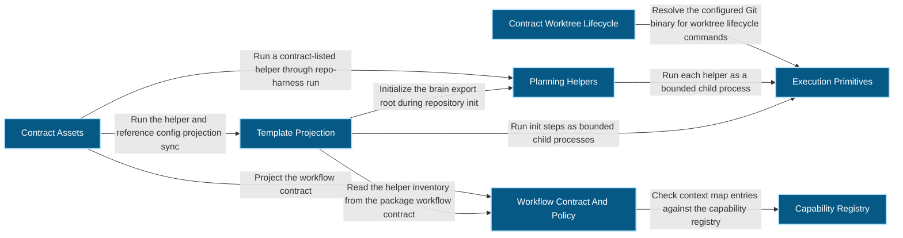
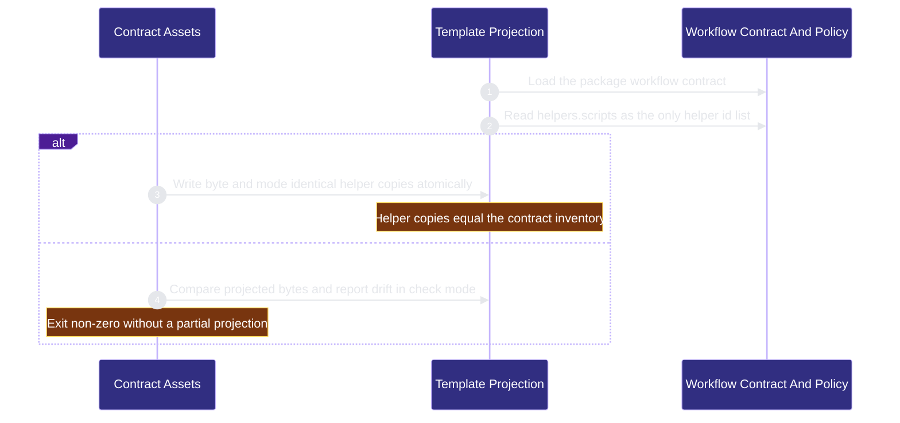
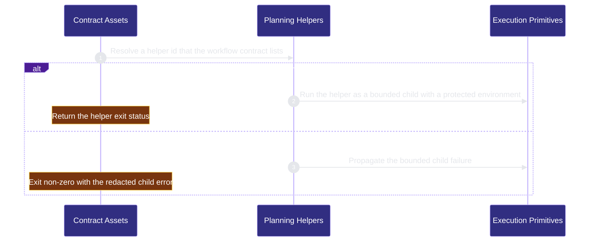

# workflow-engine/contract-assets 架构文档
<!-- BEGIN ARCHCONTEXT:generated target="projection_target.entity.capability-workflow-engine-contract-assets" sourceDigest="sha256:7bf8aef2fbbd0b64a98d0eda38f98fd85a06e36c5baf80c8f2989ff06d6f986b" rendererVersion="archcontext.docs-renderer/v5" outputDigest="sha256:75aea8700a01c0f79dde4137830bdf76de565a2a3b9d9522fe2cc7b9b16a5660" -->
> **狀態**:`active`
> **Capability ID**:`capability.workflow-engine.contract-assets`(kind `capability`)
> **Matched Prefixes**:`assets/workflow-contract.v1.json`、`.ai/harness/workflow-contract.json`、`.ai/harness/policy.json`、`.ai/context/context-map.json`、`.archcontext/model/nodes/**`、`scripts/capability-resolver.ts`、`scripts/capability-config.ts`、`scripts/contract-run.ts`、`scripts/contract-worktree.sh`、`scripts/archive-workflow.sh`、`scripts/merge-gate.ts`、`scripts/ship-worktrees.sh`、`src/cli/commands/init.ts`、`src/cli/commands/capability-context.ts`、`src/effects/runtime/helper-runner.ts`、`assets/templates/**`、`assets/reference-configs/**`、`docs/reference-configs/**`、`assets/AGENTS.md`、`assets/CLAUDE.md`、`.ai/context/**`、`.ai/harness/brain-manifest.json`、`.archcontext/**`、`src/core/capabilities/**`、`src/core/source-projection.ts`、`src/cli/commands/run.ts`、`src/cli/commands/brain.ts`、`src/cli/commands/brain-root.ts`、`assets/partials/**`、`assets/partials-agents/**`、`assets/project-structures/**`、`assets/plan-map.json`、`assets/versions.json`、`assets/initializer-question-pack.v4.json`、`assets/initializer-question-pack.v4.schema.json`、`.claude/templates/**`、`scripts/workflow-contract.ts`、`scripts/check-context-map.ts`、`scripts/check-context-files.sh`、`scripts/select-agent-context-blocks.sh`、`scripts/workstream-sync.sh`、`scripts/sync-helper-sources.ts`、`scripts/sync-reference-configs.ts`、`scripts/assemble-template.ts`、`scripts/initializer-question-pack.ts`、`scripts/contract-worktree-runtime.ts`、`scripts/worktree-merge-lib.sh`、`scripts/cutover-closure.ts`、`scripts/new-spec.sh`、`scripts/new-sprint.sh`、`scripts/new-plan.sh`、`scripts/capture-plan.sh`、`scripts/plan-to-todo.sh`、`scripts/switch-plan.sh`、`scripts/classify-historical-plans.ts`、`scripts/ensure-task-workflow.sh`、`scripts/refresh-current-status.sh`、`scripts/summarize-failures.sh`、`scripts/maintenance-triage.sh`、`scripts/heartbeat-triage.sh`、`scripts/check-deploy-sql-order.sh`、`scripts/factor-lab-new.sh`、`scripts/factor-lab-promote.sh`、`scripts/factor-lab-reject.sh`、`scripts/factor-lab-check.sh`
> **Local Contracts**:`assets/AGENTS.md`、`assets/CLAUDE.md`
> **事實優先級**:倉庫當前狀態 > 本文檔機器區 > 本文檔人工區。機器區(引言、§1、§2)由 ArchContext 從架構模型與源碼度量投影生成,手改會在下次投影被覆蓋。本文檔不記錄出處;本次投影所驗證的 commit 見 `docs/architecture/.projection-manifest.json`。

Owns the package workflow contract, repo opt-in marker, templates, capability nodes, and helper projections.

## 1. P1:能力架構地圖

### 1.1 架構圖



- Proof: `proven` (`sha256:7c211e7ff27434a90a36d13d6fcb18a4751a586593ae120477185ed29bf643e4`).
- Semantic nodes: `7`; declared relations: `9`.

### 1.2 模組職責表

| 宣告入口 | 錨點 | 職責 |
| --- | --- | --- |
| `entrypoint.contract-assets.primary` | `scripts/sync-helper-sources.ts#main` | `sink.contract-assets.primary` → `scripts/workflow-contract.ts#loadWorkflowContract`、`sink.contract-assets.helper-inventory` → `scripts/workflow-contract.ts#getHelperScripts`、`sink.contract-assets.projection-write` → `src/core/source-projection.ts#writeProjectionFileAtomic`、`sink.contract-assets.projection-compare` → `src/core/source-projection.ts#sameProjectionBytes` |
| `entrypoint.contract-assets.run-command` | `src/cli/commands/run.ts#buildRunCommand` | `sink.contract-assets.helper-runner` → `src/effects/runtime/helper-runner.ts#runHelper` |
| `entrypoint.contract-assets.helper-runner` | `src/effects/runtime/helper-runner.ts#runHelper` | `sink.contract-assets.bounded-process` → `src/effects/process-runner.ts#runProcess` |

### 1.3 規模信號

- 規模量級:`200–500` 個文件 / `50k–100k` 行
- 匹配前綴:`assets/workflow-contract.v1.json`、`.ai/harness/workflow-contract.json`、`.ai/harness/policy.json`、`.ai/context/context-map.json`、`.archcontext/model/nodes/**`、`scripts/capability-resolver.ts`、`scripts/capability-config.ts`、`scripts/contract-run.ts`、`scripts/contract-worktree.sh`、`scripts/archive-workflow.sh`、`scripts/merge-gate.ts`、`scripts/ship-worktrees.sh`、`src/cli/commands/init.ts`、`src/cli/commands/capability-context.ts`、`src/effects/runtime/helper-runner.ts`、`assets/templates/**`、`assets/reference-configs/**`、`docs/reference-configs/**`、`assets/AGENTS.md`、`assets/CLAUDE.md`、`.ai/context/**`、`.ai/harness/brain-manifest.json`、`.archcontext/**`、`src/core/capabilities/**`、`src/core/source-projection.ts`、`src/cli/commands/run.ts`、`src/cli/commands/brain.ts`、`src/cli/commands/brain-root.ts`、`assets/partials/**`、`assets/partials-agents/**`、`assets/project-structures/**`、`assets/plan-map.json`、`assets/versions.json`、`assets/initializer-question-pack.v4.json`、`assets/initializer-question-pack.v4.schema.json`、`.claude/templates/**`、`scripts/workflow-contract.ts`、`scripts/check-context-map.ts`、`scripts/check-context-files.sh`、`scripts/select-agent-context-blocks.sh`、`scripts/workstream-sync.sh`、`scripts/sync-helper-sources.ts`、`scripts/sync-reference-configs.ts`、`scripts/assemble-template.ts`、`scripts/initializer-question-pack.ts`、`scripts/contract-worktree-runtime.ts`、`scripts/worktree-merge-lib.sh`、`scripts/cutover-closure.ts`、`scripts/new-spec.sh`、`scripts/new-sprint.sh`、`scripts/new-plan.sh`、`scripts/capture-plan.sh`、`scripts/plan-to-todo.sh`、`scripts/switch-plan.sh`、`scripts/classify-historical-plans.ts`、`scripts/ensure-task-workflow.sh`、`scripts/refresh-current-status.sh`、`scripts/summarize-failures.sh`、`scripts/maintenance-triage.sh`、`scripts/heartbeat-triage.sh`、`scripts/check-deploy-sql-order.sh`、`scripts/factor-lab-new.sh`、`scripts/factor-lab-promote.sh`、`scripts/factor-lab-reject.sh`、`scripts/factor-lab-check.sh`
- 推導:掃描 `source.include` 減 `source.exclude`,跳過 `.git/` 與 `node_modules/`,再按 1–2–5 階梯分桶。精確計數不入本文檔:量級足以回答「這個能力有多大」,而逐行計數會讓覆蓋範圍內任何一次源碼改動都改寫本文檔。

### 1.4 依賴邊界

出向關係:

- `calls` → `component.contract-assets.planning-helpers` — Run a contract-listed helper through repo-harness run
- `calls` → `component.contract-assets.primary` — Project the workflow contract
- `calls` → `component.contract-assets.template-projection` — Run the helper and reference config projection sync

入向關係:

- `reads` ← `component.inspection-migration.primary` — Read directory and legacy path inventory from the package workflow contract
- `calls` ← `component.workflow-state.primary` — Match changed paths to capability ids through the pure capability registry

## 2. P2:端到端數據流

> **Proof**: `proven` (`sha256:7c211e7ff27434a90a36d13d6fcb18a4751a586593ae120477185ed29bf643e4`); selectors `6/6`.




<!-- END ARCHCONTEXT:generated target="projection_target.entity.capability-workflow-engine-contract-assets" -->

## 2026-10-05 Workflow Contract Marker

`assets/workflow-contract.v1.json` is the package contract body.
`.ai/harness/workflow-contract.json` is the opt-in marker.
It holds only `kind: repo-harness.workflow-contract-marker` and `protocol: 1`.
Hooks continue to check file existence.
Adoption replaces old content with the marker and keeps a transaction backup.
Inspect reads only the package body.
Shell scaffold scripts do not write the marker.
Run `repo-harness init --repo <target-repo>` after the shell scaffold.
Earlier byte-parity statements in dated closeouts describe the old design.

## Architecture automation defaults

Architecture projection execution preferences belong to the user-level
`~/.repo-harness/config.json#architecture`. Repository policy owns model and
capability authority, documentation paths, and freshness gates; it does not
author provider selection or apply mode. Global install/update and successful
repository init use the same configuration writer to initialize the projection
provider when unset, preserving an explicit disabled choice. Init dry-run does
not write the preference.

No hook delivers architecture or refactor work. repo-harness supplies tools and
evidence; the Bot decides what to schedule. Default enablement does not
synthesize a missing architecture model, missing code facts, or permission to
execute a refactor. `docs/spec.md` owns the product contract; the initialization and Stop
regressions verify these separate boundaries.
## 3. P3：设计决策与不变量

生成仓库必须能在没有任何服务的情况下自证。tracked 契约文件是持久真相。`.ai/harness/checks/*`、handoff packet、failure log、worktrees 与 run snapshots 都是 ignored runtime 状态。删掉或损坏 ignored 缓存不能让版本回退：`state_version` 是 Git common dir 下的单调计数器（见 workflow-state），`state_revision` 是确定性内容哈希。

### 3.1 必须保持的不变量

| # | 不变量 | 执行者 |
| --- | --- | --- |
| I1 | `assets/workflow-contract.v1.json` 是唯一契约主体；`.ai/harness/workflow-contract.json` 只是 opt-in marker（`kind` 与 `protocol` 两个字段） | `tests/workflow-contract.test.ts` “self-hosted opt-in marker matches the renderer and the protocol” |
| I2 | `helpers.scripts` 与 `helpers.descriptions` 一一对应，描述非空 | `src/effects/runtime/helper-runner.ts:246-268` + `tests/workflow-contract.test.ts` |
| I3 | `helpers.scripts` 是“有哪些 helper”的唯一 id 列表；descriptions 只挂显示数据 | 契约结构 + 上述双向校验 |
| I4 | `context.capability_source` 选择唯一 capability 权威。本仓库是 `archcontext`，读 `.archcontext/model/nodes/*.yaml`；不双读，不回退 | `.ai/harness/policy.json:101-102`；`src/core/capabilities/registry.ts:514` |
| I5 | 注册表只接受精确文件或 `dir/**`，拒绝 `source.exclude` 与通配符；重复前缀与同长度歧义匹配 fail closed | `registry.ts:560-578`、`:691-696`、`:279`、`:463` |
| I6 | 受保护 helper 的 source、helper、HOME、PATH 与解释器解析不受调用者影响 | `protectedChildEnv()`（`helper-runner.ts:73`）、`resolveHelperRuntime(env, !protectedHelper)`（`:367`） |
| I7 | merge gate 的启用位来自目标 base commit，候选不能自我豁免 | `scripts/ship-worktrees.sh:868-871`（`merge-gate.ts fingerprint --base`） |
| I8 | 55 个 helper 中 52 个与 `scripts/` 逐字节一致；3 个例外由投影脚本声明：`capability-resolver.ts` 与 `recovery-view-cli.ts` 带 `@generated-from` 头，`acceptance-receipt.ts` 只改写一条 import 路径 | `bun run check:helpers`；`scripts/sync-helper-sources.ts:48`、`:88`、`:108-113` |
| I9 | 本地 contract publication 每个 work package 只向 target 增加一个 commit，publication tree 必须与 seal 验证后的 lifecycle HEAD 一致 | `scripts/contract-worktree.sh` 的 `publication_prepared` journal phase |
| I10 | finish abort 只在 runner 证明 target publication 未落地后，才把同一 fenced lease 从 `completing` 恢复为 `bound` | `contract-worktree.sh` 的 `closeout_finish_effect_landed`（`:1213-1233`）+ `sprint abort-completion` |

本 capability 还依赖两条外部不变量。它们不归这里执行：adoption 事务不会静默覆盖用户内容（public-surface.adoption）；install profile 的唯一 authored 权威是 `profile`（hook-adapters 与 global-runtime-reconciliation）。

### 3.2 关键权衡

- **契约是 JSON 而非可执行配置。** 代价是表达力弱。收益是 byte parity 可判定、diff 可读、任何语言都能校验。
- **超时按类别硬编码而非策略可配。** 普通 helper 120 s，closeout helper 900 s，verifier helper 3,660 s（`helper-runner.ts:20-23`）。策略文件因此不能变成无限挂起的入口。
- **闸门在 commit 之后跑。** pre-commit 的 HEAD 无法标识 merge candidate，所以先落 commit 再封印。FAIL 或 BLOCKED 靠恢复 pre-finish commit 与实时工作流工件回滚。
- **`merge-gate` 不调用 provider。** 它是确定性封印，不是语义评审。语义验收由独立的 AcceptanceReceipt 承担。闸门因此可离线、可重放。
- **证据边界不等于 public commit 边界。** source branch 保留 checkpoint 与 lifecycle commits。local merge 用 frozen target base 加 verified lifecycle tree 合成一个 publication commit。代价是 source topology 不进入 target ancestry。
- **lease 与 closeout journal 没有跨存储原子事务。** abort 先幂等恢复 lease，再把 journal 标为 `aborted`。两步之间崩溃时，`recover abort` 重放同一个 fenced transition。
- **组件按职责拆，不按目录拆（2026-10-11）。** 五个组件各自对应一个入口面。代价是 `scripts/` 下的文件只能逐个列出，因为同一目录还有其他 capability 的脚本。

### 3.3 组件

组件 footprint 是组件节点上的 `source.include`。数字来自 `archctx refactor scan`（2026-10-11）。capability 本身还保留 4 个多重归属文件（reference configs），等待 arch-context#296。

| 组件 | 文件 / 行 | 职责 | 主要出向关系 |
| --- | ---: | --- | --- |
| `component.contract-assets.primary`（Workflow Contract And Policy） | 12 / 4,410 | 契约主体、opt-in marker、harness policy、context map、契约加载器与 context 门禁 | capability-registry（`check-context-map.ts` 读注册表） |
| `component.contract-assets.capability-registry` | 148 / 6,981 | `.archcontext/**` 模型文件、纯注册表、resolver 与 config CLI、capability context 命令 | 无组件外调用；workflow-state 的 resolver 调用它 |
| `component.contract-assets.template-projection`（可扩展） | 180 / 35,687 | helper 与 reference config 投影、模板装配、`repo-harness init` | primary、planning-helpers、workflow-state、execution-primitives、adoption、hook-adapters、global-runtime-reconciliation、codegraph-readiness |
| `component.contract-assets.contract-worktree-lifecycle` | 8 / 6,505 | worktree 生命周期、publication、merge gate、contract brief runner、归档 | workflow-state（worktree 拓扑锁）、execution-primitives（Git binary） |
| `component.contract-assets.planning-helpers` | 21 / 4,034 | 计划、spec、sprint、triage 与 factor-lab helper，`run` 与 `brain` 命令，受保护 helper runner | execution-primitives（有界子进程） |

template-projection 标记为可扩展。`assets/templates/helpers/**` 有 20,832 行，都是 `scripts/` 的投影副本。`src/cli/commands/init.ts` 是一个组合根。按本次提案的归属，它导入 8 个其他 capability 的代码。现在不拆。

### 3.4 10x 规模下先垮的点

按“先垮”排序：

1. **helper 数量增长（当前 55）。** 每加一个 helper 要改 4 处：`helpers.scripts`、`helpers.descriptions`、`scripts/<name>`、`assets/templates/helpers/<name>`。fail-closed 校验保证漏改会红，但同步成本线性增长。
2. **policy 顶层域数量（当前 32）。** `deepMergeDefaults`（`src/core/adoption/standard-plan.ts:236`）是无 schema 的结构合并。域数继续涨时，“默认值改了但已装仓库拿不到”这类偏差更难发现。
3. **capability 数量（当前 29 个节点）与最长前缀匹配。** 注册表不支持 exclude，`scripts/` 这类共享目录只能逐个列文件。新脚本默认没有 owner。
4. **`assets/templates/` 21,876 行。** 它是投影，正确性由 `--check` 保证。但每次 helper 改动都在 diff 里出现两次，review 信噪比下降。

最小连贯的护栏仍是现有那套：parity 测试、`sync-helper-sources.ts --check`、`capability-resolver validate` 与自迁移 dry-run。下一步应给 `.ai/harness/policy.json` 引入 schema 版本与迁移断言，而不是加抽象。

### 3.5 与历史记录的已知冲突

第 4 节逐字保留。以下各处与 HEAD 源码不符，以本节为准：

| 历史段落 | 历史说法 | HEAD 实际 | 位置 |
| --- | --- | --- | --- |
| 2026-07-16 Closeout Runner Guardrails | `verify-contract`/`verify-sprint` 720 秒 | 3,660 秒（`VERIFIER_HELPER_TIMEOUT_MS = 3_660_000`） | `src/effects/runtime/helper-runner.ts:21` |
| 2026-07-16 Closeout Runner Guardrails | 900 秒档只含 `contract-worktree`/`ship-worktrees` | 还包含 `merge-gate`；`PROTECTED_HELPERS` 另含 `acceptance-receipt` | `helper-runner.ts:20`、`:22` |
| 2026-07-14 Helper Descriptions | 46 → 48 条描述 | 55 条（scripts 与 descriptions 均为 55） | `assets/workflow-contract.v1.json#helpers` |
| 旧 §3.2 I1 | asset 契约与自宿主 runtime 副本 byte-identical | 自宿主文件是 opt-in marker（2026-10-05） | `.ai/harness/workflow-contract.json` |
| 旧 §3.2 I4 | `.ai/context/capabilities.json` 是唯一 runtime 权威 | 该文件不存在；权威是 `.archcontext/model/nodes` | `.ai/harness/policy.json:101-102` |
| 旧 §3.2 I8 | 51/52 helper 一致，唯一例外带 `@generated-from` 头 | 52/55 一致，3 个声明的例外 | `scripts/sync-helper-sources.ts` |
| 旧 §3.4 | capability 11 个，policy 29 个顶层域，templates 27k 行 | 29 个节点，32 个顶层域，21,876 行 | 本节 §3.4 |
| 2026-08-21 Windows Protected Helper Platform Contract | `src/cli/runtime/protected-helper-platform.ts` 拥有平台解析 | 文件在 `src/effects/runtime/protected-helper-platform.ts` | `helper-runner.ts` 导入路径 |
| 旧 entrypoint 与 flow | 入口是 adoption 的 `src/core/adoption/workflow-contract-asset.ts` | 该文件归 public-surface.adoption；flow 改为 `scripts/sync-helper-sources.ts#main` | 2026-10-11 历史条目 |

另有两处已由后续 slice 取代，历史段落本身未改写：

- 旧文档头部与 P1 曾把已退役的 merge-gate Skill 目录列为 matched prefix。该目录在 HEAD 不存在（Skill 来源由 `assets/skill-commands/manifest.json` 控制）。这与 2026-07-21 段落一致。
- 旧 P2 只描述 shell 路线（`pi_install_workflow_contract` → `pi_write_harness_policy` → …）。这些函数仍在 `scripts/lib/project-init-lib.sh`，调用者是 `scripts/create-project-dirs.sh` 与 `scripts/init-project.sh`，两者都归 inspection-migration。`repo-harness init` 的实际路径是 TS 事务模型。

---

## 4. 历史决策记录（append-only）

> 本节逐字保留既有文档中所有带日期的段落，英文不翻译，顺序与原文件一致。仅将标题层级由 `##` 降为 `###` 以嵌入本节；正文一字未改。历史数值与 HEAD 的差异见 §3.5。

### 2026-10-11 Component decomposition and helper ownership

- 本 capability 拆成五个组件：primary（契约与 policy）、capability-registry、template-projection、contract-worktree-lifecycle、planning-helpers。见 §3.3。
- 之前没有 owner 的 29 个 `scripts/` 契约与 helper 脚本进入 include，另外加入 `src/core/capabilities/**`、`src/core/source-projection.ts`、`run`/`brain`/`brain-root` 命令、`.archcontext/**`、`.ai/context/**`、`assets/{AGENTS,CLAUDE}.md`、partials、project structures 与 `.claude/templates/**`。没有删除任何既有 include。
- 入口从 adoption 拥有的 `src/core/adoption/workflow-contract-asset.ts` 移到本 capability 的 `scripts/sync-helper-sources.ts#main`。新增第二条 flow：`repo-harness run` 解析 helper 并交给 execution-primitives 运行。
- 以下三段原在 §3 末尾，现逐字移入本节：

### 2026-08-11 Codex Native Agent Policy Cutover

- The delegation policy now names only native `subagent` transport. Claude
  keeps its native host behavior; Codex requires the exact installed
  `agent_type` and `fork_turns=none`.
- App-thread, `codex-exec`, and main-thread fleet fallbacks are removed from the
  self-host policy and every generated policy projection. A native routing
  mismatch is observable failure, not runner degradation.
- Every new contract template now projects `preferred: [subagent]` with
  `fallback: null`; the contract brief cannot restore an alternate fleet runner
  after policy selection.
- Prompt-hook permission is typed `/delegate` or `/parallel` only. Policy no
  longer grants SessionStart standing authorization or treats natural-language
  classification as permission.

### 2026-08-14 Single Publication Commit Cutover

- `contract-worktree finish --merge` no longer fast-forwards the source branch's
  checkpoint and lifecycle topology into the target. It seals the exact source
  lifecycle HEAD, creates one commit whose parent is the frozen target base and
  whose tree is identical to that HEAD, then fast-forwards the target to the
  synthesized publication commit.
- `publication_prepared` is recorded before target mutation. Recovery treats a
  created-but-unpublished object as abortable and a target ref containing that
  exact commit as landed, so the pre-existing SIGKILL window remains fail-closed.
- Publication preserves repository signing policy: `commit.gpgsign=true`
  selects `commit-tree -S`; invalid policy values and signing failures stop
  before target mutation. A lifecycle tree already equal to the target tree is
  rejected rather than published as an empty commit.
- After the target ref contains the publication commit, in-process assertion or
  journal-write failures retain the lifecycle state and journal for explicit
  reconcile; the EXIT trap may auto-abort only while no target effect exists.
- Recovery of journals created before this cutover is explicitly bounded to
  the next major release: only a missing-`publication_prepared` lifecycle HEAD
  already contained by the target is recognized. Operators must resolve those
  journals before that upgrade, after which the fallback is removed.
- `finish --no-merge` and PR shipping retain source-branch commits because the
  provider owns their later merge/squash boundary. AcceptanceReceipt and review
  subject schemas are unchanged; commit topology is not semantic authority.

### 2026-08-21 Windows Protected Helper Platform Contract

- P1: `src/effects/runtime/helper-runner.ts` remains the sole protected-helper
  dispatcher; `src/cli/runtime/protected-helper-platform.ts` owns platform
  resolution and the protocol-1 Windows schema; install/update owns discovery
  and persistence; Git for Windows supplies the Bash/POSIX runtime; and the
  existing process runner/supervisor pair owns bounded execution and receives
  the exact validated `taskkill.exe` for both termination paths. The
  four source helpers and their packaged asset mirrors remain the execution
  surface. Installing Git, `jq`, `gh`, WSL, or an alternate shell is outside
  this boundary.
- P2: an explicit Windows install/update resolves Git and `taskkill` from the
  operator environment, proves `taskkill` matches native `SystemRoot\\System32`,
  proves Git/Bash/`usr/bin` share one non-symlink
  Git-for-Windows root, validates the ceremony's absolute non-symlink `TEMP`
  directory, probes the executables, and atomically writes the OS
  account config without replacing siblings. Later `runHelper` reads and
  revalidates that record, resolves the repo with pinned Git, selects the
  packaged helper, and launches pinned Bash/Bun with an isolated Windows
  environment. Direct `acceptance-receipt.ts` and `merge-gate.ts` invocation
  re-resolves the same host contract rather than trusting caller binary/path/temp
  overrides, and the shell ship path asks merge-gate for a scalar required flag
  without adding a `jq` dependency. Missing or stale state stops before the
  helper or repository side effect.
- P3: runtime `PATH` probing would reintroduce caller authority, so discovery is
  intentionally confined to install/update and relocation requires an explicit
  update. Small host-absolute predicates in the two shell helpers preserve the
  existing Bash implementation while accepting Windows drive paths. At 10x
  invocation volume, repeated validation is bounded local filesystem I/O; the
  first operational failure remains a moved Git-for-Windows installation, and
  that failure is deliberately closed rather than repaired heuristically.

### 2026-07-14 Local Merge Gate Enforcement

- P1: installed `contract-worktree` remains the commit/merge authority and
  installed `ship-worktrees` remains the PR push authority. The target base
  policy owns enablement, the OS account home
  `~/.repo-harness/config.json#merge_gate` owns local
  runner identity, the host-only `merge-gatekeeper` agent owns only tool-free model isolation,
  the former merge-gate skill owned review semantics, and `scripts/merge-gate.ts`
  is the only receipt writer/verifier.
- P2: finish snapshots live workflow state, verifies and archives it, commits
  the exact candidate, and invokes Claude with no tools from an empty temporary
  directory. The stdin request supplies the complete diff,
  goal, changed files, and current deterministic check evidence. A successful
  verdict is stored under `~/.repo-harness/gates/<repo-id>/` and bound to
  repository root, exact base ref/SHA, head SHA, binary diff fingerprint, host
  runtime fingerprint (config, binary identity, agent, and skill), and installed
  helper fingerprint. FAIL/BLOCKED restores
  the pre-finish commit and live workflow artifacts. PR mode fetches the remote
  target and pushes the verified SHA explicitly; local merge also names the
  verified SHA instead of the mutable branch name.
- P3: target-base policy prevents the candidate from disabling its own gate;
  host config and host-state receipts keep runner and receipt authority outside
  the candidate workspace. The gate runs after commit because pre-commit HEAD
  cannot identify the merge candidate. Only Claude is configured in this
  slice; protected helper resolution ignores process-level source/helper/HOME
  overrides and pins its Bash/Git/Bun/gh toolchain outside caller `PATH`.
  There is no provider fallback, GitHub check-run, alternate receipt
  shape, candidate-code execution, or agent-owned write.
- At 10x concurrency the first failure is the remote target advancing after
  fetch. Receipt revalidation rejects any locally observed base or head drift,
  and the explicit SHA refspec prevents a moved local branch from changing what
  is pushed. Remote merge-time freshness remains GitHub branch-protection/CI
  authority rather than a claim made by this local pre-push gate.

### 2026-05-29 Cleanup Script Policy Closeout

- `worktree_strategy.cleanup_script` is part of the policy contract surface. It advertises the terminal cleanup command generated repos can call after `finish` has already archived and merged a contract worktree.
- The runtime owner remains `scripts/contract-worktree.sh`; `.ai/harness/policy.json`, `scripts/ensure-task-workflow.sh`, and `scripts/lib/project-init-lib.sh` only publish the command shape for self-host and generated repos.
- File-prefix capability requests such as `.ai/harness/policy.json` still belong to `workflow-engine-contract-assets`; local capability context is projected to `assets/AGENTS.md` and `assets/CLAUDE.md`.
- No new architecture snapshot or semantic diagram is required because the module boundary, entrypoints, and dependency direction are unchanged.

### 2026-06-12 Architecture Queue Contract Closeout

- The self-host workflow contract helper inventory now names
  `architecture-queue.sh` as the architecture request helper; the retired
  `architecture-drift.sh` is removed from the source and installable helper
  templates.
- `.ai/harness/policy.json` and generated policy templates expose
  `architecture.freshness_gate`, `gate_min_severity`, pending block markers, and
  `queue_script` so slice 2 can promote the gate from advisory to strict without
  changing the queue data model.
- The contract invariant remains byte parity between
  `assets/workflow-contract.v1.json` and `.ai/harness/workflow-contract.json`;
  helper installation stays flat under `scripts/`.

### 2026-07-06 Delegation Policy Auto Mode Closeout

- `.ai/harness/policy.json` now documents that `delegation.mode=auto` is
  install-time standing user authorization for bounded Codex delegation on
  prompts without explicit trigger words.
- Global `~/.repo-harness/config.json` remains the user-level authority for the
  mode choice and takes precedence over repo policy when the value is exactly
  `auto` or `explicit`; repo policy is still the generated/self-host fallback.
- This is a policy text contract change only. It does not change contract asset
  ownership, helper inventory shape, byte-parity requirements, or generated repo
  storage boundaries.

### 2026-07-11 Capability Authority Closeout

- `.ai/context/capabilities.json` is the only runtime capability authority. Resolver commands fail when it is missing or malformed and reject registered prefixes that do not exist.
- `capability-config add` remains the explicit creation path for a new registry; normal reads no longer derive capabilities from `agent-context-blocks.txt`, environment variables, or nested agent files.
- Capability context files and the ArchContext boundary export remain deterministic, one-way projections of the registry. They do not become alternate authoring surfaces.

### 2026-07-11 Archive Evidence Gate Closeout

- `archive-workflow.sh` is the completion archive authority. `Completed` now
  requires a verified `Active` or `Fulfilled` linked contract, the review to
  recommend `pass`, current `verify-sprint` structured evidence, canonical
  external acceptance `pass`, and the architecture freshness helper to succeed
  before any workflow artifact moves. After all gates pass, archive owns the
  `Active -> Fulfilled` transition so verifier/reviewer content cannot be made
  stale by a pre-archive status mutation.
- `Abandoned` and `Superseded` remain non-completion outcomes and preserve the
  complete plan and lifecycle artifact bodies. They do not synthesize passing
  evidence.
- `archive-architecture-request.sh` accepts only a live `Pending` request.
  `Resolved` additionally requires the request's declared architecture module
  to exist and be passed as an existing, repository-contained durable artifact.
  Queue/index projection is rebuilt and checked before and after the move.
- Current-status refresh, architecture reindex, and Sprint backlog back-fill
  failures now propagate to the caller and restore the pre-archive live
  workflow/architecture snapshot. A failed projection can neither be reported
  as a successful finish nor strand the plan/request only in archive storage;
  the same command can be retried after repairing the failed dependency.
- These gates reuse the existing workflow-state, verify-sprint, architecture
  queue, and freshness authorities. No new dependency or compatibility parser
  was added.

### 2026-07-14 Verification Asset Cutover

- The installable helper inventory now includes the bounded-command runner and
  benchmark evidence validator alongside `verify-contract.sh` and
  `verify-sprint.sh`; self-host and product copies remain byte projections.
- Generated contract/review templates emit only canonical completion and Rubric
  v2 subject fields. The retired manual-override, Human Review Card fallback,
  ancestry fingerprint, and report-v1 reader are removed in the same package.
- Report/check projections use one benchmark evidence shape:
  `status`, `report_sha256`, and `benchmark_subject_sha256`.

### 2026-07-13 Deploy SQL Policy Authority

- Optional `.ai/harness/policy.json#operations.deploy_sql` is the sole authority for established alternate SQL roots, naming modes, and invariant files. Its absence keeps the generated `deploy/sql/` plus `ordered4` default.
- Policy generators deliberately do not seed the optional object. Their existing default merge preserves an explicit repo override while avoiding a second steady-state authority.
- Root guidance, generated partials, deploy scaffolds, the deploy skill, and installed hooks are projections of that precedence. Existing parity and scaffold tests guard against self-host/generated drift; the module boundary and dependency direction are unchanged.

### 2026-07-12 Agent Fleet Worker Routing Telemetry Closeout

- `scripts/contract-run.ts` (mirrored byte-for-byte to `assets/templates/helpers/contract-run.ts` through the existing helper projection route) is now a matched prefix of this capability. It is the task-delegation contract runner: it reads a `tasks/contracts/*.contract.md` execution brief, preflights it, generates worker/verifier prompts, optionally dispatches them, and writes a run manifest. This is a distinct "contract" concept from `assets/workflow-contract.v1.json` (the install/workflow contract this capability already owned) — the two share the word by coincidence, not by schema or lifecycle, but both are contract-lifecycle tooling this capability already narrates (compare the pre-existing `scripts/contract-worktree.sh` mention in the 2026-05-29 closeout above).
- Contract roles (`parent`/`explorer`/`worker`/`verifier`; existing generic mode/purpose defaults at `scripts/contract-run.ts:340-346`, unchanged) now also map to the four fixed, model-pinned fleet profiles (`explorer`, `fast-worker`, `deep-reasoner`, `gatekeeper`) through a new `delegation_plan.role_profiles` manifest field (`scripts/contract-run.ts:792-797`):
  - `parent` -> `"orchestrator"`: never model-assigned; not one of the 4 profiles.
  - `explorer` -> `"explorer"` (fixed).
  - `worker` -> derived in `buildRun()` (`scripts/contract-run.ts:754-758`) from the resolved runner dispatch value, without renaming `RunnerContract.preferred`/`fallback`'s pre-existing dispatch-mechanism vocabulary (`subagent` / `codex-subagent` / `codex-exec` / `main-thread`): dispatch `main-thread` -> `"sol-high"`; dispatch `codex-subagent` or `codex-exec` -> the raw dispatch label passed through unchanged (Codex is an independent peer provider, not one of the 4 profiles); any other dispatch (e.g. `subagent`) -> `"fast-worker"`.
  - `verifier` -> `"gatekeeper"` (fixed).
  - `deep-reasoner` sits outside this role table entirely, as an independent escalation path not bound to any single contract role.
- New `--effort <tier>` CLI flag (parsed at `scripts/contract-run.ts:148-151`; validated by the local `EFFORT_TIERS`/`parseEffort()` pair at `scripts/contract-run.ts:190-201` against the closed vocabulary `low`/`medium`/`high`/`xhigh`/`max`, the same tiers `buildFamilyEffortMap()` in `scripts/install-agent-fleet.sh` already uses — kept as a local literal list rather than a shared import because that copy lives inside an embedded Node.js heredoc, not an importable module). Record-only, matching the pre-existing `--runner` philosophy: `contract-run.ts` never itself selects, spawns, or degrades a runner or effort tier. Defaults to `"high"` only when the resolved dispatch is the contract's worker fallback and no explicit `--effort` is passed (`scripts/contract-run.ts:758`).
- New manifest telemetry fields are additive only; `RunnerContract`, `parseRunner()`, `runChild()`, and the run-mode control flow are unchanged:
  - `runner_usage.path`: `"worker_preferred"` | `"worker_fallback"` (`scripts/contract-run.ts:780`).
  - `runner_usage.effort`: resolved effort tier string or `null` (`scripts/contract-run.ts:781`).
  - `delegation_plan.role_profiles`: `{ parent, explorer, worker, verifier }` as derived above (`scripts/contract-run.ts:792-797`).
- Regression coverage lives in `tests/contract-run.test.ts`: the preferred path, the `codex-subagent`/off-policy runner passthrough, the `main-thread` worker-fallback path (`sol-high` plus default effort `"high"`), the `codex-exec` passthrough, and an explicit `--effort xhigh` override sharing one scenario, `"runner metadata from the contract flows into the manifest"` (`tests/contract-run.test.ts:742-891`); invalid `--effort` rejection is `"invalid --effort value exits with usage error"` (`tests/contract-run.test.ts:893-897`).

### 2026-07-12 Repo-owned Agent Fleet Authority Closeout

- `agents/fleet/*.md` is the only authored fleet source and is shipped through
  the existing npm `agents/` package surface. `.claude/agents/*.md` and
  `.codex/agents/*.toml` are deterministic repo-local projections and goldens.
- `.ai/harness/policy.json` declares `external_tooling.agent_fleet` with
  `source: package:agents/fleet`. The retired `fable_agents` key, remote URLs,
  network fetch, source override, and compatibility reader are absent.
- Installer source validation completes for all managed roles before any target
  mutation. Helper-path resolution supports only the declared source-checkout
  and packaged-helper layouts; target-repo cwd never becomes an authority.
- The four managed roles are explorer, deep-reasoner, fast-worker, and
  gatekeeper. Claude receives source bytes; Codex receives the Sol/Luna family
  projection with unchanged effort strings. Gatekeeper remains read-only in
  both sandbox and prompt semantics.
- The first 10x failure would be publishing helpers without their fleet source.
  Tarball-content checks, temporary-HOME package smoke, helper parity, and
  source/projection golden tests guard that distribution boundary.

### 2026-07-12 Agent Fleet Specialist Roles Closeout

- The packaged fleet has six managed identities. `root-cause-prover` produces
  the existing bugfix gate's four evidence fields without changing gate
  semantics; `harness-evaluator` invokes existing skill/adoption evaluation
  surfaces and treats migration audit as a profile rather than another agent.
- The Codex writable-role set is closed and explicit: `fast-worker`,
  `root-cause-prover`, and `harness-evaluator`. Every other projection is
  read-only. Harness-evaluator's workspace-write is valid only inside a
  complete disposable repo/HOME; skills uses the runner's enforcing mode and adoption uses one
  guarded invocation that injects the validated roots into both existing commands. Both reject source or real
  HOME in either argument position. The task contract's
  allowed paths and isolated worktree remain the authority that prevents the
  diagnosis role from turning evidence work into a production fix.
- Native Explore remains host-owned informal capability. Formal explorer work
  resolves to the complete repo-owned persona; no alias, wrapper, inherited
  prompt, incremental merge, or second authored authority participates.
- BDD2 and BDD3 evaluation data and the BDD2 runner are retired. The harness
  evaluator must fail closed on requests for `evals/bdd2/**` or
  `scripts/run-bdd2-evals.ts`. It uses only the skills and adoption profiles.
- The first 10x failure would be adding persona names without updating package,
  policy seeds, projections, readiness, and HOME installation together. Exact
  six-role lists, all-source preflight, tarball assertions, and temporary-HOME
  smokes protect that boundary.

### 2026-07-14 Helper Descriptions Contract Surface Closeout

- `assets/workflow-contract.v1.json#helpers.descriptions` is the sole authority for the one-line description of every bundled helper (helper id, filename minus extension, mapped to description text). `helpers.scripts` keeps sole authority over which helpers exist; descriptions attach display data to those ids without introducing a second id list.
- The contract parser fails closed in `src/effects/runtime/helper-runner.ts` (`readContractHelperDescriptions`): a missing `descriptions` object, a scripts entry without a description, an empty or non-string value, or a description key with no matching script is a contract error, so the description map cannot drift from the script list.
- `repo-harness run --help` now renders the full helper enumeration lazily through `listHelpers()` (`src/cli/commands/run.ts`), closing the discovery gap where the 46-helper surface was previously printed only on an unknown-helper failure. `.ai/harness/workflow-contract.json` remains the byte-identical installed mirror of the assets contract; no module boundary, dependency direction, or verification command changed.
- Regression coverage: `tests/workflow-contract.test.ts` (descriptions cover `helpers.scripts` 1:1 with non-empty text) and `tests/cli/run.test.ts` (fail-closed validation plus `run --help` enumeration output).
- The invariant was exercised live at ship time: rebasing onto origin/main added two upstream helpers (`run-bounded-verifier-command.ts`, `validate-harness-profile-benchmark.ts`) and the fail-closed check blocked shipping until their descriptions landed, bringing the map to 48 entries.

### 2026-07-16 Closeout Runner Guardrails

- P1: `src/effects/runtime/helper-runner.ts` remains the canonical helper dispatch
  policy. Ordinary helpers receive a fixed 120-second envelope,
  `verify-contract`/`verify-sprint` receive 720 seconds, and
  `contract-worktree`/`ship-worktrees` receive 900 seconds. Repository policy
  and caller environment cannot redefine these classes.
- P2: every helper runs through a private launcher/supervisor pair. The launcher
  cannot start the target until the supervisor has published its PGID; normal
  cleanup and the parent's hard-timeout backstop both perform TERM, a fixed
  grace period, then KILL against that group. Lock wait consumes the same outer
  deadline, and completion is published only after group absence.
  `ship-worktrees` checks review/acceptance readiness and delegates to
  `contract-worktree finish`; only finish invokes `verify-sprint`, so one ship
  has exactly one sprint-verification producer.
- P3: canonical release helper modes resolve the Git common directory and use
  the same fail-closed expensive-run lane as authoritative benchmark
  production. Nested raw helper calls stay inside the already-held outer lane;
  invoking packaged Bash files directly is an internal/test surface and does
  not create a second lock or verification authority.

### 2026-07-21 Single Acceptance Authority

- The contract's strict `## Acceptance Policy` block freezes reviewer identity
  and whether the named owner may issue `user_waiver`. One host-owned
  UserWaiverGrant records that owner decision against stable contract/goal
  authority. The host-owned AcceptanceReceipt is the exact closeout authority;
  its closed dispositions are `external_pass`, `user_waiver`, and `reject`.
- `verification-plan execute` records declared checks in an explicitly selected native report.
  Receipt verification binds that evidence, normalized implementation content,
  goal, contract, benchmark evidence, reviewed paths, and target revision.
  Semantic changes invalidate the receipt and require fresh evidence, while an
  unchanged valid waiver grant may rematerialize the new exact receipt without
  repeating the owner's decision. Contract/goal authority changes or explicit
  revocation invalidate the grant. Review Markdown is a generated projection
  and cannot authorize closeout.
- `merge-gate.ts` is now a deterministic local seal. The former host-only
  merge-gate skill/agent and internal Claude call are removed. Lifecycle-only
  head movement is checked against the declared archive manifest; a later
  non-overlapping target advance only reseals the exact base/head/full diff,
  while overlap invalidates semantic acceptance.
- PR CI is the sole candidate-branch lane. `codex/**` push CI is removed and
  workflow concurrency cancels superseded runs for the same PR/ref.

### 2026-08-14 Change Assessment contract projection

- New contract templates freeze a strict `## Change Assessment` declaration;
  helper inventory projects `change-assessment.ts` and
  `runtime-evidence-receipt.ts` into the npm package with the other canonical
  helpers.
- The contract declaration is only oracle intent. Final-subject selection is
  recomputed by the acceptance owner from policy `review_base`, and the result is
  bound through verification evidence while protocol-2 AcceptanceReceipt stays
  the single merge authority.

---

## Workstream Ledger

- `tasks/archive/gate-audit-20261003/workstreams/workflow-engine/contract-assets/cleanup-script-policy.md`
- `tasks/archive/gate-audit-20261003/workstreams/workflow-engine/contract-assets/20260712-contract-assets.md`
- `tasks/archive/gate-audit-20261003/workstreams/workflow-engine/contract-assets/agent-fleet-specialists.md`
- `tasks/archive/gate-audit-20261003/workstreams/workflow-engine/contract-assets/20260714-merge-gate-enforcement.md`
- `tasks/archive/gate-audit-20261003/workstreams/workflow-engine/contract-assets/github-issues-158-159.md`

## Optimization Backlog

- **template-projection 是可扩展组件。** 先把 `src/cli/commands/init.ts` 拆成独立的 init 组件，再看 `assets/templates/helpers/**` 是否需要单独的投影组件。
- **`init.ts` 组合根。** 它导入 adoption、hook-adapters、global-runtime-reconciliation、codegraph-readiness、workflow-state 与 execution-primitives，还导入当前无 owner 的 `src/cli/commands/{architecture-configuration,install,herdr-skill}.ts`、`src/core/skill-surface/catalog.ts` 与 `src/effects/skill-tree-integrity.ts`。
- **投影脚本知道源码布局。** `scripts/sync-helper-sources.ts:48-120` 用字符串改写 registry、checkpoint snapshot、readonly-observation 与 worktree-location 的 import 行。被投影文件移动时，这里要同步修改。
- **contract-worktree-lifecycle 的外部依赖。** `scripts/contract-worktree-runtime.ts` 动态导入 `src/effects/terminal/task-session.ts` 与 `herdr.ts`；`scripts/merge-gate.ts` 导入 `scripts/acceptance-receipt.ts` 与 `src/effects/publication/merge-readiness.ts`。这些目标由并行分组认领，关系在集成时补齐。
- **planning-helpers 的平台依赖。** `src/effects/runtime/helper-runner.ts` 导入 `node-candidates.ts` 与 `protected-helper-platform.ts`。它们当前无 owner。
- **reference configs 多重归属（after arch-context#296）。** `assets/reference-configs/external-tooling.md` 与 `docs/reference-configs/{external-tooling,install-profiles,chatgpt-coding-mcp}.md` 同时被 global-runtime-reconciliation 或 mcp-sidecar 认领。镜像对必须由一个 owner 持有。
- **组件 footprint 用精确文件列表（use globs after arch-context#296）。** repo-harness model reader 只接受精确路径或 `dir/**`（`src/effects/architecture/model-reader.ts:85-89`）。`planning-helpers` 因此列出 4 个 `scripts/factor-lab-*.sh` 文件。`template-projection` 列出 2 个 `assets/initializer-question-pack.v4*.json` 文件。新增同名模式的文件不会自动进入组件。

- Run `bun scripts/capability-resolver.ts validate --format text` when capability data changes. The workflow helper remains a read-only diagnostic.
- Keep durable knowledge in repo-authored research and lessons. Optional external brain exports require an operator-invoked manifest sync and never participate in workflow correctness.

## 验证命令

来自 capability 节点 `extensions.verification`：

```bash
bun test tests/workflow-contract.test.ts tests/scaffold-parity.test.ts
bun scripts/capability-resolver.ts validate --format text
bun run check:helpers
```
