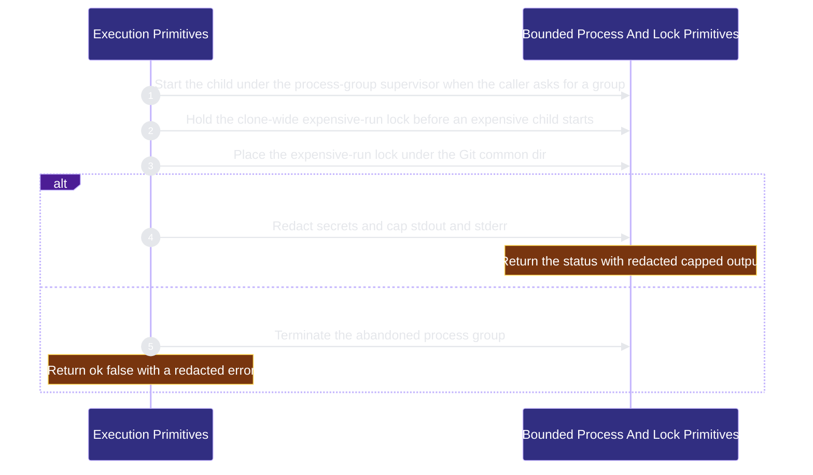

# workflow-engine/execution-primitives 架構文檔

<!-- BEGIN ARCHCONTEXT:generated target="projection_target.entity.capability-workflow-engine-execution-primitives" sourceDigest="sha256:9329644eb003602afef4bac8b9d95ee0a20cd6bce409f28a22454ac8ef3cfd0b" rendererVersion="archcontext.docs-renderer/v5" outputDigest="sha256:3c89534c1dbd2f6586cdbc5a7dcedf2917b8a93048b45c1e49d59a94d06ea6f1" -->
> **狀態**:`active`
> **Capability ID**:`capability.workflow-engine.execution-primitives`(kind `capability`)
> **Matched Prefixes**:`src/effects/process-runner.ts`、`src/effects/process-supervisor.ts`、`src/effects/process-group-launcher.ts`、`src/effects/expensive-run-lock.ts`、`src/effects/locking/**`、`src/effects/git/**`
> **Local Contracts**:`AGENTS.md`、`CLAUDE.md`
> **事實優先級**:倉庫當前狀態 > 本文檔機器區 > 本文檔人工區。機器區(引言、§1、§2)由 ArchContext 從架構模型與源碼度量投影生成,手改會在下次投影被覆蓋。本文檔不記錄出處;本次投影所驗證的 commit 見 `docs/architecture/.projection-manifest.json`。

Runs bounded child processes and provides the canonical directory lock and Git common-dir and worktree topology reads. It holds no workflow policy.

## 1. P1:能力架構地圖

### 1.1 架構圖

- Proof: `proven` (`sha256:9f41aa6d777c6e47efb1e2c13e4246852eac82a8a414adbdf98efa8c636d2d9c`).
- Semantic nodes: `2`; declared relations: `1`.

### 1.2 模組職責表

| 宣告入口 | 錨點 | 職責 |
| --- | --- | --- |
| `entrypoint.execution-primitives.primary` | `src/effects/process-runner.ts#runProcess` | `sink.execution-primitives.primary` → `src/effects/process-runner.ts#runSupervisedProcess`、`sink.execution-primitives.output-cap` → `src/effects/process-runner.ts#capProcessOutput` |
| `entrypoint.execution-primitives.primary` | `src/effects/process-runner.ts#runSupervisedProcess` | `sink.execution-primitives.abandoned-group` → `src/effects/process-runner.ts#terminateAbandonedProcessGroup` |
| `entrypoint.execution-primitives.supervisor` | `src/effects/process-supervisor.ts#supervise` | `sink.execution-primitives.expensive-lock` → `src/effects/expensive-run-lock.ts#acquireExpensiveRunLock` |
| `entrypoint.execution-primitives.expensive-lock` | `src/effects/expensive-run-lock.ts#acquireExpensiveRunLock` | `sink.execution-primitives.git-common-dir` → `src/effects/git/common-directory.ts#resolveGitCommonDirectory`、`sink.execution-primitives.directory-lock` → `src/effects/locking/exclusive-directory-lock.ts#acquireExclusiveDirectoryLock` |

### 1.3 規模信號

- 規模量級:`5–10` 個文件 / `1000–2000` 行
- 匹配前綴:`src/effects/process-runner.ts`、`src/effects/process-supervisor.ts`、`src/effects/process-group-launcher.ts`、`src/effects/expensive-run-lock.ts`、`src/effects/locking/**`、`src/effects/git/**`
- 推導:掃描 `source.include` 減 `source.exclude`,跳過 `.git/` 與 `node_modules/`,再按 1–2–5 階梯分桶。精確計數不入本文檔:量級足以回答「這個能力有多大」,而逐行計數會讓覆蓋範圍內任何一次源碼改動都改寫本文檔。

### 1.4 依賴邊界

出向關係:

- `calls` → `component.execution-primitives.primary` — Run a bounded child process

入向關係:

- `calls` ← `component.contract-assets.contract-worktree-lifecycle` — Resolve the configured Git binary for worktree lifecycle commands
- `calls` ← `component.contract-assets.planning-helpers` — Run each helper as a bounded child process
- `calls` ← `component.contract-assets.template-projection` — Run init steps as bounded child processes
- `calls` ← `component.workflow-state.continuation-ledger` — Serialize attempt ledger appends under a directory lock
- `calls` ← `component.workflow-state.coordination-plane` — Take task and backlog locks and read the worktree topology
- `calls` ← `component.workflow-state.primary` — Take the state lock and commit the version owner under the Git common dir

## 2. P2:端到端數據流

> **Proof**: `proven` (`sha256:9f41aa6d777c6e47efb1e2c13e4246852eac82a8a414adbdf98efa8c636d2d9c`); selectors `5/5`.

<!-- END ARCHCONTEXT:generated target="projection_target.entity.capability-workflow-engine-execution-primitives" -->

## 3. P3:設計決策與不變量

### 3.1 必须保持的不变量

1. **本 capability 不持有工作流策略。** 它只提供进程、锁与 Git 读取原语。调用方决定超时类别、锁路径与重试。`src/` 与 `scripts/` 下有 54 个文件导入这些原语（`git grep`，2026-10-11）。
2. **每个子进程都有截止时间和输出上限。** 默认超时 120 s，默认输出上限 64 KiB（`src/effects/process-runner.ts:43-44`）。命令行与输出都经过密钥脱敏（`:73-82`、`:135-140`）。
3. **监督者回执必须与退出状态一致。** 监督者的回执、退出码或信号不一致时，`runSupervisedProcess` 终止被遗弃的进程组，并把结果改为失败（`process-runner.ts:209-230`）。
4. **未确认进程组已死时不释放 expensive-run 锁。** 清理被异常打断时，监督者设置 `preserveExpensiveRunLock`，`supervise()` 不释放锁（`src/effects/process-supervisor.ts:17-22`）。
5. **只凭死 PID 不能回收 expensive-run 锁。** 回收要求 owner 记录中登记的进程组 PID，并且该进程组已排空（`src/effects/expensive-run-lock.ts:42-56`）。Windows 无法证明进程组为空，所以那里从不回收（`:31-40`）。
6. **目录锁逐级校验祖先。** 锁目录的每一级祖先都要是真实目录，身份（dev/ino）不能变化，符号链接直接失败（`src/effects/locking/exclusive-directory-lock.ts:139-197`）。
7. **锁争用是可分类的错误。** 等待超时与失去所有权都抛 `ExclusiveLockContentionError`，调用方按类型决定是否重试（`exclusive-directory-lock.ts:29-40`）。
8. **Git 是 worktree 拓扑的唯一权威。** `readWorktreeTopology` 只读 `git worktree list --porcelain`（`src/effects/git/worktree-topology.ts:102-111`）。`resolveGitCommonDirectory` 返回 realpath（`src/effects/git/common-directory.ts:9-19`）。

### 3.2 关键权衡

| 决策 | 权衡 |
| --- | --- |
| 进程组监督放在独立的 supervisor 与 launcher 进程里（PR #83，CRG-01） | 父进程被杀时仍能 TERM 后 KILL 整个进程组。代价是每次受监督调用多两个进程，并通过回执文件交换结果 |
| expensive-run 锁放在 Git common dir（PR #83） | 一个 clone 的所有 linked worktree 共用一把锁，昂贵的发布与基准测试不会重叠。代价是同一 clone 的并行 worktree 必须排队 |
| 目录锁用 mkdir 加 owner 文件，而不是 OS 文件锁 | 在 Bun 与 Node 上可移植，不需要原生依赖。代价是 PID 复用可能让陈旧 token 看起来仍活着，只能靠有界等待和人工清理（`effective-state-authority.md` Consequences） |
| 只回收“死 PID + 精确 token”的 owner；空目录默认不回收（`exclusive-directory-lock.ts:305-404`） | 活进程永远不会被抢锁，崩溃的 owner 可以被回收。空目录无法区分崩溃的创建者与暂停的创建者，所以只有调用方显式开启时，超过 30 s 的空目录才会被移除（`:18`、`:323-343`）。代价是默认等待只有 5 s（`:19`），争用方要自己重试 |
| Git 读取经过 `readonly-observation` 的可选 IO 能力（PR #604） | strategy 等只读观察可以在一个作用域内拒绝写入并验证路径。代价是 `src/effects/git/*` 反向导入 `src/effects/state/readonly-observation.ts`（见 Optimization Backlog） |

### 3.3 组件

本 capability 只有一个组件：`component.execution-primitives.primary`，8 个文件、1,755 行（`archctx refactor scan`，2026-10-11）。源码里有三类职责：进程生命周期（runner、supervisor、launcher、expensive-run 锁）、目录锁、Git 读取。它们目前都很小，所以没有拆分。

### 3.4 10x 规模下先垮的点

1. **expensive-run 锁的排队。** 所有昂贵运行共用一把 clone 级锁。并行 worktree 数增加时，排队时间线性增长。
2. **`process-supervisor.ts` 494 行。** 超时、信号转发、父进程丢失检测与锁保留都在一个文件里。
3. **入向依赖面宽。** 54 个文件直接导入这些原语。任何签名变化都会波及大多数 capability。

## 4. 歷史決策記錄(append-only)

### 2026-10-11 Capability node minted

- 本 capability 第一次进入架构模型。8 个文件之前没有 capability 节点。
- 来源：PR #83（CRG-01，2026-07-18）引入超时类别、PGID 监督者与 Git common-dir expensive-run 锁。PR #101（HRD-07）把断路器序列化移到共享目录锁。

## Optimization Backlog

- **回边：git → state。** `src/effects/git/common-directory.ts:1` 与 `src/effects/git/readonly-virtual-tree.ts:4` 导入 `src/effects/state/readonly-observation.ts`（workflow-state）。这让最底层的原语依赖工作流状态目录。候选做法：把 `readonly-observation.ts` 移到本 capability。evidence 与 `scripts/acceptance-receipt.ts:3` 也导入它，移动后它们都会指向下层。
- **候选迁入：`src/effects/evidence/atomic-append.ts`。** workflow-state 的 7 个文件用它做持久写。它是通用持久写原语，不属于证据语义。
- **可能的组件拆分。** 文件数超过约 15 个或行数超过约 4k 时，按进程生命周期、目录锁、Git 读取拆成三个组件。
