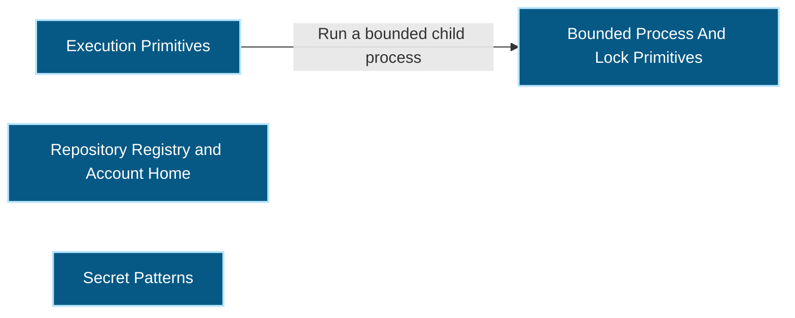
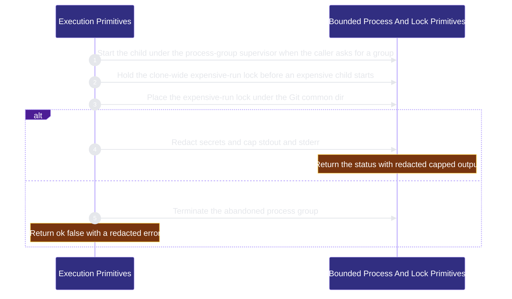

# workflow-engine/execution-primitives 架構文檔

<!-- BEGIN ARCHCONTEXT:generated target="projection_target.entity.capability-workflow-engine-execution-primitives" rendererVersion="archcontext.docs-renderer/v6" outputDigest="sha256:a03b0261b1890eeb28433e9441fccfe064242bc520d862d2323d485ebaaf151c" -->
> **狀態**:`active`
> **Capability ID**:`capability.workflow-engine.execution-primitives`(kind `capability`)
> **Matched Prefixes**:`src/effects/process-runner.ts`、`src/effects/process-supervisor.ts`、`src/effects/process-group-launcher.ts`、`src/effects/process-group-termination.ts`、`src/effects/process-group-registry.ts`、`src/effects/expensive-run-lock.ts`、`src/effects/readonly-observation.ts`、`src/effects/atomic-append.ts`、`src/effects/locking/**`、`src/effects/git/**`
> **Local Contracts**:`AGENTS.md`、`CLAUDE.md`
> **事實優先級**:倉庫當前狀態 > 本文檔機器區 > 本文檔人工區。機器區(引言、§1、§2)由 ArchContext 從架構模型與源碼度量投影生成,手改會在下次投影被覆蓋。本文檔不記錄出處;本次投影所驗證的 commit 見 `docs/architecture/.projection-manifest.json`。

Runs bounded child processes and provides the canonical directory lock and Git common-dir and worktree topology reads. It also holds the shared repository registry, the account home root and the secret patterns that core and plugins read. It holds no workflow policy.

## 1. P1:能力架構地圖

### 1.1 架構圖

- Proof: `proven` (`sha256:ce4cc2fa11c15105955c9bf86d78836847338383cc19c7963b3027c4e27a0143`).
- Semantic nodes: `4`; declared relations: `1`.

### 1.2 模組職責表

| 宣告入口 | 錨點 | 職責 |
| --- | --- | --- |
| `entrypoint.execution-primitives.primary` | `src/effects/process-runner.ts#runProcess` | `sink.execution-primitives.primary` → `src/effects/process-runner.ts#runSupervisedProcess`、`sink.execution-primitives.output-cap` → `src/effects/process-runner.ts#capProcessOutput` |
| `entrypoint.execution-primitives.primary` | `src/effects/process-runner.ts#runSupervisedProcess` | `sink.execution-primitives.abandoned-group` → `src/effects/process-runner.ts#terminateAbandonedProcessGroup` |
| `entrypoint.execution-primitives.supervisor` | `src/effects/process-supervisor.ts#supervise` | `sink.execution-primitives.expensive-lock` → `src/effects/expensive-run-lock.ts#acquireExpensiveRunLock` |
| `entrypoint.execution-primitives.expensive-lock` | `src/effects/expensive-run-lock.ts#acquireExpensiveRunLock` | `sink.execution-primitives.git-common-dir` → `src/effects/git/common-directory.ts#resolveGitCommonDirectory`、`sink.execution-primitives.directory-lock` → `src/effects/locking/exclusive-directory-lock.ts#acquireExclusiveDirectoryLock` |

組件入口:

- 組件均未宣告 `source.entrypoints`。

### 1.3 規模信號

- 規模量級:`20–50` 個文件 / `2000–5000` 行
- 匹配前綴:`src/effects/process-runner.ts`、`src/effects/process-supervisor.ts`、`src/effects/process-group-launcher.ts`、`src/effects/process-group-termination.ts`、`src/effects/process-group-registry.ts`、`src/effects/expensive-run-lock.ts`、`src/effects/readonly-observation.ts`、`src/effects/atomic-append.ts`、`src/effects/locking/**`、`src/effects/git/**`
- 推導:掃描 `source.include` 減 `source.exclude`,跳過 `.git/` 與 `node_modules/`,再按 1–2–5 階梯分桶。精確計數不入本文檔:量級足以回答「這個能力有多大」,而逐行計數會讓覆蓋範圍內任何一次源碼改動都改寫本文檔。

### 1.4 依賴邊界

出向關係:

- `deployed-on` → `process.process-supervisor` — Execution primitives own the supervisor protocol.
- `calls` → `external.git` — Run git for refs, worktrees and the common directory.
- `calls` → `component.execution-primitives.primary` — Run a bounded child process

入向關係:

- `calls` ← `component.acceptance-review.primary` — Hold an exclusive directory lock around one generic review run
- `depends-on` ← `capability.public-surface.adoption` — Run bounded processes for adoption and file transactions.
- `depends-on` ← `capability.verification.codegraph-readiness` — Run bounded CodeGraph processes.
- `calls` ← `component.contract-assets.contract-worktree-lifecycle` — Resolve the configured Git binary for worktree lifecycle commands
- `calls` ← `component.contract-assets.planning-helpers` — Run each helper as a bounded child process
- `calls` ← `component.contract-assets.template-projection` — Run init steps as bounded child processes
- `calls` ← `component.evals-checks.evals-and-benchmarks` — Take the expensive-run lock before a costly benchmark profile runs
- `calls` ← `component.evidence-ledger.primary` — Hold exclusive directory locks under the Git common directory and read the virtual tree
- `calls` ← `component.external-source-intake.immutable-evidence` — Hold exclusive directory locks under the Git common directory
- `calls` ← `component.global-runtime-reconciliation.archctx-closure` — Run the archctx binary through the process runner
- `calls` ← `component.global-runtime-reconciliation.primary` — Run processes and read lock owners during runtime reconciliation
- `calls` ← `component.global-runtime-reconciliation.release-packaging` — Run installed binaries to read back runtime evidence
- `calls` ← `component.hook-adapters.edit-guards` — Lock the circuit breaker records
- `calls` ← `component.hook-adapters.host-installer` — Hold the runtime host transaction lock and resolve the Pi opt-in repository through the bounded shared Git runner
- `calls` ← `component.hook-adapters.primary` — Run the process supervisor and group launcher entries
- `calls` ← `component.hook-adapters.session-lifecycle` — Hold the native role evidence lock
- `calls` ← `component.mcp-sidecar.coding-profile` — Use the configured Git binary for coding workspaces
- `calls` ← `component.mcp-sidecar.host-setup` — Hold the MCP setup ownership lock
- `calls` ← `component.mcp-sidecar.primary` — Read the worktree topology for the PM server scope
- `calls` ← `component.mcp-sidecar.repo-policy-registry` — Run Git for repository roots and lock guarded writes
- `depends-on` ← `capability.runtime-harness.operator` — Read Git topology for task diffs and development activity.
- `calls` ← `component.publication.primary` — Read the worktree topology and the Git common directory
- `calls` ← `component.publication.provider-feedback` — Resolve the Git common directory for feedback records
- `calls` ← `component.task-agent-host.primary` — Run Git through the process runner and hold task session locks
- `calls` ← `component.task-fleet.task-inbox` — Hold exclusive directory locks under the Git common directory for the task inbox
- `calls` ← `component.workflow-state.continuation-ledger` — Serialize attempt ledger appends under a directory lock and write them durably
- `calls` ← `component.workflow-state.coordination-plane` — Take task and backlog locks, read the worktree topology, and write coordination records durably
- `calls` ← `component.workflow-state.primary` — Take the state lock and commit the version owner under the Git common dir

組件出向關係:

- `component.execution-primitives.primary`:
  - 無。
- `component.execution-primitives.repository-registry`:
  - 無。
- `component.execution-primitives.secret-patterns`:
  - 無。

### 1.5 組件結構

| 組件 | 名稱 | 規模量級 | 宣告入口 |
| --- | --- | --- | --- |
| `component.execution-primitives.primary` | Bounded Process And Lock Primitives | `20–50` 個文件 / `2000–5000` 行 | 未宣告 |
| `component.execution-primitives.repository-registry` | Repository Registry and Account Home | `2–5` 個文件 / `500–1000` 行 | 未宣告 |
| `component.execution-primitives.secret-patterns` | Secret Patterns | `1–2` 個文件 / `20–50` 行 | 未宣告 |

## 2. P2:端到端數據流

> **Proof**: `proven` (`sha256:ce4cc2fa11c15105955c9bf86d78836847338383cc19c7963b3027c4e27a0143`); selectors `5/5`.

<!-- END ARCHCONTEXT:generated target="projection_target.entity.capability-workflow-engine-execution-primitives" -->

## 3. P3:設計決策與不變量

### 3.1 必须保持的不变量

1. **本 capability 不持有工作流策略。** 它提供进程、锁与 Git 读取原语，以及 core 与插件共用的 repository registry、account home 根目录与密钥模式（#1343）。调用方决定超时类别、锁路径与重试。`src/` 与 `scripts/` 下有 54 个文件导入这些原语（`git grep`，2026-10-11）。
2. **每个子进程都有截止时间和输出上限。** 默认超时 120 s，默认输出上限 64 KiB（`src/effects/process-runner.ts:43-44`）。命令行与输出都经过密钥脱敏（`:73-82`、`:135-140`）。
3. **监督者回执必须与退出状态一致。** 监督者的回执、退出码或信号不一致时，`runSupervisedProcess` 终止被遗弃的进程组，并把结果改为失败（`process-runner.ts:209-230`）。
4. **未确认进程组已死时不释放 expensive-run 锁。** 清理被异常打断时，监督者设置 `preserveExpensiveRunLock`，`supervise()` 不释放锁（`src/effects/process-supervisor.ts:17-22`）。
5. **只凭死 PID 不能回收 expensive-run 锁。** 回收要求 owner 记录中登记的进程组 PID，并且该进程组已排空（`src/effects/expensive-run-lock.ts:42-56`）。Windows 无法证明进程组为空，所以那里从不回收（`:31-40`）。
6. **目录锁逐级校验祖先。** 锁目录的每一级祖先都要是真实目录，身份（dev/ino）不能变化，符号链接直接失败（`src/effects/locking/exclusive-directory-lock.ts:139-197`）。
7. **锁争用是可分类的错误。** 等待超时与失去所有权都抛 `ExclusiveLockContentionError`，调用方按类型决定是否重试（`exclusive-directory-lock.ts:29-40`）。
8. **Git 是 worktree 拓扑的唯一权威。** `readWorktreeTopology` 只读 `git worktree list --porcelain`（`src/effects/git/worktree-topology.ts:102-111`）。`resolveGitCommonDirectory` 返回 realpath（`src/effects/git/common-directory.ts:6-17`）。

### 3.2 关键权衡

| 决策 | 权衡 |
| --- | --- |
| 进程组监督放在独立的 supervisor 与 launcher 进程里（PR #83，CRG-01） | 父进程被杀时仍能 TERM 后 KILL 整个进程组。代价是每次受监督调用多两个进程，并通过回执文件交换结果 |
| expensive-run 锁放在 Git common dir（PR #83） | 一个 clone 的所有 linked worktree 共用一把锁，昂贵的发布与基准测试不会重叠。代价是同一 clone 的并行 worktree 必须排队 |
| 目录锁用 mkdir 加 owner 文件，而不是 OS 文件锁 | 在 Bun 与 Node 上可移植，不需要原生依赖。owner 记录保存 PID 与 OS 进程表中的启动时间（`src/effects/locking/process-start-time.ts`），PID 被复用时启动时间不同，锁判为过期（#915）。代价是每个进程第一次加锁时读一次进程表：Linux 读 `/proc`，macOS 运行一次 `/bin/ps`，Windows 运行一次 PowerShell |
| 只回收“死 owner + 精确 token”的 owner；空目录默认不回收（`exclusive-directory-lock.ts`） | 死 owner 指 PID 不存在，或该 PID 的启动时间与记录不同。没有启动时间的 owner 记录（旧版本留下的锁）从不自动回收，要人工清理。活进程永远不会被抢锁，崩溃的 owner 可以被回收。空目录无法区分崩溃的创建者与暂停的创建者，所以只有调用方显式开启时，超过 30 s 的空目录才会被移除（`:18`、`:323-343`）。代价是默认等待只有 5 s（`:19`），争用方要自己重试 |
| Git 读取经过 `readonly-observation` 的可选 IO 能力（PR #604） | strategy 等只读观察可以在一个作用域内拒绝写入并验证路径。该能力在 `src/effects/readonly-observation.ts`，属于本 capability，所以 Git 读取不导入 workflow-state（#907） |

### 3.3 组件

`component.execution-primitives.primary`：8 个文件、1,755 行（`archctx refactor scan`，2026-10-11）。源码里有三类职责：进程生命周期（runner、supervisor、launcher、expensive-run 锁）、目录锁、Git 读取。它们目前都很小，所以没有拆分。

#1343 增加两个组件：

| 组件 | 层 | footprint | 职责 |
| --- | --- | --- | --- |
| `component.execution-primitives.repository-registry`（Repository Registry and Account Home） | effects | `src/effects/repo-registry.ts`（859 行）、`src/effects/repo-harness-home.ts`（8 行） | 注册仓库记录、read_write 授权与授权 revision；account 级 repo-harness home 根目录 |
| `component.execution-primitives.secret-patterns`（Secret Patterns） | core | `src/core/security/**`（1 个文件，32 行） | 脱敏与只读投影共用的密钥 token 模式 |

`repo-registry.ts` 只导入 Node 内置模块、`./locking/exclusive-directory-lock`、`./git/runner` 与 `./repo-harness-home`。`repo-harness-home.ts` 只导入 `node:os` 与 `node:path`。`secret-patterns.ts` 没有 import。所以本 capability 没有新增出向边。

### 3.4 10x 规模下先垮的点

1. **expensive-run 锁的排队。** 所有昂贵运行共用一把 clone 级锁。并行 worktree 数增加时，排队时间线性增长。
2. **`process-supervisor.ts` 494 行。** 超时、信号转发、父进程丢失检测与锁保留都在一个文件里。
3. **入向依赖面宽。** 54 个文件直接导入这些原语。任何签名变化都会波及大多数 capability。

## 4. 歷史決策記錄(append-only)

### 2026-10-11 Capability node minted

- 本 capability 第一次进入架构模型。8 个文件之前没有 capability 节点。
- 来源：PR #83（CRG-01，2026-07-18）引入超时类别、PGID 监督者与 Git common-dir expensive-run 锁。PR #101（HRD-07）把断路器序列化移到共享目录锁。

### 2026-10-25 Observation and durable-write primitives moved in (#907)

- state 目录中的只读观察原语移到 `src/effects/readonly-observation.ts`。evidence 目录中的原子追加原语移到 `src/effects/atomic-append.ts`。两个文件只导入 Node 内置模块。
- 结果：git、capabilities、evidence、review 与 state 目录之间的 4 对层内目录环消失。`bun run check:state-boundaries` 现在检查层内目录环。
- `relation.execution-primitives.imports.workflow-state` 不再有源码边。

### 2026-11-01 Shared repository registry and secret patterns moved in (#1343)

- `src/effects/repo-registry.ts`、`src/effects/repo-harness-home.ts` 与 `src/core/security/**` 从 mcp-sidecar 移到本 capability 的两个新组件。只改模型，源码与 import 不变。
- 原因：`src/core/review`、`src/core/operator` 与多个 capability 读这些文件。#1287 的依赖检查不应把它们算作 core → MCP 边。
- 新路径只写在组件 include 上，不写在 capability include 上，与 `src/effects/runtime/os-account-home.ts` 相同。

## Optimization Backlog

- **可能的组件拆分。** 文件数超过约 15 个或行数超过约 4k 时，按进程生命周期、目录锁、Git 读取拆成三个组件。
