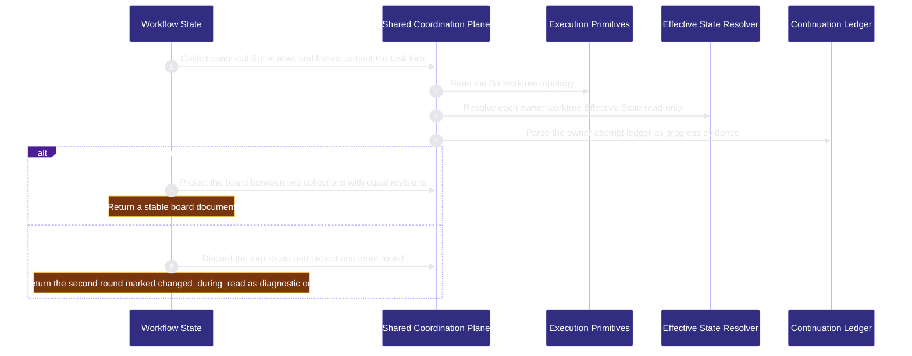
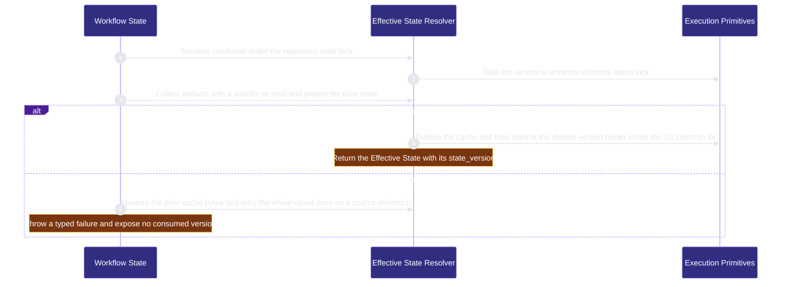

# workflow-engine/workflow-state 架構文檔

<!-- BEGIN ARCHCONTEXT:generated target="projection_target.entity.capability-workflow-engine-workflow-state" sourceDigest="sha256:571e944b859dbc42ba73891ce36ee7c8fa308d72ec870716d50c296da6833760" rendererVersion="archcontext.docs-renderer/v5" outputDigest="sha256:e7e527b1a0dc3e90cdadad1ac34583b34b2fa9aeb39e10cbf285e6a2926ced32" -->
> **狀態**:`active`
> **Capability ID**:`capability.workflow-engine.workflow-state`(kind `capability`)
> **Matched Prefixes**:`src/core/state/**`、`src/effects/state/**`、`src/core/workflow/**`、`interfaces/**`、`src/core/worktree-location.mjs`、`src/core/worktree-location.d.mts`、`src/cli/commands/state.ts`、`src/cli/commands/sprint.ts`、`scripts/check-state-boundaries.ts`、`scripts/sprint-backlog.sh`
> **Local Contracts**:`AGENTS.md`、`CLAUDE.md`
> **事實優先級**:倉庫當前狀態 > 本文檔機器區 > 本文檔人工區。機器區(引言、§1、§2)由 ArchContext 從架構模型與源碼度量投影生成,手改會在下次投影被覆蓋。本文檔不記錄出處;本次投影所驗證的 commit 見 `docs/architecture/.projection-manifest.json`。

Resolves the one deterministic Effective State projection and owns the shared coordination plane and the continuation ledger.

## 1. P1:能力架構地圖

### 1.1 架構圖

```mermaid
flowchart LR
  p1_capability_workflow_engine_execution_primitives_b3033934["Execution Primitives"]:::component
  p1_capability_workflow_engine_workflow_state_c0df5f05["Workflow State"]:::component
  p1_component_workflow_state_continuation_ledger_379dbd7c["Continuation Ledger"]:::component
  p1_component_workflow_state_coordination_plane_01b22a1b["Shared Coordination Plane"]:::component
  p1_component_workflow_state_primary_d0fb4045["Effective State Resolver"]:::component
  p1_component_workflow_state_continuation_ledger_379dbd7c -->|"Serialize attempt ledger appends under a directory lock"| p1_capability_workflow_engine_execution_primitives_b3033934
  p1_component_workflow_state_continuation_ledger_379dbd7c -->|"Project the continuation envelope from read-only Effective State"| p1_component_workflow_state_primary_d0fb4045
  p1_capability_workflow_engine_workflow_state_c0df5f05 -->|"Serve the Sprint ownership verbs and the read-only board"| p1_component_workflow_state_coordination_plane_01b22a1b
  p1_component_workflow_state_coordination_plane_01b22a1b -->|"Append claim attempt receipts and read owner ledgers as progress evidence"| p1_component_workflow_state_continuation_ledger_379dbd7c
  p1_component_workflow_state_coordination_plane_01b22a1b -->|"Take task and backlog locks and read the worktree topology"| p1_capability_workflow_engine_execution_primitives_b3033934
  p1_component_workflow_state_coordination_plane_01b22a1b -->|"Read artifacts and owner Effective State through the shared resolver"| p1_component_workflow_state_primary_d0fb4045
  p1_capability_workflow_engine_workflow_state_c0df5f05 -->|"Resolve Effective State under the state lock"| p1_component_workflow_state_primary_d0fb4045
  p1_component_workflow_state_primary_d0fb4045 -->|"Take the state lock and commit the version owner under the Git common dir"| p1_capability_workflow_engine_execution_primitives_b3033934
  classDef actor fill:#111827,color:#ffffff,stroke:#f9fafb,stroke-width:2px
  classDef component fill:#075985,color:#ffffff,stroke:#bae6fd,stroke-width:2px
  classDef datastore fill:#3f6212,color:#ffffff,stroke:#d9f99d,stroke-width:2px
  classDef external fill:#7c2d12,color:#ffffff,stroke:#fed7aa,stroke-width:2px
```

- Proof: `proven` (`sha256:5277aa25769a0dccd118d6c166edcd2f71a12f3894551ca01bc718c2b8768ab9`).
- Semantic nodes: `5`; declared relations: `8`.

### 1.2 模組職責表

| 宣告入口 | 錨點 | 職責 |
| --- | --- | --- |
| `entrypoint.workflow-state.primary` | `src/effects/state/resolve-effective-state.ts#resolveEffectiveState` | `sink.workflow-state.primary` → `src/effects/state/state-lock.ts#withStateLock` |
| `entrypoint.workflow-state.primary` | `src/effects/state/resolve-effective-state.ts#resolveEffectiveStateUnlocked` | `sink.workflow-state.project` → `src/core/state/project-effective-state.ts#projectEffectiveState` |
| `entrypoint.workflow-state.primary` | `src/effects/state/resolve-effective-state.ts#resolveAndCommitEffectiveState` | `sink.workflow-state.version-commit` → `src/effects/state/git-state-version-store.ts#commitStateVersionAfter` |
| `entrypoint.workflow-state.state-lock` | `src/effects/state/state-lock.ts#withStateLock` | `sink.workflow-state.directory-lock` → `src/effects/locking/exclusive-directory-lock.ts#withExclusiveDirectoryLock` |
| `entrypoint.workflow-state.version-owner` | `src/effects/state/git-state-version-store.ts#commitStateVersionAfter` | `sink.workflow-state.git-common-dir` → `src/effects/git/common-directory.ts#resolveGitCommonDirectory` |
| `entrypoint.workflow-state.board` | `src/effects/state/resolve-board.ts#resolveBoard` | `sink.workflow-state.board-inputs` → `src/effects/state/collect-board-inputs.ts#collectBoardInputs` |
| `entrypoint.workflow-state.board` | `src/effects/state/resolve-board.ts#collectProjectCollect` | `sink.workflow-state.board-projection` → `src/core/state/project-board.ts#projectBoard` |
| `entrypoint.workflow-state.board-inputs` | `src/effects/state/collect-board-inputs.ts#collectBoardInputs` | `sink.workflow-state.worktree-topology` → `src/effects/git/worktree-topology.ts#readWorktreeTopology` |
| `entrypoint.workflow-state.board-inputs` | `src/effects/state/collect-board-inputs.ts#observeOwnerWorktree` | `sink.workflow-state.owner-state` → `src/effects/state/resolve-effective-state.ts#resolveEffectiveStateReadOnly`、`sink.workflow-state.owner-attempts` → `src/core/state/attempt-ledger.ts#parseAttemptLedger` |

### 1.3 規模信號

- 規模量級:`50–100` 個文件 / `10k–20k` 行
- 匹配前綴:`src/core/state/**`、`src/effects/state/**`、`src/core/workflow/**`、`interfaces/**`、`src/core/worktree-location.mjs`、`src/core/worktree-location.d.mts`、`src/cli/commands/state.ts`、`src/cli/commands/sprint.ts`、`scripts/check-state-boundaries.ts`、`scripts/sprint-backlog.sh`
- 推導:掃描 `source.include` 減 `source.exclude`,跳過 `.git/` 與 `node_modules/`,再按 1–2–5 階梯分桶。精確計數不入本文檔:量級足以回答「這個能力有多大」,而逐行計數會讓覆蓋範圍內任何一次源碼改動都改寫本文檔。

### 1.4 依賴邊界

出向關係:

- `calls` → `component.workflow-state.coordination-plane` — Serve the Sprint ownership verbs and the read-only board
- `calls` → `component.workflow-state.primary` — Resolve Effective State under the state lock

入向關係:

- `calls` ← `component.contract-assets.contract-worktree-lifecycle` — Create and remove task worktrees under the worktree topology lock
- `calls` ← `component.contract-assets.template-projection` — Check cutover quiescence and record the coordination cutover during init

## 2. P2:端到端數據流

> **Proof**: `proven` (`sha256:5277aa25769a0dccd118d6c166edcd2f71a12f3894551ca01bc718c2b8768ab9`); selectors `10/10`.

<!-- END ARCHCONTEXT:generated target="projection_target.entity.capability-workflow-engine-workflow-state" -->

## 3. P3:設計決策與不變量

人工权威文档有两份。本文只记录 capability 边界与组件划分，协议细节以它们为准：

- [`effective-state-authority.md`](../../effective-state-authority.md)：Effective State 的决定、冻结不变量与 P2 解析轨迹。
- [`shared-coordination-plane.md`](../../shared-coordination-plane.md)：lease 协议、board 投影与 hook 层 slice。

### 3.1 必须保持的不变量

1. **仓库 Markdown 与工作流工件是唯一权威。** `.ai/harness/state/effective.json` 与 `tasks/current.md` 只是读模型，不能把权威反馈回解析（`effective-state-authority.md` Frozen Invariants 1-3）。
2. **纯核心不做 IO。** `src/core/state`、`src/core/workflow` 与 `src/core/capabilities` 是一个纯核心（`scripts/check-state-boundaries.ts:36-40`）。它们不能导入 `fs`、`child_process` 等运行时模块（`:106-130`），也不能导入 `src/cli` 或 `src/effects`（`:277`）。门禁命令是 `bun run check:state-boundaries`。
3. **缓存先发布，版本 owner 最后提交。** `commitStateVersionAfter` 在 Git common dir 的锁内先调用 `publishCache`，再写版本记录；任何一步失败都回滚缓存字节（`src/effects/state/git-state-version-store.ts:129-167`）。失败不会暴露已消耗的版本号。
4. **解析在仓库状态锁内串行。** `resolveEffectiveState` 先取 `.ai/harness/state/effective.lock`（`src/effects/state/state-lock.ts:3-7`）。源在稳定性循环之后又变化时，整轮只重试一次，第二次仍不一致就抛 `StateResolutionUnstableError`（`src/effects/state/resolve-effective-state.ts:893-920`）。
5. **只读路径不写任何东西。** `resolveEffectiveStateReadOnly` 走同一个稳定性循环，但不分配版本，也不发布缓存（`resolve-effective-state.ts:922-933`）。board 与 continuation envelope 都只用这条路径。
6. **身份是读出来的。** `task_id` 是 Sprint 行 `ID` 单元格的原文，必须匹配 `TASK_DIGEST_PATTERN`（`src/core/state/coordination-identity.ts:77`）。只有 `task_revision` 是推导值。
7. **每一次所有权变更都在该任务的锁内完成读-比较-写。** 锁位于 `<git-common-dir>/repo-harness/coordination/v1/`（`src/effects/state/coordination-lease-store.ts:53`、`:126-160`）。fencing 由 `claim_id` 与 `generation` 共同完成。
8. **board 不取锁，也不是授权依据。** `resolveBoard` 按 collect → project → collect 运行；两次输入 revision 不同就丢弃整轮再跑一次，仍不同就标记 `changed_during_read`（`src/effects/state/resolve-board.ts:1-28`）。`claim`、`steal`、`release` 与 `begin-completion` 必须在自己的任务锁内重新读权威。
9. **attempt ledger 不进入 Effective State。** 收据不是 `EffectiveState`、`state_revision` 的输入。断路器只在路由表给出可执行路由后运行（`src/core/state/project-continuation-envelope.ts` 文件头）。
10. **停滞判定没有计数器。** 当前 unit 的尾部连续两条 `completed` 收据且 before/after token 等于当前 token，即判定 `no_progress`（`src/core/state/no-progress.ts:6`、`:20-35`）。无法解析的行 fail closed，不跳过（`src/core/state/attempt-ledger.ts:29-31`）。

### 3.2 关键权衡

| 决策 | 权衡 |
| --- | --- |
| 共享协调面是本 capability 的组件，不是独立 capability（2026-10-11 用户决定） | 协调面复用 Effective State 的工件读取、只读解析与纯核心门禁。它独立成 capability 会把这些调用变成跨 capability 依赖。代价是本 capability 有 50 个文件、约 13.9k 行，需要组件表来说明内部边界 |
| 版本 owner 放在 Git common dir，而不是 worktree 本地 | 所有 linked worktree 共享一个单调版本（Frozen Invariant 6）。代价是每次发布都要解析 common dir 并取第二把锁 |
| board 无锁读取，用双采样暴露撕裂 | 观察者不会串行化所有 agent。代价是读者可能拿到 `changed_during_read` 文档，只能当诊断用 |
| continuation ledger 只读 Effective State | `state next` 保持零写入。代价是它看到的 `state_version` 是当前已发布的版本，不是新分配的版本 |
| CLI 通过依赖注入把 resolver 传给命令函数 | 命令函数可以在测试中替换 resolver。代价是 CodeGraph 只记录 `references` 边，flow 选择器只能从 effects 层开始 |

### 3.3 组件

组件 footprint 是组件节点上的 `source.include`。数字来自 `archctx refactor scan`（2026-10-11）。

| 组件 | 文件 / 行 | 职责 | 主要出向关系 |
| --- | ---: | --- | --- |
| `component.workflow-state.primary`（Effective State Resolver） | 17 / 4,434 | 工件解析、风险 profile、稳定读取、缓存与版本发布、`state` CLI、`interfaces/**`、边界门禁 | execution-primitives（状态锁与版本锁）、contract-assets（能力注册表） |
| `component.workflow-state.coordination-plane`（Shared Coordination Plane） | 28 / 8,924 | Sprint 身份、四态 lease、claim token、cutover、worktree 拓扑记录、board 与 slice 投影、`sprint` CLI | primary（工件读取与 owner 只读解析）、continuation-ledger（attempt 收据）、execution-primitives（任务锁、backlog 锁、worktree 拓扑） |
| `component.workflow-state.continuation-ledger`（Continuation Ledger） | 5 / 540 | continuation 路由表、attempt ledger、no-progress 断路器 | primary（只读 Effective State）、execution-primitives（ledger 追加锁） |

coordination-plane 用文件名通配符声明 footprint（例如 `src/effects/state/coordination-*.ts`）。新的 `coordination-*` 文件自动归入该组件。其他新文件只归入 capability，直到有人把它加入某个组件。

### 3.4 10x 规模下先垮的点

1. **同步的 Git 与源收集。** `effective-state-authority.md` Consequences 已记录：第一个 10x 压力点是重复的同步 Git 与源收集，不是纯投影。hook 侧的 `resolveEffectiveState` 锁竞争已在 `hook-adapters.md` §3.3 第 5 条记录。
2. **board 的 owner worktree 观察。** `collectBoardInputs` 对每个 owner worktree 调一次 `resolveEffectiveStateReadOnly`，再读一次 attempt ledger，而且每轮采样两次。并行 worktree 增加时，读成本按 worktree 数线性增长。
3. **`coordination-sprint.ts` 1,261 行。** 所有所有权动词都在这一个文件里，`processSprintDependencies` 是它们共享的依赖注入点。
4. **`coordination-identity.ts` 1,076 行的纯核心。** 身份、lease record 解析与状态转换都在一个文件里。

## 4. 歷史決策記錄(append-only)

### 2026-10-11 Capability node minted

- 本 capability 第一次进入架构模型。之前 `src/core/state/**`、`src/effects/state/**`、`src/core/workflow/**` 等 50 个文件没有任何 capability 节点（`docs/researches/20261011-archctx-signal-and-architecture-coverage.md`）。
- 共享协调面作为组件进入本 capability。`shared-coordination-plane.md` 中“不 mint capability node”的记录已同步更新。
- `src/effects/review/diff-fingerprint.ts` 不归本 capability。并行的 acceptance-review 分组整体认领了 `src/effects/review/**`。

## Optimization Backlog

以下是回边与边界缺口。它们是重构证据，不是声明的关系。

- **primary → coordination-plane 回边。** `src/core/state/types.ts:12` 导入 `coordination-identity.ts`，`:316` 内联导入 `lease-liveness.ts`。board DTO 类型因此住在 Effective State 的类型文件里。`src/cli/commands/state.ts:13-21` 还承载 `state board`。候选做法：把 board 类型移到协调面，或把 `state board` 适配器移到协调面。
- **primary → continuation-ledger 回边。** `src/cli/commands/state.ts:15`、`:22` 承载 `state attempt` 与 `state next`。处理方式同上。
- **continuation-ledger → coordination-plane 回边。** `src/core/state/project-continuation-envelope.ts:45` 导入 `sprint-backlog-rows.ts`。该文件是 Sprint backlog 的纯解析器。候选做法：把它和 `artifact-parsers.ts` 放在一起。
- **coordination-plane → engineer-scheduling 回边。** `src/cli/commands/sprint.ts:4`、`:12` 与 `src/effects/state/sprint-schema-migration.ts:26` 导入 engineers scheduling。
- **coordination-plane → mcp-sidecar 回边。** `src/cli/commands/sprint.ts:8` 导入 `src/effects/repo-registry.ts`。
- **primary → hook-adapters 回边。** `src/cli/commands/state.ts:24` 导入 `src/cli/hook/mutation-observed.ts` 的 `migratePendingPostEditJournalV1`。
- **coordination-plane → task-agent-host。** `src/effects/state/coordination-worktree-topology.ts:12` 导入 `src/effects/terminal/task-session.ts`，在 prune 前确认 task runtime 已关闭。若 task-agent-host 也依赖本 capability，这是一个环。
- **持久写原语在 evidence 目录。** 协调面与 ledger 的 7 个文件导入 `src/effects/evidence/atomic-append.ts`（例如 `coordination-lease-store.ts:48`）。它是通用持久写原语。候选做法：移到 execution-primitives。
- **`readonly-observation.ts` 被下层导入。** `src/effects/git/common-directory.ts:1` 与 `readonly-virtual-tree.ts:4` 导入它，evidence 与 `scripts/acceptance-receipt.ts:3` 也导入它。候选做法：移到 execution-primitives。
- **`diff-fingerprint.ts` 的归属（after arch-context#296）。** `effective-state-authority.md` 把 Git review-subject 观察记为 Effective State 的实现边界，`resolve-effective-state.ts:11` 导入它。现在它归 acceptance-review。exclude 可用后，再决定是否把这一个文件移回本 capability。
- **primary 的跨 capability 依赖。** `resolve-effective-state.ts:6-7` 导入 `scripts/acceptance-receipt.ts` 与 `src/effects/evidence/verification-execution.ts`。如果 acceptance-review 或 evals-checks 反向依赖本 capability，就形成环。
