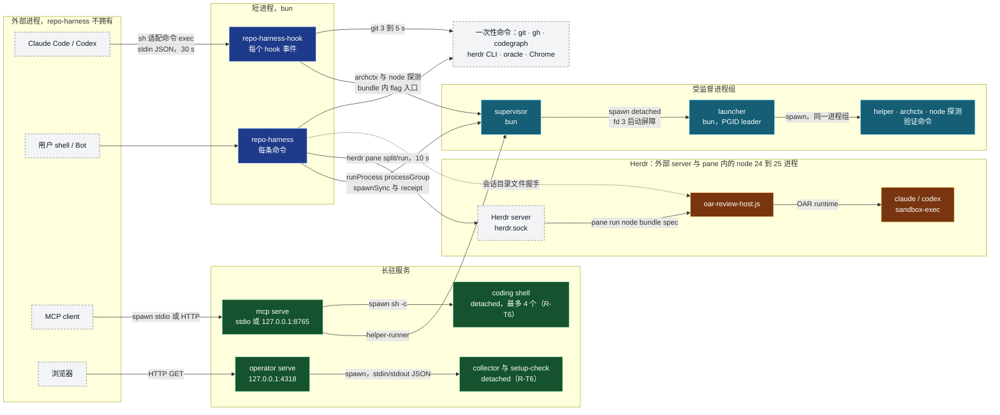
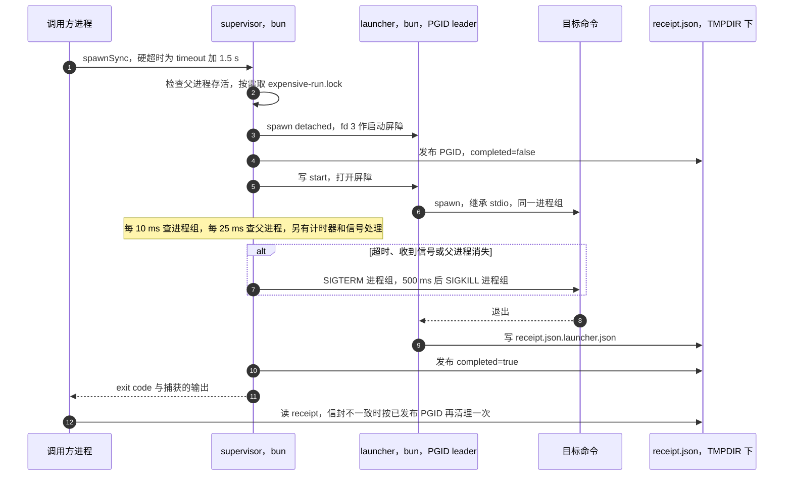
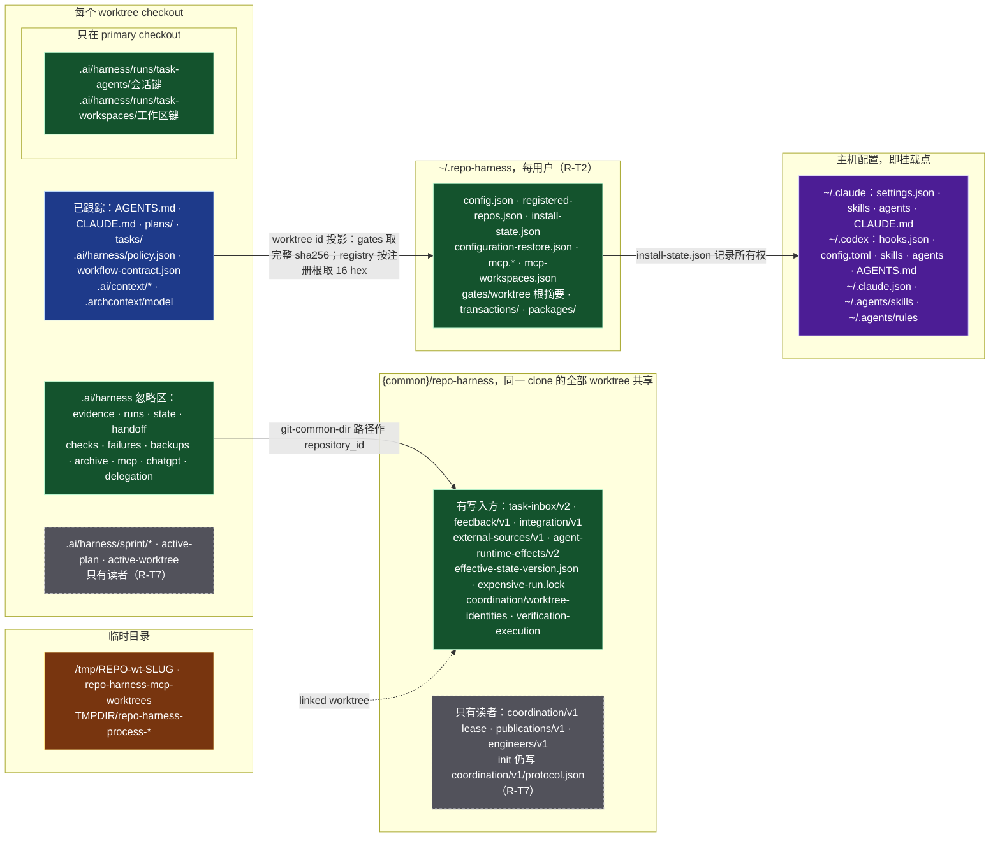
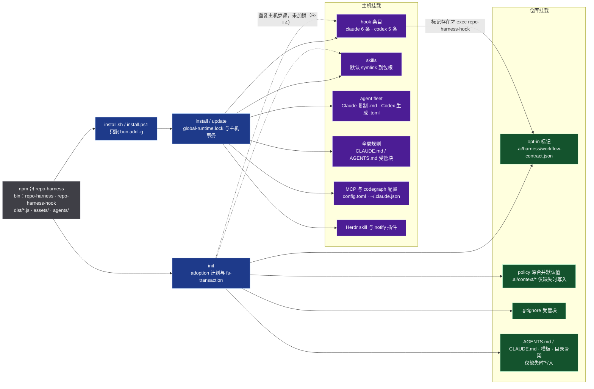

# 进程与命名空间拓扑 + 挂载层

> **历史归档**：以下图、行号、数量和 Remarks 只描述 `d7e92f43d`，不代表当前实现。
> 当前规范见 [功能架构、时序与拓扑](current-architecture.md)。
> #901/#902/#904 的只读状态、失败停止回滚、init 分离，以及 #947 的恢复修复已经合入当前基线。
> 保留原快照用于追踪审查；历史读者的退出决定继续引用 #917，不据此删除或恢复。

> **快照**：`origin/main` `d7e92f43d`（2026-10-25）。文中行号都按这个提交。
> **事实优先级**：源码 > `.archcontext/model/` > 本文。本文是手写视图，archctx 不投影它。
> **配套**：[总分层架构与时序](layered-architecture.md) · [Global Hook Runtime](global-hook-runtime.md) · [Architecture Index](index.md)
> **用途**：精简重构的定位图。`R-Tx` 指向本文 [Remarks](#remarks)，`R-Lx` 指向[分层文档的 Remarks](layered-architecture.md#remarks)。

术语：

- `{common}`：`git rev-parse --git-common-dir` 的 realpath（`src/effects/git/common-directory.ts:10-19`）。同一 clone 的全部 linked worktree 共享它。
- 短进程：每个 hook 事件或每条命令一个进程。
- 长驻进程：收到信号或父进程关闭 stdin 后才退出。

## 1. 进程拓扑

repo-harness 不安装 launchd、systemd 或 cron 单元。长驻进程只有两个本地服务：MCP（stdio 由 client 拉起，HTTP 由用户启动）与 operator（用户启动）。其余进程由宿主、用户 shell、这两个服务或 Herdr 拉起。

| 进程 | 入口 | 启动方与 API | 生命周期 | IPC | 超时与终止 | 锁 |
| --- | --- | --- | --- | --- | --- | --- |
| hook | `dist/hook-entry.js`，bun bundle，源码 `src/cli/hook-entry.ts` | 宿主经 sh 适配命令 `exec` | 每事件 | stdin JSON；stdout JSON 与 exit code | 宿主 30 s；内部 git 3 到 5 s | `runs/.hook-events.jsonl.lock`、circuit-breaker 锁 |
| CLI | `src/cli/index.ts`，bun | 用户 shell 或 Bot | 每命令 | argv、stdout、exit code | 无 | 按命令，例如 `global-runtime.lock` |
| supervisor | `src/effects/process-supervisor.ts`；在 hook bundle 内是 `--process-supervisor` | `process-runner.ts:178` 的 `spawnSync` | 每次受监督调用 | argv；`$TMPDIR/repo-harness-process-*/receipt.json` | 见 §2 | 可选 `{common}/repo-harness/expensive-run.lock` |
| launcher | `src/effects/process-group-launcher.ts` | supervisor `spawn`，detached，进程组 leader | 同上 | fd 3 启动屏障；`receipt.json.launcher.json` | 随进程组终止 | — |
| helper 目标 | workflow contract 列出的 49 个 helper | `helper-runner.ts:419-428`；调用方 `run.ts:148`、`mcp/tools.ts:1294` | 每次调用 | `REPO_HARNESS_*` 环境变量 | verify-contract 与 verify-sprint 3,660 s；contract-worktree、merge-gate、ship-worktrees 900 s；其余 120 s | 按 helper 选择 expensive lane |
| MCP 服务 | `repo-harness mcp serve`（`src/cli/commands/mcp.ts:125`） | MCP client 拉起（stdio）或用户启动（HTTP） | 长驻 | stdio MCP；HTTP `/mcp` 与 OAuth | SIGINT/SIGTERM 关闭会话后退出 | setup 时 `transactions/mcp-setup.lock` |
| coding shell | `src/cli/mcp/process-sessions.ts:511` | MCP 服务 `spawn sh -c`，非 win32 时 detached | 最长 30 min，最多 4 个 | 管道与环形缓冲 | SIGTERM 进程组，宽限后 SIGKILL | — |
| operator 服务 | `repo-harness operator serve` → `src/effects/operator/server.ts:1698` | 用户 | 长驻 | 只读 HTTP API | SIGINT/SIGTERM 调 `server.close()` | — |
| operator collector | `fleet-collector-process.ts`、`task-read-process.ts`、`setup-check-child.ts` | operator `spawn`，detached | fleet 与任务读取每请求一个；setup 每 10 min | stdin/stdout JSON | fleet 与任务读取 1 到 30 s，SIGTERM 进程组，500 ms 后 SIGKILL；setup 90 s，只发 SIGKILL | — |
| OAR review host | `dist/oar-review-host.js`，node | `herdr pane run`（`task-session.ts:543`） | 每评审会话，最多 3 轮 | 会话目录文件；stdout `OAR_HOST_READY` | `close.request` 或信号；`disposed.json` 证明已释放 | 会话目录 `caller.lock` |
| 供应商 CLI | claude、codex | OAR review host 经 `reviewer-launcher` 与 `sandbox-exec` | 每会话 | OAR 进程内 API | `session.abort()` 与 `dispose()` | — |
| 一次性命令 | git、gh、archctx（node）、codegraph、herdr、oracle | 各调用点 `spawnSync`、`execFileSync` 或 `runProcess` | 每调用 | stdout | 3 s 到 30 min；部分调用没有超时（R-T11） | — |
| Chrome | `open -na "Google Chrome" --remote-debugging-port=0` | ChatGPT native provider | 浏览器生命周期 | CDP WebSocket，端口来自 `DevToolsActivePort` | 发 `Browser.close`；`keepBrowser` 时保留 | — |

## 2. 受监督执行协议

`runProcess(..., { processGroup: true })` 是 helper、archctx、node 探测和验证命令的共同执行路径。PGID 先发布再启动目标，所以监督器自身超时后，调用方仍能按已发布的 PGID 清理。

Windows 没有进程组：launcher 不 detached，终止用 `taskkill /pid <leader> /T`，进程组存在性检查恒为 false。无法确认进程已退出时，supervisor 保留 expensive-run 锁（`process-supervisor.ts:154,187-195,362-399`）。

## 3. 命名空间拓扑

命名空间按共享范围分 6 个根。灰色虚线框是只有读者的历史存储。

| 根 | 共享范围 | 主要写入方 | 锁 | 回收 |
| --- | --- | --- | --- | --- |
| 已跟踪仓库文件 | 每个 checkout，经 Git 同步 | `init`（多为仅缺失时写入）、archctx ChangeSet、人与 agent | fs-transaction 目标锁 | Git |
| `.ai/harness/` 忽略区 | 每个 checkout | hook、evidence ledger、Effective State、MCP、chatgpt-browser | 每个文件或目录一个锁 | hook 日志与 `mcp/*.jsonl`、`mcp/audit.log` 由写入方 8 MiB 轮转；evidence 由 checkpoint 发布与 `scripts/evidence-gc.ts` 回收；`backups/fs-transaction` 由 `repo-harness retention` 30 天后移入 `archive/retention`，归档条目 90 天后删除 |
| `.ai/harness/runs/task-agents`、`task-workspaces` | 只在 primary checkout | task-session、generic-review | 每会话 `caller.lock` | `closed.json` 墓碑阻止重启，目录不回收 |
| `{common}/repo-harness/` | 同一 clone 的全部 worktree | task inbox、feedback、integration、external sources、state version | 各子目录锁与 `expensive-run.lock` | 没有回收；`retention --json` 把 task inbox、feedback、integration 列为 keep（R-T8） |
| `~/.repo-harness/` | 每用户 | install 与 update、registry、MCP setup、acceptance | `transactions/global-runtime.lock`、registry 自有锁、`mcp-setup.lock` | `transactions/install-*` 在提交或回滚后删除；`packages/` 只留 install 装入的 release tarball；`upgrade-cleanup.log.jsonl` 只留最新 100 条 |
| 主机配置 | 每用户 | install 与 update 写受管片段 | `global-runtime.lock` 与主机事务副本 | `install-state.json` 所有权清单 |
| 临时目录 | 每台机器 | worktree helper、MCP coding、process-runner | — | worktree 由 closeout 与 sweep 回收 |

身份命名空间：

仓库身份由两个 id 定义，二者都由 Git 决定（`src/effects/git/repository-identity.ts`）：

- repo id：`git rev-parse --git-common-dir` 的 realpath，即 `{common}`。同一 clone 的全部 linked worktree 共享它。解析函数是 `resolveRepoIdentity`。
- worktree id：`git rev-parse --show-toplevel` 的 realpath。每个 checkout 各有一个。解析函数是 `resolveWorktreeId`。

其余标识是这两个 id 的确定投影。每种标识只有一个派生函数。投影保持原有字节，所以已存的记录不移动。

| 标识 | 来源 id | 推导 | 派生函数 |
| --- | --- | --- | --- |
| coordination `repository_id` | repo id | 原样 | `resolveRepoIdentity` |
| worktree trash 前缀 | repo id | sha256 的前 32 位 hex | `worktreeTrashPrefix` |
| task-agent 会话键 | repo id | sha256(JSON[repo id, task, role]) | `taskSessionKey` |
| task-workspace 键 | repo id 与 worktree id | sha256(JSON[repo id, worktree id]) | `taskWorkspaceKey` |
| gates id | worktree id | sha256，64 位 hex | `gatesDirectoryName` |
| registry repo id | 注册根的 realpath | `repo_` 加 sha256 的前 16 位 hex | `repoHarnessRepoIdFor`（`src/effects/repo-registry.ts`） |

gates 按 worktree 划分是有意的设计：acceptance receipt 绑定一个 checkout 的源快照。如果按 clone 划分，一个 linked worktree 的 receipt 会覆盖另一个 worktree 的 receipt。registry repo id 按注册路径计算，不按 `{common}` 计算；同一 clone 的两个 worktree 可以分别注册。改成按 repo id 计算需要迁移 `registered-repos.json`，这一项留给后续（R-T9 余项）。
| Herdr agent 名 | `task-` 加 20 位 hex | `src/effects/terminal/task-session.ts:486` |
| hook 身份 | 只取 payload 的 `session_id`、`run_id`、`turn_id`，不生成新 id | `src/cli/hook/hook-input.ts:63-72` |
| hook 路由 | `(event, routeId, matcher)` 共 7 条；registry 摘要为 sha256(ROUTES) | `src/cli/hook/route-registry.ts:69-119`；`src/cli/runtime/candidate-reconciliation.ts:329-331` |

## 4. 挂载层

挂载层把包投影到两类目标：主机（每用户）和目标仓库（每 checkout）。`install.sh` 与 `install.ps1` 只执行 `bun add -g` 并回读版本，其余写入都由 CLI 完成。

| 挂载点 | 来源 | 方式 | 写入命令 | 所有权与漂移检查 |
| --- | --- | --- | --- | --- |
| bin `repo-harness`、`repo-harness-hook` | npm 包 | `bun add -g` | `install.sh`、`install.ps1`、`installCli` | 回读 `--version` |
| hook 条目，`~/.claude/settings.json`、`~/.codex/hooks.json` | `routesForHost`：claude 6 条，codex 5 条 | 合并受管条目：带 `MANAGED_TAG` 的 sh 命令，超时 30 s | `install`、`update`、`init` | `ManagedHookProjectionReport`；candidate receipt 中的 adapter 摘要 |
| skills，`~/.claude/skills`、`~/.codex/skills` | 包根与 `assets/skill-commands/manifest.json`，profile 为 minimal 或 full | 默认 symlink 到包根，可选 rsync 副本 | `scripts/sync-codex-installed-copies.sh`；bundled、staged、Herdr、Strategy、ChatGPT skill 各有一个 TypeScript 写入函数。所有写入方从 `src/effects/host-skill-roots.ts` 取根 | `installedProfileStatus` 漂移报告；清理悬空的受管链接 |
| agent fleet，`~/.claude/agents`、`~/.codex/agents` | `agents/fleet/*.md`，7 个 | Claude 复制 `.md`；Codex 生成 `.toml` | `scripts/install-agent-fleet.sh`，仅 full profile | 用户改过的目标需要 `--force` 或 `--accept-user-managed` |
| 全局规则，`~/.claude/CLAUDE.md`、`~/.codex/AGENTS.md` | 包内规则文本 | 受管块 | `applyGlobalContextRefresh` | 受管块标记 |
| MCP 与 codegraph，`~/.codex/config.toml`、`~/.claude.json` | `CODEX_MCP_BLOCK` 与 codegraph 片段 | 片段级编辑 | `install`、`mcp setup`、`tools` | `~/.repo-harness/configuration-restore.json` 记录前像 |
| Herdr | `assets/herdr/webhook-notify` 与 herdr skill | 复制，再 `herdr plugin link` 与 `enable` | `herdr notify install`、`install` | `.repo-harness-owner.json` |
| 仓库 opt-in 标记 | `assets/workflow-contract.v1.json` | `writeFile` | `init` | hook 的 sh 命令按它决定是否 exec |
| 仓库 policy 与 context | 默认 policy 与模板 | policy 深合并，其余仅缺失时写入 | `init` | `check:context-map` |
| `.gitignore` 受管块 | `assets/templates/runtime.gitignore` | `appendManagedBlock` | `init` | 块标记 `repo-harness generated-runtime` |

## Remarks

按级别排序。`高`：影响正确性或热路径成本。`中`：重复实现或无用负担。`低`：命名与清理。标“推断”的条目只读过代码，没有运行验证。

| ID | 级别 | 问题 | 证据 | 精简方向 |
| --- | --- | --- | --- | --- |
| R-T1 [#911](https://github.com/Ancienttwo/repo-harness/issues/911) | 中 | OAR coding host 打包发布，但没有生产调用方。`startCodingTaskAgent` 与 `sendCodingTaskRequest` 只被 `tests/herdr-task-lifecycle.test.ts` 导入。`dist/oar-coding-host.js` 仍在 `prepack` 中构建，列在包的 `files` 与 workflow contract 中，`task-session.ts` 也为它保留校验分支。 | `src/effects/terminal/coding-session.ts:51`；`package.json:16,76-77`；`assets/workflow-contract.v1.json:2747`；`src/effects/terminal/task-session.ts:526`；`modules/runtime-harness/task-agent-host.md:37` 仍把它列为入口 | 接入真实调用方，或在一个 PR 里删除 coding host、bundle、构建步骤和校验分支。 |
| R-T2 [#912](https://github.com/Ancienttwo/repo-harness/issues/912) | 中 | “home” 有三种解析约定。`REPO_HARNESS_HOME` 在 registry、MCP auth、coding workspaces 中指 `.repo-harness` 目录本身，在 `dependency-authority.ts` 中指它的父目录，`acceptance-receipt.ts` 再追加一层 `.repo-harness`。设置 `REPO_HARNESS_HOME=X/.repo-harness` 时，registry 在 `X/.repo-harness/`，经这条路径解析的 gates 在 `X/.repo-harness/.repo-harness/gates/`。`global-configuration.ts`、`install-profile.ts`、`configuration-ownership.ts`、`runtime-host-lock.ts` 只认 `HOME`。 | `src/effects/repo-registry.ts:97-99`；`src/effects/engineers/dependency-authority.ts:127-129`；`scripts/acceptance-receipt.ts:569-573`；`src/cli/installer/runtime-host-lock.ts:11-13` | 全部改用 `repoHarnessHome(env)` 一个解析函数，删除父目录语义。 |
| R-T3 [#913](https://github.com/Ancienttwo/repo-harness/issues/913) | 中 | “SIGTERM 进程组、宽限、SIGKILL、确认进程组消失” 写了 7 份，Windows `taskkill /T` 写了 3 份。supervisor 与 runner 的注释说两份靠人工保持同步。同类任务的终止策略也不一致：setup collector 只发 SIGKILL；dev-activity collector 只终止直接子进程，留下孙进程。 | `src/effects/process-supervisor.ts:153,187-195`；`src/effects/process-runner.ts:88-133`；`scripts/run-bounded-verifier-command.ts:152-157`；`src/cli/mcp/process-sessions.ts:608-626,749`；`src/effects/operator/server.ts:820-822,881-890`；`src/effects/terminal/task-session.ts:154,715-727`；`src/effects/setup/collector.ts:53-54`；`src/effects/dev-activity/collector.ts:109-113` | 在 execution-primitives 提供一个 `terminateProcessGroup(pgid, graceMs)`，全部调用方共用。 |
| R-T4 [#914](https://github.com/Ancienttwo/repo-harness/issues/914) | 中 | 有两个有界执行监督器。`process-supervisor.ts` 用相对超时和 receipt 文件。`scripts/run-bounded-verifier-command.ts` 用绝对截止时间和日志文件，并注册为 helper。两者都负责进程组终止与静止确认。 | `src/effects/evidence/verification-execution.ts:1038`（`runProcess` 带 processGroup）；`src/cli/commands/run.ts:56` | 保留一个监督器，绝对截止时间作为它的选项。 |
| R-T5 [#915](https://github.com/Ancienttwo/repo-harness/issues/915) | 中 | 共享锁原语之外还有 4 套锁：registry 自有锁、fs-transaction 的 `O_EXCL` 目标锁（没有过期回收）、general-repo-access 的目录锁、herdr-decision 的裸 `mkdir` 锁（没有 owner 记录）。共享原语判断过期只看 PID 是否存活，PID 被复用时会误判。 | `src/effects/locking/exclusive-directory-lock.ts:131-137`；`src/effects/repo-registry.ts:272`；`src/effects/fs-transaction.ts:226-236`；`src/cli/mcp/general-repo-access.ts:727,738`；`src/effects/terminal/herdr-decision.ts:70-71` | 全部改用 `exclusive-directory-lock`。owner 记录加进程启动时间，过期判断用 PID 加启动时间。 |
| R-T6 [#916](https://github.com/Ancienttwo/repo-harness/issues/916) | 中 | 推断：detached 子进程没有登记，父进程被 SIGKILL 时会留下孤儿。涉及 MCP coding shell 和 operator collector。ChatGPT native provider 用 `open -na` 启动 Chrome，它不是 repo-harness 的子进程，`keepBrowser` 或 `Browser.close` 失败时一直运行。 | `src/cli/mcp/process-sessions.ts:511-514`；`src/effects/operator/server.ts:741-746`；`src/effects/setup/collector.ts:42`；`src/cli/chatgpt-browser/native-provider.ts:279-294,404` | 长驻服务把 detached 子进程的 PGID 写入登记文件，启动时清理残留；或者不再 detached。 |
| R-T7 [#917](https://github.com/Ancienttwo/repo-harness/issues/917) | 中 | 退役功能的存储仍在。`{common}/repo-harness/coordination/v1`（lease）、`publications/v1`、`engineers/v1` 与 `.ai/harness/sprint/claims` 只有读者。`init` 仍写 `coordination/v1/protocol.json`，并运行 cutover 静止检查。 | `src/effects/state/coordination-lease-store.ts:1`；`src/effects/state/coordination-claim-token.ts:1`；`src/effects/publication/publication-receipt.ts:1`；`src/effects/engineers/binding-store.ts`、`claim-actor-store.ts` 没有写调用；`src/effects/state/coordination-cutover.ts:234,281-282` | 一次性迁移：确认没有在途历史状态，然后删除读者、cutover 门和标记写入。代码侧见 R-L3。 |
| R-T8 [#918](https://github.com/Ancienttwo/repo-harness/issues/918) | 低 | 以下命名空间没有回收：`.ai/harness/backups/fs-transaction` 与 `.ai/harness/archive/retention`（注释说由 operator 清理）、`.ai/harness/mcp/*.jsonl`、`~/.repo-harness/packages/`、`~/.repo-harness/upgrade-cleanup.log.jsonl`、`{common}/repo-harness/` 下的 `task-inbox`、`feedback/v1`、`integration/v1`，以及 task-agent 会话目录。 | `src/effects/artifact-retention.ts:9,20-22`；`src/effects/fs-transaction.ts:31`；`src/cli/mcp/general-repo-access.ts:193-197`；`src/cli/commands/global-runtime.ts:655`；`src/cli/commands/upgrade.ts:225` | 把这些根和保留期加入 `repo-harness retention`，或由写入方按大小轮转。 |
| R-T9 [#919](https://github.com/Ancienttwo/repo-harness/issues/919) | 低 | 仓库身份有 5 种形式：registry id、gates id、`repository_id`、会话键、trash 前缀。gates id 是 worktree 根路径的摘要，同一 clone 的每个 linked worktree 各有一个 gates 目录。 | 见 §3 身份命名空间表 | 定一个基于 `{common}` 的 repo id 和一个 worktree id，其余标识从这两个派生。 |
| R-T10 [#920](https://github.com/Ancienttwo/repo-harness/issues/920) | 低 | 同一挂载点有多个写入实现。主机 skills 由 `sync-codex-installed-copies.sh`、`init.ts` 的 `syncBundledItemsAtHome`、`projectStagedSkills` 和 `herdr-skill.ts` 写入。skill 根在 shell 与 TypeScript 里各算一遍。agent fleet 脚本用 `os.homedir()`，安装事务用 `env.HOME`。默认 policy 在 `standard-plan.ts` 与 `project-init-lib.sh` 各写一份。 | `scripts/sync-codex-installed-copies.sh:11-22`；`src/cli/installer/install-profile.ts:587-593,768-773`；`src/cli/commands/init.ts:345-436`；`src/cli/commands/global-runtime.ts:1168`；`scripts/lib/project-init-lib.sh:1598` | 一个 TypeScript skill 投影器；shell 脚本改成薄调用或删除；home 解析见 R-T2。已完成：skill 根规则只在 `src/effects/host-skill-roots.ts`，shell 从 `profile-projection` 读根；agent fleet 脚本改用 `HOME`。余项：写入函数仍有 6 个；shell policy 比 `defaultPolicy` 多 52 个键、少 4 个键，需要逐键确认读者后再合并。 |
| R-T11 [#921](https://github.com/Ancienttwo/repo-harness/issues/921) | 低 | 子进程调用没有统一入口。超时从 3 s 到 30 min 不等，`src/cli/commands/*` 中多处 `execFileSync('git', …)` 没有超时。`git rev-parse --show-toplevel` 有 7 份。`model-reader.ts` 与 `upgrade.ts` 绕过 `REPO_HARNESS_GIT_BIN`。可信 node 探测写了两份。supervisor 与 launcher 各有 `.ts` 文件和 hook bundle flag 两种入口。 | `src/cli/commands/status.ts:90`、`capability-context.ts:86`、`retention.ts:20`、`brain.ts:131`、`security.ts:132`、`upgrade.ts:384`；`src/cli/hook/runtime.ts:45`；`src/effects/architecture/model-reader.ts:22`；`src/effects/runtime/helper-runner.ts:34-49`；`src/effects/architecture/archctx-provider.ts:116-135`；`src/cli/hook-entry.ts:41-48` | 一个 git runner，带默认超时和配置的 binary；一个 node 解析器。 |
| R-T12 [#922](https://github.com/Ancienttwo/repo-harness/issues/922) | 低 | `HOME` 被当作作用域参数。MCP 的 Codex 项目级 setup 用 `{ HOME: repoRoot }` 调用主机事务锁和配置所有权，在仓库里生成 `.repo-harness/transactions/global-runtime.lock`。锁名是 global，作用域是单个仓库。 | `src/cli/mcp/setup.ts:912,932`；`src/cli/mcp/uninstall.ts:113-114`；`src/cli/installer/runtime-host-lock.ts:11-17` | 锁和所有权函数接收显式的 scope 根，锁文件按 scope 命名。 |
