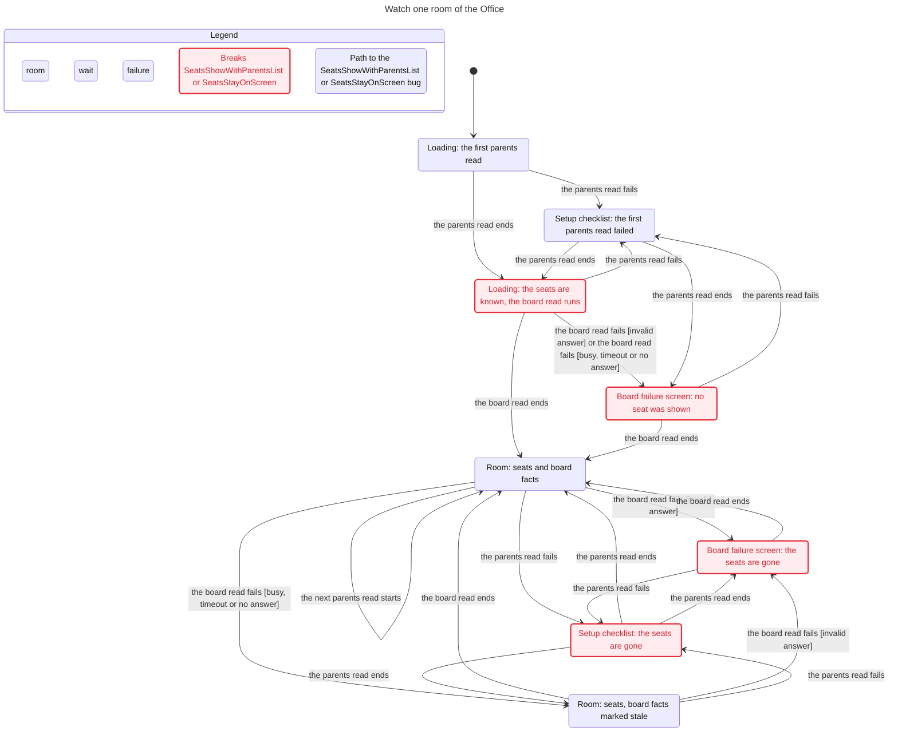
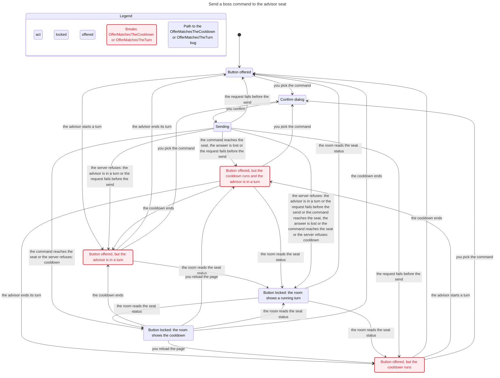
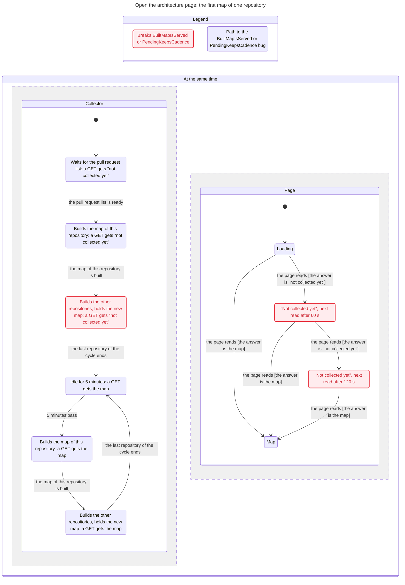
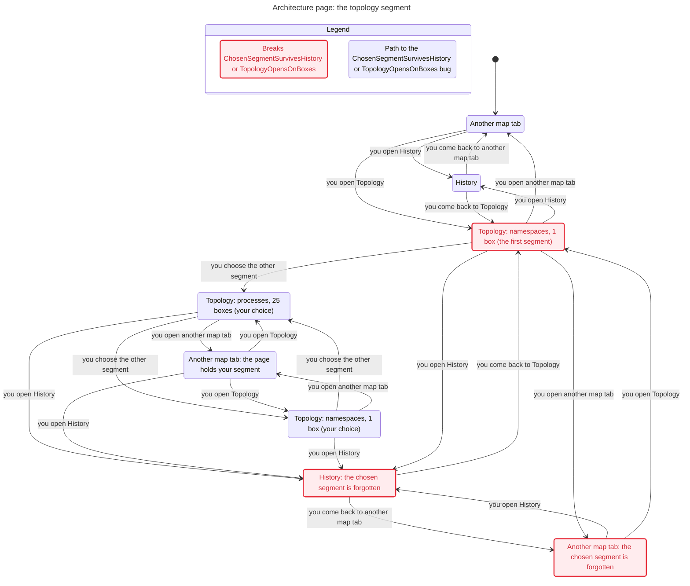
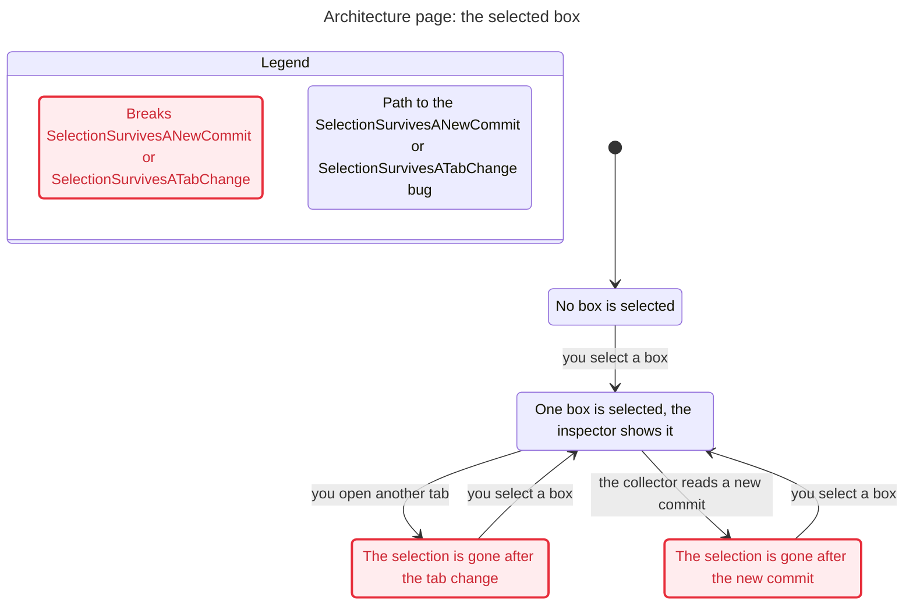

# State machine trial: TLA+ models, statecharts and the fit with the archctx state-machine kind

Date: 2026-11-10. Base: main `c9af3b0`. Earlier note: `docs/researches/20261110-board-office-sync-and-architecture-views.md`.
Method: the pstack skills `create-formal-verification-skill` and `statechart` (cursor/plugins `de8ee15`, read as text and followed by hand: this session cannot install a Cursor plugin).
Tools: TLC of TLA+ 1.7.4 (the jar that `scripts/contract-closeout-tla.sh` pins), OpenJDK 21, the `statechart` script of pstack on Node 22.23.4, pele 1.9.0 for the SVG files.
Host: Linux container. Each count is from a run in this container.

## Verdict

| Question | Finding |
|---|---|
| Does a state machine model find what the reading did not? | Yes, in the least tested machine. The resident collector publishes the result of one repository only when the last repository of the cycle ends (the architecture map, tests and docs collectors). The collector test passes with each of its three close guards removed. Both were not in the earlier note. |
| What does it cost? | 7 models, 28 TLC configs, one command, 26 s. The largest model has 72,018 states. |
| Where does it add nothing to the tests? | The console read loop and the boss command send: the unit tests fail for each of their 7 guard removals. The models add each order of the steps and the crash at each step boundary. |
| Does it fit the architecture model? | The repository has the slot: `extensions.behaviorSpecs` on a model node, one TLA+ spec (`specs/tla/ShipCloseoutClaim.tla`), a hand-composed behavior board in `archimap.html`. 6 of the 7 new models fit the declared kind `archcontext.state-machine/v1` that archctx plans; the boss command send does not. |
| Does it find refactoring candidates? | It makes two known ones exact. The 11 resident collectors are one machine with three policy points (publish, keep on failure, first-cycle gate), and 3 of them share the publish defect. The console readers are one loop with two refusal rules. |

## 1. Models

Each model header maps its actions to code lines at the base. `specs/tla/checks.tsv` holds the expectation of each config. `specs/tla/check.sh` runs them.

| Model | Code | States | Rules that hold | Rules that the code breaks | Guards with a fix-off config |
|---|---|---|---|---|---|
| `ObservationLoop` | `src/operator-web/useObservationRefresh.ts:16-62` | 80 | 5 | `RefusalKeepsCadence` with the board, parents, overview and map readers | 4 |
| `ResidentCollector` | `src/effects/operator/architecture-map-collector.ts:126-168` | 155 | 4 | `CollectedResultIsServed` | 4 |
| `BossCommandSend` | `src/effects/operator/write-run.ts:145-197`, `advisor-seat-route.ts:126-224` | 72,018 | 4 | none | 3 |
| `OfficeRoomFlow` | `src/operator-web/BoardPage.tsx:449-468`, `board-view.ts:53-132` | 29 | 0 | `SeatsShowWithParentsList`, `SeatsStayOnScreen` | design configs |
| `BossCommandFlow` | `src/operator-web/BoardOffice.tsx:294-356`, `office-boss.ts:36-62` | 64 | 1 | `OfferMatchesTheTurn`, `OfferMatchesTheCooldown` | none |
| `ArchitectureFirstMapFlow` | the collector and `src/operator-web/ArchitectureMap.tsx:51-65,292-313` | 76 | 0 | `BuiltMapIsServed`, `PendingKeepsCadence` | design configs |
| `ArchitectureMapsFlow` | `ArchitectureWorkspace.tsx:245-333`, `ArchitectureMap.tsx:286-325` | 70 | 0 | 4 view-state rules | design configs |

A fix-off config turns one guard of the code off and must make TLC report the rule that the guard protects. One such run found an error of the model, not of the code: the first collector model had one guard for the loop head (line 134) and the publish (line 140), and `no-publish-close-check` passed. The code has two guards. The corrected model has two.

## 2. What the tests reach

Each row removes one guard from the real code, runs the tests of that code with `bun run test:files`, and restores the file.

| Code | Guard removed | Tests | Model |
|---|---|---|---|
| `useObservationRefresh.ts:36` | `\|\| active` | 2 of 5 fail | `OneUnsettledRead` breaks |
| `useObservationRefresh.ts:45` | the queued request | 2 of 5 fail | `NoLostRefresh` breaks |
| `useObservationRefresh.ts:46` | `schedule()` | 4 of 5 fail | `LoopAlive` breaks |
| `useObservationRefresh.ts:51` | `latest?.abort()` | 1 of 5 fails | `HiddenIsQuiet` breaks |
| `architecture-map-collector.ts:134` | `if (closed) return` in the loop | 1 of 1 passes | `NoChildAfterClose` breaks |
| `architecture-map-collector.ts:140` | `if (closed) return` before the publish | 1 of 1 passes | `NoPublishAfterClose` breaks |
| `architecture-map-collector.ts:146` | `if (closed) return` before the timer | 2 of 2 pass | `ClosedIsQuiet` breaks |
| `advisor-seat-route.ts:127` | an intent with no result counts | the boss command test fails | `CooldownHolds` breaks |
| `advisor-seat-route.ts:130` | `reconcile_required` counts | the boss command test fails | `CooldownHolds` breaks |
| `write-run.ts:153` | the request lookup | 3 write-channel tests fail | `OneSendPerRequest` breaks |

Tests: `tests/operator-web/operator-interactions.test.tsx` (`bounded observation lifecycle`), `tests/cli/operator-serve.test.ts` (`the collector is pending, then serves the child map`, `architecture map`, `boss commands`), `tests/effects/operator-write-channel.test.ts`.
The close guards of the other 10 collectors were not tried.

## 3. Findings

| # | Rule | The code breaks it in this way | Harm | State |
|---|---|---|---|---|
| F1 | `RefusalKeepsCadence`, `PendingKeepsCadence` | A reader returns `false` for a typed refusal, and "not collected yet" is a refusal. | A 60 s or 120 s cycle after one refusal. | known: #2149, #2151 |
| F2 | `CollectedResultIsServed`, `BuiltMapIsServed` | `states = next` runs after the last repository: `architecture-map-collector.ts:141` and `tests-collector.ts:290` (one repository at a time), `docs-collector.ts:150` (all repositories in parallel, so each waits for the slowest). `execution-collector.ts:108` has one child for all repositories, so no repository waits there. | The first map of each repository waits for every repository. One child at its limit (120 s + 20 s + the termination grace) holds all maps back for that time, in each cycle. | new |
| F3 | the three close guards | No test fails when a guard goes. | A later change can start a child or a timer after `operator serve` closed the collector, with no failed check. | new: a test gap |
| F4 | `SeatsShowWithParentsList` | The room waits for the board read. | A loading screen for the time of the board read. | known: #2149 |
| F5 | `SeatsStayOnScreen` | A failed parents refresh sets the view to `failed` (`board-view.ts:126`), and the page shows the setup checklist. A board refusal outside `STALE_BOARD_KEPT` shows the failure screen. | The seats go away for 60 s after one failed parents refresh. #2149 does not change this. | new: the owner decides the rule |
| F6 | `TopologyOpensOnBoxes` | The first segment is `namespace`. | One box on an empty canvas. | known: #2151 |
| F7 | `ChosenSegmentSurvivesHistory` | The lens, the flow and the segment are state of `ArchitectureMap`. The History and Modules tabs unmount it. | A visit to History sets them back. | new: the owner decides the rule |
| F8 | `SelectionSurvivesATabChange`, `SelectionSurvivesANewCommit` | The selection is state of each canvas, and the key of a canvas holds the commit. | The inspector closes at a tab change and when a commit lands. | the tab change was in the earlier note; the commit is new |
| F9 | `OfferMatchesTheTurn`, `OfferMatchesTheCooldown` | The button lock reads the advisor status of the last parents read. The cooldown is in page memory, and an answer that does not confirm the send sets none. | The person confirms a command that the server refuses. The server refuses each time: `OneCommandInACooldown` holds. | the turn was in the earlier note; the cooldown is new |

## 4. Charts of the user flows

The `statechart` script made each chart from the TLC state graph and a view module (`specs/tla/*.view.mjs`). A red state breaks a rule. A blue border is the shortest path to a broken rule.

### 4.1 Watch one room of the Office

`Loading: the seats are known, the board read runs` and the two `Board failure screen` states break `SeatsShowWithParentsList`. The two states with `the seats are gone` break `SeatsStayOnScreen`.

### 4.2 Send a boss command

A state with `but the advisor is in a turn` breaks `OfferMatchesTheTurn`. A state with `but the cooldown runs` breaks `OfferMatchesTheCooldown`. The chart does not draw the cancel step.

### 4.3 Open the architecture page: the first map

Config `ArchitectureFirstMapFlow.main-path.cfg`: no failed child. The red collector state breaks `BuiltMapIsServed`. The two red page states break `PendingKeepsCadence`.

### 4.4 Architecture page: the topology segment

`Topology: namespaces, 1 box (the first segment)` breaks `TopologyOpensOnBoxes`. The states with `the chosen segment is forgotten` break `ChosenSegmentSurvivesHistory`.

### 4.5 Architecture page: the selected box

## 5. Fit with the archctx state-machine kind

archctx plans a declared kind `archcontext.state-machine/v1` under `.archcontext/model/state-machines/` (archctx plan of 2026-11-10; ADR-0054 is not written yet): regions of finite states, events that are one step with guards on the other regions, the rules `never` and `final`, a checker in TypeScript with a limit of 100,000 product states, a `stateDiagram-v2` projection into the capability document, anchors with a symbol digest, and a `finding` mark with a tracking issue on a rule. TLA+ stays in a skill.

| Model | Fits | Reason |
|---|---|---|
| The four flow models | yes | 3 to 6 finite variables, 29 to 76 states. Each rule is a forbidden combination. 6 rules need a history variable: a region that no code symbol backs. |
| `ObservationLoop` | yes | Each variable is finite. `min(failures + 1, 2)` is three steps. |
| `ResidentCollector` | yes, for a fixed count of repositories | "For each repository" becomes one region set for each repository. |
| `BossCommandSend` | no | The guards are arithmetic over values that a step writes: `IntentAt(other) + Window > now` over an append-only log and a clock. As enum guards the cooldown is one step for each pair of times. |
| `ShipCloseoutClaim` (in the repository) | no | 1,348,960 states with two ships and two recoveries. |

Three facts for that design:

- The fix-off run found a wrong model that was green (section 1). A declared machine with no such run cannot show that a rule is able to fail.
- Three flows ran in two or three designs: as built, with the open issue, and a target (`OfficeRoomFlow.issue-2149.cfg`, `keep-seats.cfg`). The result names what an issue leaves open: #2149 does not repair `SeatsStayOnScreen`. A kind with no constants holds one design.
- The `finding` mark with a tracking issue is the same record as the `finding` rows of `specs/tla/checks.tsv`: a rule that the code breaks stays in the check, and the check fails when the rule starts to hold.

What repo-harness reads from archctx today, and what a new debt check changes:

| Reader | Code | Effect of a new debt kind or check |
|---|---|---|
| The debt report decoder | `src/core/architecture/projection.ts:194-203`: the schema of the pinned `archctx-contracts` | None, when `archctx` and `archctx-contracts` move in one pin change (`package.json:109-110`, both `0.12.0`). |
| The architecture map worker | `src/effects/operator/architecture-map-worker.ts:352-375`, `ARCHITECTURE_DEBT_KINDS` at `src/core/operator/architecture-map.ts:121` | An item of a kind outside the three listed kinds makes the debt part `unavailable: archctx_failed`. |
| The edit-time notice of the hook | `src/cli/hook/agent-notice.ts:34`: three kinds; `archctx checkpoint` with a 3 s limit (`src/effects/architecture/archctx-provider.ts:540`) | The agent that edits an anchored symbol gets no line for a new kind. A checkpoint above 3 s is `RH_ARCHCTX_TIMEOUT`. |
| The behavior board of the map | `assets/skills/repo-harness-archimap/scripts/measure.ts:131-179`, `references/boards.md` section 7 | The board is hand-composed from `extensions.behaviorSpecs`. A declared machine has no board. |
| The docs page | `src/operator-web/DocsMarkdown.tsx:24-34`: mermaid 12.3.0, `securityLevel: 'strict'` | A projected `stateDiagram-v2` is one more diagram of a capability document. Not rendered in this trial. |

## 6. Limits

- A model is a hand description of the code. The header table and the fix-off configs are the only link. Nothing fails when the code changes and the model does not.
- The flow rules are candidate rules. The owner approved none of them.
- `BossCommandSend` has one binding, three calls, one crash and one server process. The lock code and the free-text route are not in it.
- `ResidentCollector` reads one of 11 collectors.
- No model has time: `PendingKeepsCadence` is a rule about the order of the waits.
- GitHub draws the charts of section 4 with its own Mermaid version. The SVG files of the trial came from pele.

## Reproduce

- Checks: `TLA2TOOLS_JAR=<tla2tools.jar of TLA+ v1.7.4> bash specs/tla/check.sh` (26 s; Java 11 or later).
- Charts: the pstack `/statechart` skill on a spec of `specs/tla`, with its config and its view module.
- Guard removals: remove the line of section 2, then `bun run test:files <test file> --timeout 60000 --max-concurrency 1`.
- Skills: `.claude/skills/verify-office-sync`, `verify-architecture-map` and `verify-boss-command` hold the coverage record and the sync commit of each area.
