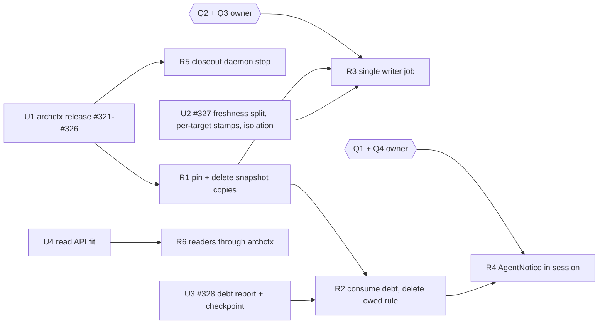

# Plan: 以「架构债」重建架构闭环（epic #690）

> **Status**: DRAFT。只是设计，不含实现代码。§8 的问题要 owner 决定。每个子 issue 开工前还要单独 GO。
> **Created**: 20261014-0209
> **Slug**: architecture-debt-loop-690
> **Artifact Level**: epic design
> **Baseline**: `main@f7ffaef7`（含 #728 `bd05ddd9`）
> **Branch**: `docs/arch-debt-design-690`
> **Refs**: #690。已关闭的子项：#675（#702）、#676（#706）、#677（#707）、#678（#708）、#679（#716）、#680（#715）、#688、#689（#728）。#722 是一次手工投影刷新。
> **Upstream**: Ancienttwo/arch-context#321–#326 已在上游关闭，但 npm 上最新的 `archctx` 仍是 0.7.2（2026-10-12 发布），这些修复还没有发布。#327 和 RFC #328 仍是 OPEN。
> **Verification Boundary**（本文档）：链接和范围检查。不跑产品测试。
> **Rollback Surface**: 只增加这一个文件。`git revert <squash-commit>`。

## 0. P1 / P2 / P3

**P1 现状**
- archctx 0.7.2 是架构事实的引擎：模型 `.archcontext/model/**`、ownership（`resolve`）、flow proof（`flows check`）、引用检查（`docs anchors`）、依赖矩阵（`deps`）、重构扫描（`refactor scan`）、投影写入（`projection run`）。
- repo-harness 通过 #728 的 `ArchctxClient`（`src/effects/architecture/archctx-provider.ts:194-229`）调用 archctx。projection、refactor 和 ownership 三个消费者共用这一个 transport。
- 生成文档在 `docs/architecture/`。manifest `.projection-manifest.json` 有 43 个 target：37 个 `entity-summary`、1 个 index、1 个 decision index、1 个 changelog，都是 `ownership: mixed`；3 个图表是 `generated`。mixed 文件里，生成区由 `<!-- BEGIN ARCHCONTEXT:generated ... -->` 标记包住，标记外是人写的文字。
- 写入者是 PR 作者。Agent 在同一个分支里跑 `repo-harness architecture-projection apply --json`，再提交 `docs/architecture/`（`docs/reference-configs/external-tooling.md:1068-1075`，`assets/skill-commands/repo-harness-architecture/references/worker.md:73`）。
- 会话内信号来自 repo-harness 自己的 owed 规则（`src/effects/state/owed-capabilities.ts`），不来自 archctx。
- CI 有两条非 required 的 lane：PR advisory 和 daily freshness（`.github/workflows/ci.yml:149-170`、`:199-226`，`scripts/check-ci.sh:95-135`、`:168-185`）。所有 workflow 都是 `contents: read`（`ci.yml:12`），没有一个 job 写 main。

**P2 追踪**（一次逻辑修改，今天的真实路径）
1. Agent 修改 `src/effects/state/resolve-effective-state.ts` 里一个函数的逻辑。没有新依赖，flow proof 不变。
2. 首次编辑这个路径时，PreToolUse.edit（`mutation-guard.ts:120-137`）输出 `[CapabilityOwner] <path> belongs to <id> (<doc>)`。
3. Claude Stop：`stop-handler.ts:119-148` 调 `owedCapabilities`。规则是「owned path 在 manifest 最后一次变更之后改过」。这次修改命中规则，所以输出 `[ArchitectureOwed] ... Next: repo-harness architecture-projection check --json`。
4. Agent 跑 `check`（45-76 s，需要 CodeGraph index）。结果是 `planned`，`files` 只有 manifest，`freshness.staleNodes` 有一个节点，原因是 `projection-source-changed-since-stamp`。
5. Agent 跑 `apply`（48 s 以上）。唯一的变化是 manifest 里的几个 hash。
6. 另一个 PR 改了别的 capability，也跑了 `apply`。两个 PR 在 manifest 的全局 digest（`sourceDigest`、`provenance.sourceTreeDigest`、`projectionDigest`、`receiptDigest`）上冲突。
7. 如果 Agent 换成加一条未声明的跨 capability import，第 3 到 5 步完全一样。真正的问题不会出现。
8. 压力点：度量是源文件字节戳，不是需要人决定的事实；写入者是每个 PR，不是一个机器。

**P3 决定**
- 架构债的定义、计算、严重度和身份都归 archctx。repo-harness 只通过 `ArchctxClient` 读取一个带版本的债务报告。
- 生成文档变成构建产物。一个 post-merge job 是唯一写入者。PR 只改模型和人写文字。
- 会话内只投递「当前 diff 引入的债」和「被触及 capability 的高危旧债」。字节戳漂移永远不投递。
- 每一步都删代码。不加 fallback，不保留 owed 规则和债务规则两套权威。
- 为什么现状是这个形状（推断）：0.7.2 只提供字节戳 freshness，没有债务接口，也没有 render-equality 检查；PR 作为更新单元是当时唯一能保证文档与代码同步合入的办法。这些前提在 #327、#328 落地后不再成立。
- 10 倍规模时先坏的：PR 上的 manifest 冲突（与并发 PR 数成正比）和每次 `check` 的全量构建时间。本设计把两者都移出 PR 路径。

## 1. 问题

### 1.1 度量错误：freshness 是字节戳

- archctx 的 freshness 比较每个 target 的 `sourceFootprintDigest` 戳和当前文件内容 digest。结果是 `freshness.staleNodes[{nodeId, stampedDigest, currentDigest}]`，原因码 `projection-source-changed-since-stamp`（archctx-contracts `projection.ts` 的 `PROJECTION_FRESHNESS_REASON_CODES`）。
- repo-harness 只解码这个结果（`src/core/architecture/projection.ts:98-108`）。
- repo-harness 还有第二个更粗的度量。`owed-capabilities.ts:62-117` 用 `git log` 找 manifest 最后一次变更，任何 owned path 在它之后变过就算 owed。这个规则不问 archctx。它的文件头写着「owed capability 一定 stale」，所以每次逻辑修改都会产生 owed。
- 这个规则有 5 个消费者：`state owed` CLI（`src/cli/commands/state.ts:243-262`）、SessionStart（`src/cli/hook/session-context.ts:96-108`、`:165`）、Claude Stop（`stop-handler.ts:119-148`）、Pi PostToolUse.bash（`src/cli/hook/command-observed.ts:131-145`）、PR advisory lane（`scripts/check-ci.sh:95-135`）。
- 在 `e2e2fef6` 上，10 个 stale 节点里有 9 个只需要新 hash。唯一真实的问题（#688 的 flow proof）被淹没，还挡住了其他所有戳（arch-context#327 finding 3）。

### 1.2 写入者错误：每个 PR 都写生成文件

- 生成文件由 PR 作者在分支里写。manifest 有 7 行全局 digest，每次 apply 都变（arch-context#327 finding 4）。两个改不同 capability 的 PR 一定冲突。
- 模型变化还会改 6 个仓库级文件（index、changelog、decision index、3 个图表）的 `sourceDigest` 标记，即使它们的输出没变。
- 结果是 #722 这样的手工刷新 PR：14 个 stale 节点，Agent 手工跑 apply，PR 里只有生成文件。
- daily lane 在 stale 时失败（`check-ci.sh:168-185`），repair issue 的动作行由 `scripts/report-ci.ts:65-80` 按 manifest-only、rendered 等状态映射。这些行都在描述字节戳。

### 1.3 接收者和时机错误

- 今天会话内的信号内容是「你欠文档」，不是「你引入了什么问题」。
- Claude：SessionStart 和 Stop 能收到 owed 信号。
- Codex：Stop 必须静默（`src/cli/hook/hook-protocol.ts:67-70`）。`PostToolUse.bash` route 只装给 Pi（`src/cli/hook/route-registry.ts:94-100`）。所以 Codex 在修改之后、会话之内只收到编辑时的 ownership 行，owed 段落要等下一次 SessionStart。
- PR advisory lane 先看 owed，再跑约 100 s 的 `check`，然后报 stale 节点。它报的还是字节戳。

### 1.4 第二权威还在

#702、#706、#707、#728 已经删掉一部分副本（见 §6.3）。仍然存在的副本：

- 快照 walker 和第二个 digest 权威（`archctx-provider.ts:36-52`、`:450-525`）。
- 5 个独立的模型 YAML 读取器（§6.1 第 6 项）。
- registry 的 archcontext 翻译和 include anchor 语法（`src/core/capabilities/registry.ts:597-605`、`:635-841`）。
- 从生成文档里按标题正则切 §3 和 backlog（`src/core/architecture/module-view.ts:88-89`）。
- 本地的 renderer floor 判断和输出回读（`archctx-provider.ts:360-376`，`src/effects/architecture/projection-apply.ts:39-51`）。

## 2. 架构债的定义

### 2.1 定义

**架构债**是一个需要人或 Agent 做决定的架构事实。它有稳定的身份，有证据，有修复位置（模型字段或代码），并且能被 archctx 从模型、code facts 和工作树确定地算出来。

**不是债**：

| 现象 | 归属 | 处理 |
| --- | --- | --- |
| 戳漂移：戳旧了，渲染结果不变 | 机器 | 唯一写入者顺手重写戳，或者戳被删除（#327） |
| 渲染漂移：渲染结果不等于已提交的字节 | 机器 | 唯一写入者修复（§4） |
| code facts 不可用（无 CodeGraph index） | 覆盖度 | 报告里的 `coverage` 字段写明。不能把「没算」读成「没债」 |
| 仓库级重构 backlog | backlog | 按固定周期审阅（#675 的结论）。会话内只显示被触及 capability 的高危 open 建议 |
| `adoption-required` | 安装状态 | 走 `architecture-projection status` 的 `next` |

### 2.2 债的种类（闭合枚举，archctx 拥有）

| kind | 今天的 archctx 来源 | 计算 | 默认 severity | 身份 key | 修复位置 |
| --- | --- | --- | --- | --- | --- |
| `undeclared-dependency` | `deps` 的 import 边；未声明判定在上游 #326（PR arch-context#330，未发布） | A 的文件 import B 的文件，且模型里没有 A→B 的 relation | medium；形成新环时 high | `undeclared-dependency/<fromCapability>/<toCapability>` | 模型 `relations`，或移动代码 |
| `proof-failure` | `flows check`；manifest `semanticState.capabilities[].proofStatus` | required flow 的 entrypoint、sink 或 step selector 不是 `proven` | high；只阻塞自己 capability 的 target | `proof-failure/<flowId>/<selectorId>` | 模型 `flows[].steps` 的 selector，或代码 |
| `stale-citation` | `docs anchors`（`missing-path`、`line-out-of-range`、`missing-symbol`） | 人写区或节点 prose 里的引用不再成立 | low；在被触及 capability 的文档里为 medium | `stale-citation/<nodeId 或 targetId>/<sha256(引用原文)>` | 人写文字 |
| `ownership-gap` | `resolve`；ChangeSet `ownership-delta`（`becameUnowned`、`becameContested`） | 声明的源根下出现无主文件；或多个 owner 且没有 `owningCapabilityId` | medium | `ownership-gap/<path>` | 某个 capability 的 `source.include` / `source.exclude` |
| `practice-regression` | `practices` / `checkpoint`（例如 `modularity.no-new-cycle`），waiver 已有 | ratchet 指标比 base 变差 | 由 practice 定义 | `practice-regression/<practiceId>/<subject>` | 代码，或带期限的 practice waiver |
| `render-blocked` | projection `humanActions`：`manual-region-conflict`、`target-collision`、`orphaned-document-review` | 唯一写入者无法写这个 capability 的 target | high；只阻塞自己的 target | `render-blocked/<reasonCode>/<targetId>` | 人写文字或模型 |

说明：
- `unprovable-required-flow` 归入 `proof-failure`。`unresolved-major-change` 不进枚举：apply 总是带 `acceptObservedMajorChange`（#728）。按 archctx-contracts 的 `majorChangeAcceptance` 合同，这个标志被拒绝时结果一定是 `declined-unprovable-proof` 加 `unprovable-required-flow`，也就是 `proof-failure`。
- `stale-citation` 依赖上游先修 #327 finding 6（selector id 和 `owner/repo#N` 被误报）。修好之前，这一类只进 daily 报告，不进会话。
- 新 kind 只能由 archctx 增加。repo-harness 遇到未知 kind 时按通用格式显示，不丢弃，不推断含义。

### 2.3 两个独立的维度

- `severity`（`high | medium | low`）：由 archctx 按 kind 和证据决定。repo-harness 不改它。
- `origin`（`introduced | existing`）：archctx 在同一范围内分别算 base 和 head 的债，再按身份 key 做集合差。`introduced` 表示当前 diff 引入。
- 投递规则（§5）只按这两个字段和 `capabilityIds` 选择条目。选择是渠道预算，不是语义判断。

### 2.4 身份与稳定性

- `debtId = <kind>/<subject>`。subject 优先用模型 id（capability、flow、selector、practice）。只有主体本身是文件时才用仓库相对路径。
- 身份里不能有：行号、worktree 绝对路径、分支名、时间戳、request id。#321 证明了绑定 worktree 路径和分支的 id 会让决定在 worktree 删除后丢失。
- `evidenceDigest` 跟随证据变化。证据变了，身份不变；同一条债的新证据不算新债。
- 决定（接受、推迟、waiver）由 archctx 存在 Git 里，按 `debtId` 关联（#321 的路径无关 id）。repo-harness 不保存决定，也不按决定过滤。

### 2.5 计算范围与预算

- 会话和 PR：`--base <sha>` 加 changed paths。archctx 只计算这些路径所属 capability 的债，base 和 head 各算一次。
- daily：仓库全量。
- 预算：会话内一次计算 p95 小于 3 s，在进程内完成，不需要 daemon（RFC #328 §1、§4）。超过预算按 epic 的 falsifier 处理：会话内只保留 ownership 和 citation，完整债务移到 PR check。
- code facts 不可用时，`undeclared-dependency`、`proof-failure`、`practice-regression` 标为 `coverage: unavailable`，ownership 和 citation 照常计算。

## 3. 数据模型与权威切分

### 3.1 报告合同草案（由 archctx-contracts 定义）

字段名是给上游的建议，最终以 archctx-contracts 为准。

```text
ArchitectureDebtReportV1
  schemaVersion      "archcontext.architecture-debt-report/v1"
  scope              { kind: "changed-paths" | "repository", baseSha | null, headSha, worktreeDigest, changedPathCount }
  coverage           { codeFacts: "complete" | "partial" | "unavailable", reasonCodes[] }
  items[]            DebtItemV1，按 severity、origin、debtId 排序
  blockedCapabilities[]   被 proof-failure 或 render-blocked 阻塞 target 的 capability id
  relatedRecommendations[]  被触及 capability 的 open 高危重构建议 id（来自 recommendations ledger）
  omittedCount       超出 --max-items 的条目数
  actionsRequired[]  只在 complete 结果里出现；失败时至少一条

DebtItemV1
  debtId, kind, severity, origin
  capabilityIds[]    排序，去重
  summary            一句话，<= 160 字节
  evidence           { kind, totalCount, truncated, items[] }，有界
  fix                { modelField | null, nodeId | null, command[] | null }
  evidenceDigest
```

`fix.command` 是 argv 数组，不是 prose。repo-harness 不解析它，只把开头的 `archctx` 换成 `architecture-projection status --json` 给出的 managed command（`projectionProvider.command`），因为 shipped 文字里不允许裸 `archctx`（#715）。

### 3.2 archctx 命令（上游决定名字）

| 用途 | 建议命令 | 运行方式 |
| --- | --- | --- |
| 会话内债务 | `archctx checkpoint --base <sha> --changed-path <p>... --json` | 进程内，只读，< 3 s |
| PR 判定 | `archctx complete --base <sha> --head-sha <sha> --json` | 进程内，只读，带 `actionsRequired` |
| daily 全量 | `archctx checkpoint --scope repository --json` | 进程内，只读 |
| 渲染等价 | `archctx projection freshness --json`（#327 Expected） | 进程内；戳状态不需要 code facts，渲染等价需要 |
| 唯一写入 | `projection run` mode `apply` | daemon 持有写锁 |

0.7.2 已有 `checkpoint`、`prepare`、`complete`，但它们走 daemon，返回 practice checkpoint，不返回上面的债务报告。

### 3.3 谁拥有什么

| 事项 | archctx | repo-harness |
| --- | --- | --- |
| 快照身份和 worktree digest | 拥有（#323） | 不计算，原样传递 |
| ownership、依赖、proof、引用、practice | 拥有 | 不解析模型 YAML |
| 债的种类、severity、origin、身份 | 拥有 | 不改，不重排语义 |
| 决定和 waiver | 拥有，存 Git | 只转发用户命令 |
| 渲染、manifest、freshness | 拥有 | 不读 manifest 字段 |
| 什么时候算、给谁、走哪个 host 渠道 | 不管 | 拥有（hook 事件、CI job、Bot） |
| 渠道预算、去重、截断文字 | 不管 | 拥有（`AgentNotice`） |
| 生命周期绑定（worktree、PR、closeout） | 提供命令 | 拥有调用时机 |
| advisory 还是 required | 不管 | owner 决定（§8 Q5） |

### 3.4 repo-harness 一侧的形状

- `ArchctxClient` 增加一个类型化方法读取债务报告。解码器用 archctx-contracts 的 schema 和 invariant，和 `src/core/architecture/projection.ts` 现有的 decode 方式一致。没有第二个 transport。
- 一个 CLI 读模型：`repo-harness architecture debt --json [--base <ref>]`。它给 CI、Bot 和人用，输出就是 archctx 报告本身加上 repo-harness 解析出的 base。它替换 `state owed`。
- 失败时报 `ArchctxClientError` 的 `code`、`action`、`reasonCode`。不退回 owed 规则，不用 git 历史推断。

### 3.5 不变量

- **D1** 每个架构事实只有一个权威：archctx。
- **D2** repo-harness 只按 `origin`、`severity`、`capabilityIds` 选条目，不改语义。
- **D3** 失败时关闭，带类型化原因。没有 fallback。
- **D4** 覆盖度写明。`coverage: unavailable` 不能显示成「无债」。
- **D5** hook 里不跑 projection、apply 或仓库级扫描。只允许有预算的只读 `checkpoint`。

## 4. 生成文档的唯一写入者

### 4.1 事实

- 43 个 target 里 40 个是 `mixed`：同一个文件里既有生成区，也有人写的 §3 决策和 backlog。只有 3 个图表是纯生成文件。
- `docs/architecture/` 下还有不在 target 里的人写文档（例如 `effective-state-authority.md`）。
- repo-harness 是模板。下游仓库通过 adoption 得到同样的 `docs/architecture/` 形状。
- 所有 workflow 都没有写权限。用 `GITHUB_TOKEN` 创建的 PR 和 push 不会触发新的 workflow run，所以 bot PR 上的 Required / CI 不会自己运行。

### 4.2 选项

| | A. post-merge job 写 main | B. 不提交，按需渲染 | C. 现状：PR 作者写 |
| --- | --- | --- | --- |
| 写入者 | 一个 job，串行 | 没有已提交的生成字节 | 每个 PR |
| PR 冲突 | 无（PR 不碰生成区） | 无 | 每对 PR 都冲突 |
| mixed 文件 | 保持不变 | 必须先把人写区迁出 40 个文件 | 不变 |
| GitHub 上浏览 | 能看到，落后 main 一个 job | 看不到生成区和图表 | 能看到 |
| 下游模板 | 加一个可选 workflow | 改变下游合同 | 不变 |
| 权限 | 需要能触发 CI 的 bot 凭据（§8 Q3） | 不需要 | 不需要 |
| 一个 capability 证明失败 | 只挡它自己的 target（需要 #327） | 渲染时报错 | 挡住所有戳 |
| Agent 的任务 | 无 | 无 | 每次逻辑修改都要 apply |
| 前置条件 | #327 | #327 加人写区迁移设计 | 无 |

### 4.3 推荐：A，用滚动 bot PR 加 auto-merge

理由：
- B 要先把 40 个 mixed 文件里的人写区迁出去。这是一次大的格式迁移，还会改变下游合同。A 不需要。
- A 让 Agent 完全不再跑 apply。PR 只改模型和人写文字。
- 用滚动 PR，不直接 push main。分支保护不用开 bypass。生成提交照样过 Required / CI，并有审计记录。

job 设计：
1. 触发：`push` 到 main、每日 schedule、`workflow_dispatch`。`concurrency: architecture-render`，不取消正在运行的 job。
2. 在 main 的这个 SHA 上：`bun install --frozen-lockfile`，`codegraph init`，`repo-harness architecture-projection apply --json`。
3. 没有文件变化：结束。有变化：从这个 SHA 创建或重置 `bot/architecture-render` 分支，提交，强推这个 bot 分支，创建或更新唯一的 PR，打开 squash auto-merge。
4. main 在 job 运行期间前进：下一次 job 重新生成，覆盖 bot 分支。job 是幂等的。
5. 某个 capability 被 `proof-failure` 或 `render-blocked` 挡住：其他 capability 照常写（需要 #327 的 capability 隔离）。被挡的 capability 进入 job summary 和 daily repair issue，issue 写明 debtId 和修复命令。
6. job 只写生成区和 manifest。人写区由 archctx 的 region 合同保护。

PR 一侧的规则：
- PR 不改生成区和 manifest。PR check 用 archctx 判断 diff 是否手改了生成区（上游需求，见 U2），手改时给 `::warning::`。repo-harness 不自己解析标记。
- main 上的 freshness 定义为「渲染结果等于已提交字节」。daily lane 检查这个等式。不相等时，repair issue 报告写入者失败（job 失败、bot PR 未合入或被挡的 capability），不列 stale 节点。

如果 owner 不批准 bot 凭据（Q3），选 B，并为人写区迁移单独出设计。不保留 C。

## 5. 会话内信号路径

### 5.1 `AgentNotice`

- 一个模块负责架构提示：选条目、截断、去重、文字格式。它替换 `renderOwedCapabilities`、`owedStopSignal` 和 SessionStart 的 `architecture-owed` provider。
- host 渲染不重复实现。runtime 已经在一个地方决定输出形状（`hook-protocol.ts:44-93`）：Claude 和 Codex 用 `hookSpecificOutput.additionalContext`，Codex Stop 输出为空，Pi 用 `additional_context`。`AgentNotice` 只产出文本。

### 5.2 事件

| 事件 | host | 条件 | archctx 调用 | 内容 |
| --- | --- | --- | --- | --- |
| SessionStart | Claude、Codex、Pi | 分支相对 `review_base` 有 owned path 变化 | `checkpoint --base` | introduced 债，加被触及 capability 的 high existing 债 |
| PreToolUse.edit | Claude、Codex | 同今天 | 无新调用 | 保留 `[CapabilityOwner]` 一行（`mutation-guard.ts:120-137`）。不算债 |
| Stop | Claude | 本轮有 owned path 变化，且 `stop_hook_active` 为假 | `checkpoint --base` | 同 SessionStart；集合没变时不输出 |
| UserPromptSubmit | Codex | 同 Stop | `checkpoint --base` | 同 Stop。原因：Codex Stop 必须静默，`PostToolUse.bash` 只给 Pi（§8 Q4） |
| PostToolUse.bash | Pi | `git commit` 成功之后 | `checkpoint --base` | 同 Stop |
| PR | CI | PR 有 owned path 变化 | `complete --base` | 每条债一个 `::warning::`，非 required |
| daily | CI | 每天 | 仓库全量 | repair issue 写明 debtId、capability 和修复命令；渲染不等价时另报写入者失败 |

`review_base` 来自 policy `.worktree_strategy.review_base`（默认 `main`，`resolve-effective-state.ts:214`）。

### 5.3 内容格式

示例（flow 和 selector id 是虚构的）：

```text
[ArchitectureDebt] 3 new in capability.workflow-engine.workflow-state
- undeclared-dependency capability.workflow-engine.workflow-state -> capability.runtime-harness.hook-adapters: src/effects/state/x.ts imports src/cli/hook/y.ts. Fix: add relation in relations, or move the import. Run: repo-harness architecture debt --json
- proof-failure capability.workflow-engine.workflow-state flow.workflow-state.resolve/step.2: selector is no-direct-call. Fix: flows[].steps selector. Run: "$NODE" "$ARCHCTX" flows check --json
(+1 more: repo-harness architecture debt --json)
```

- 最多 3 条，总长不超过 800 字节。
- 每条都有 capability、模型字段和修复命令。这是 epic 的第一证明点要求的三项。
- SessionStart 段落继续占用现有的 1,500 token 预算（`session-context-budget.ts:33`），优先级沿用 `architecture-owed` 的位置。

### 5.4 噪声控制

- 戳漂移和渲染漂移永远不投递。
- 只投递 `introduced`，加上被触及 capability 的 `high` `existing`。
- 去重 key：`sha256(branch, 排序后的 debtId 列表)`，存在 git 忽略的 `.ai/harness/state/` 下，替换今天的 `stop-owed-signal`。集合没变时不输出。
- 没有债：不输出任何字节。
- `coverage: unavailable`：每个分支和原因码只说一次，带 `action`。
- archctx 失败或超时：不给模型输出。stderr 写一行操作信息（今天的运维行渠道），PR check 是兜底网。

### 5.5 预算

- 每次 archctx 调用用 `ArchctxClient` 的 `deadlineMs`，上限 3 s。现有 hook 总超时是 30 s（`src/cli/installer/managed-entries.ts:77`）。
- 先看 `state resolve` 已经算出的 `capability_ownership`。没有 owned path 变化就不调 archctx。今天 hook 里已经有 `archctx resolve` 进程，所以这不是新的进程类型。
- 如果 p95 超过 3 s：会话内只保留 ownership 和 citation 两类，完整债务只在 PR check 出现（epic falsifier）。

### 5.6 生命周期绑定

| 时机 | 动作 |
| --- | --- |
| worktree 创建 | 不调用 archctx。CodeGraph 初始化仍是 worker.md 第 1 步 |
| Stop / UserPromptSubmit | `checkpoint`（只读） |
| PR | `complete`（CI） |
| closeout | `daemon stop`，按 state 目录（#322） |

今天没有任何 daemon 启停绑定在 worktree 生命周期上。closeout 绑定等 #322 发布后再做。

## 6. 删除清单

### 6.1 仍然存在的副本

| # | 代码 | 为什么是副本 | 替代 | 子 issue |
| --- | --- | --- | --- | --- |
| 1 | `src/effects/architecture/archctx-provider.ts:36-52` 忽略集合；`:450-471` `captureArchitectureProjectionSnapshot`；`:510-525` `listProjectionInputFiles`；调用方 `:386-398` 和 `scripts/axr5-archctx-clean-room.ts:121`、`:158` | 第二个快照 digest 权威。#689 的 `.claude/.session-id` 缺陷就出在这里 | archctx 快照 API（#323） | R1 |
| 2 | `src/effects/architecture/archctx-provider.ts:473-508` `architectureAgentContextTargets` | 用 `Bun.YAML` 直接解析节点，只为了把 contract 文件加进忽略集合 | 随 #1 一起删 | R1 |
| 3 | `src/effects/architecture/archctx-provider.ts:360-376` `assertRendererFloor` | 读 manifest 的 `rendererVersion` 并做本地版本比较 | archctx 的最低 renderer 声明（RFC #328 §6） | R2 |
| 4 | `src/effects/architecture/projection-apply.ts:39-51` `verifyArchitectureProjectionOutputs` | 本地重算输出 digest，因为 0.7.2 的 replay 不会重写（#325） | #325 的 replay 语义 | R1 |
| 5 | `src/effects/refactor/archctx-provider.ts:13-24` `checkedRoots` 和自己的 `capabilities` 握手 | 重复 `archctxCapabilities` 的版本检查 | `archctxCapabilities` | R1 |
| 6 | 模型 YAML 读取器：`scripts/capability-resolver.ts:127-150` `readArchcontextNodeFiles`（及 `assets/templates/helpers/capability-resolver.ts` 副本，消费者含 `src/cli/commands/capability-context.ts:194-203`）；`src/effects/state/resolve-effective-state.ts:266-290`、`:425-440` `parseNodeYaml` / `loadArchcontextAuthority`；`src/effects/architecture/model-reader.ts:151-161`（HEAD）、`:277-282`（schema 校验）、`:296-310`（工作树）；加上第 2 项 | 5 处独立解析同一份模型；model-reader 还自己做 schema 校验 | archctx `context` / `export` / `agent-context` 读接口 | R6 |
| 7 | `src/core/capabilities/registry.ts:597-605` `archcontextIncludeAnchor`；`:635-841` `capabilityRegistryFromArchcontextNodes` | 把 archctx 节点翻译成 repo-harness `Capability`，带自己的 anchor 语法 | archctx 的 capability 列表（含 contract 文件）。epic falsifier：如果 anchor 承载真实策略合同（`ContractScopeGuard`、workstream 文档、context block），保留一个只由 archctx 输出喂的薄投影 | R6 |
| 8 | `src/core/architecture/module-view.ts:88-89` `section3FromMarkdown`、`backlogFromMarkdown`；`:5` `MODEL_NODE_KINDS` | 用标题正则切生成文档；本地复制节点 kind 枚举 | archctx context 导出人写区和 kind | R6 |
| 9 | `src/effects/state/owed-capabilities.ts` 整个文件；`state owed`（`src/cli/commands/state.ts:243-262`、`:294-302`）；`src/cli/hook/session-context.ts:96-108`、`:165`；`src/cli/hook/stop-handler.ts:119-148` 和 marker；`src/cli/hook/command-observed.ts:131-145` | 本地 freshness 启发式，按 manifest 提交顺序判定 | 债务报告和 `AgentNotice` | R2、R4 |
| 10 | `scripts/check-ci.sh:95-135` 的 owed 步骤和 stale 警告；`:168-185` 的 stale 即失败；`scripts/report-ci.ts:65-80` 的 manifest-only 等动作行 | 在 CI 里描述字节戳 | `complete` 警告；daily 的渲染等价检查和债务 issue | R2、R3 |
| 11 | 指导文字：`assets/skill-commands/repo-harness-architecture/references/worker.md:73` 和 Coverage 中「apply 并在同一 PR 提交文档」；`{assets,docs}/reference-configs/external-tooling.md:1068-1075`；`{assets,docs}/reference-configs/hook-operations.md:172-175`；`CLAUDE.md` 和 `AGENTS.md` 中「review 前跑 check」那一条；`assets/skill-commands/repo-harness-check/references/architecture-evidence.md` 的 manifest-only 行 | 让 Agent 把写生成文件当任务步骤 | 「处理债务提示；生成文件由 job 写」 | R3 |

### 6.2 不删的东西

- `ArchctxClient` 和 `ArchctxClientError`：唯一 transport。
- `resolveArchcontextCapabilityPaths`（`archcontext-owners.ts`）：已经直接用 `archctx resolve`。
- `[CapabilityOwner]` 编辑时提示：便宜，只来自 archctx。
- `select-agent-context-blocks.sh` 的 registry 模式：那是非 archcontext 的 `capability_source`，不在本 epic 范围。

### 6.3 已经删掉（在 `main@f7ffaef7` 上确认）

- 两次 apply、本地 `acceptedChange` 推导、`/committed projection receipt/i` 正则、`processFailure` 截断（#728）。
- refactor 的 `DECIDED` 过滤、book 读取、先记录再决定（#702）。
- `tests/architecture-projection-e2e.test.ts` 的模型数量钉（#716）。
- DocDrift 遗留 target 和 `minimal-change` 以外的 journal 脏位（#708；#721 删除了整个 `mutation-observed.ts`）。
- archcontext 模式下 selector 的 JSON 回退（#706）。
- Bot 在每次 `done` 跑仓库级扫描的指令。`SKILL.md:29` 现在明确说不要这样做（#702）。

## 7. 迁移与发布

### 7.1 子 issue

上游（arch-context，由 archctx owner 排期）：

- **U1 发布** 含 #321–#326 的 archctx 版本。
- **U2 #327**：freshness 分成戳漂移和渲染漂移；每个 target 一行戳，manifest 不再有全局 digest；capability 隔离；按格式区分标记（JSON 不用注释）；`docs anchors` 修误报；能判断 PR 是否手改了生成区。
- **U3 RFC #328 的债务部分**：`ArchitectureDebtReportV1` 合同；仓库可声明最低 renderer 和协议版本（RFC §6）；进程内 `checkpoint --base --changed-path`，p95 < 3 s；`complete` 的 `actionsRequired`；身份规则 §2.4。
- **U4 读接口确认**：`context` / `export` / `agent-context` 能否覆盖 §6.1 第 6–8 项的读者（人写区、contract 文件、node kind、组件摘要）。不够就在上游补。

repo-harness：

- **R1 升级 pin，删除快照副本**。依赖 U1。删除 §6.1 第 1、2、4、5 项。验收：hook bundle、`architecture-projection` 测试、clean-room 脚本改用 archctx 快照。
- **R2 消费债务报告**。依赖 U3、R1。删除 §6.1 第 3 项（最低 renderer 声明随 U3 的合同一起交付）。`ArchctxClient` 的债务解码；`repo-harness architecture debt --json`；PR lane 改用 `complete`；删除 `state owed` 和 `owed-capabilities.ts` 的 CLI 与 CI 消费者。
- **R3 唯一写入者**。依赖 U2、R1，以及 Q2、Q3。render workflow、bot PR、PR 手改生成区警告、daily 改为渲染等价检查；删除 §6.1 第 10 项的 stale 失败和第 11 项的指导文字。
- **R4 会话内 `AgentNotice`**。依赖 R2，以及 Q1、Q4。替换 SessionStart、Stop、Pi PostToolUse 的 owed 投递，新增 Codex UserPromptSubmit；删除 §6.1 第 9 项剩余部分；更新 #617 相关测试。
- **R5 生命周期绑定**。依赖 U1（#322）。closeout 时按 state 目录 `daemon stop`。
- **R6 读者经 archctx**（#677 剩余部分）。依赖 U4。删除 §6.1 第 6–8 项。

### 7.2 依赖图



建议顺序：R1 → R2 → R4；R3 在 U2 和 owner 决定之后与 R2 并行开发；R5 在 R1 之后任意时间；R6 独立。

发布约束：R3 和 R4 进同一个版本（§8 Q6）。R3 让 PR 不再改 manifest；如果 R4 还没发布，hook 里的 owed 规则会对每次编辑报 owed，并让 Agent 跑 apply，与唯一写入者冲突。

### 7.3 每一步删什么

| 子 issue | 删除 | 新增 |
| --- | --- | --- |
| R1 | 快照 walker、忽略集合、YAML 目标解析、输出回读、refactor 握手缓存 | 无 |
| R2 | `state owed`、owed 规则的 CLI 和 CI 消费者、manifest-only 动作行、renderer floor | 债务解码器、`architecture debt` CLI |
| R3 | 「PR 里 apply」的指导、stale 即失败 | render workflow |
| R4 | owed 的 hook 投递、`stop-owed-signal` | `AgentNotice` |
| R5 | 无 | closeout 的一个调用 |
| R6 | 5 个 YAML 读取器、registry 翻译、标题正则 | 无（只换数据源） |

### 7.4 证明与度量

- 只改逻辑的编辑（无新依赖，proof 不变）：Agent 不收到任何任务。今天它会被要求跑一次 48 s 的 apply，结果只写一个 hash。
- 加一条未声明的跨 capability import，或弄坏一个 flow proof：Agent 在 3 s 内收到一条 `additionalContext` 提示（Claude 在 Stop，Codex 在下一次 UserPromptSubmit），提示里有 capability、模型字段和修复命令。
- 连续 10 个合入的 PR 之后，main 上 introduced 未处理的债保持为 0，生成文件与渲染结果一致。今天最近 5 个 PR 中有 5 个留下漂移。

## 8. 待 owner（Aimpact）决定的问题

1. **#617 与会话内架构内容**。worker 会话要不要收到债务提示？
   推荐：要。提示发给改代码的那个会话，worker 会话也算，因为它手里有上下文。hook 里仍然不跑 projection、apply 或扫描（D5）。`tests/stop-handler.test.ts` 和 `tests/session-context.test.ts` 里钉住旧决定的用例在 R4 中按条修改。
2. **唯一写入者选哪个**。
   推荐：A，post-merge job，用滚动 bot PR 加 squash auto-merge（§4.3）。不直接 push main。
3. **bot 凭据**。`GITHUB_TOKEN` 开的 PR 不触发 CI，所以需要别的凭据。
   推荐：只授权本仓库的 GitHub App installation token，权限 `contents: write` 和 `pull_requests: write`，secret 由 owner 创建和保管。这属于凭据和权限边界，需要 owner 批准。
4. **Codex 的投递事件**。Codex Stop 必须静默，`PostToolUse.bash` 只给 Pi。
   推荐：Codex 用 UserPromptSubmit，带同样的 3 s 预算和去重。不加跨事件的待投递缓存。
5. **PR 债务检查是否变成 required**。
   推荐：保持 advisory。连续 10 个 PR 后看度量；如果 introduced 债仍然累积，再由 owner 决定。今天的规则是架构诊断不阻塞工作。
6. **`minimum_harness_version`**。0.22.1 已经是 npm `latest`，epic 的「发布 0.22.x」已完成。仓库 marker（`.ai/harness/workflow-contract.json`）还没有声明最低版本。
   推荐：R3 和 R4 放进同一个版本发布，marker 的 `minimum_harness_version` 设为这个版本。原因：R3 之后 PR 不再改 manifest，旧 hook 的 owed 规则会对每次编辑都报 owed，并让 Agent 去跑 apply。设了最低版本，旧 hook 只提示升级。
7. **下游仓库**。render workflow 是否随模板发给下游？
   推荐：先只在本仓库运行一个发布周期。之后作为可选模板提供，默认不启用，因为它需要 Q3 的凭据。
8. **`stale-citation` 的会话投递**。
   推荐：上游修好误报（U2）之前只进 daily。之后只在被触及 capability 的文档中作为 medium 投递。
9. **债务计算的 base**。
   推荐：会话用 `review_base` 的 merge-base；PR 用 PR 的 base SHA；daily 用全量。三者都由 repo-harness 解析好 SHA 再传给 archctx。

## 9. 风险

- 上游排期：R2、R3、R4 都依赖还没发布的 archctx 版本。U3 合同变化会推迟 R2。在 U1 发布前，repo-harness 不开工任何删除。
- 3 s 预算可能达不到。届时按 §5.5 收缩会话内的种类，不加缓存层。
- bot 凭据是新的长期 secret。泄露面是本仓库的写权限。Q3 不批准时走 B，需要单独设计。
- 写入者落后期间，GitHub 上的生成文档比 main 晚一个 job。人写文字不受影响。
- 未知 kind 按通用格式显示。如果上游加了高噪声的 kind，会话提示会变多；去重和 3 条上限限制最坏情况。
