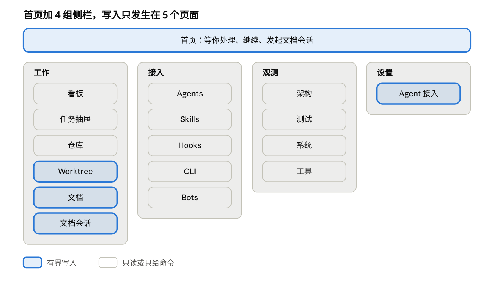
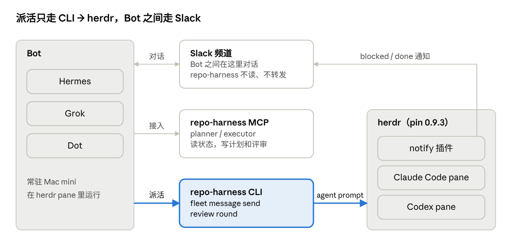
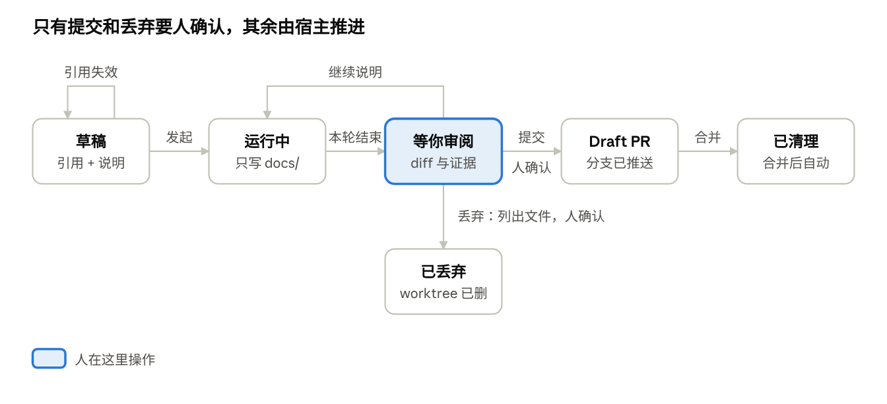

# PRD: repo-harness 控制台 UIUX 方案

> **Status**: Draft
> **Slug**: operator-console-uiux
> **Created**: 2026-10-26 23:10
> **Updated**: 2026-10-26
> **Source of truth**: [Claude 文档](https://claude.ai/artifact/6nK8dssBnBGMEB74CnvZHa)，rev 213。本文件是这一版的快照；两者不一致时以文档为准，文档改动后重新导出本文件。
> **Design**: [设计画布](https://claude.ai/artifact/JVJiUztNTXwx1wvmFwdcyw)，Version 38；画布和文档都是私有链接，要 owner 分享后才能打开。
> **Baseline**: `origin/main@e551f3e672085e6d50e91afdd06614be0530b7da`（package `0.24.3`）；Worktree 根目录的说法已对齐 `9b5a15f`（#983、#985）
> **Tier**: standard

## AI Quick-Read Card

- Problem: 控制台在 0.24.3 是 8 页、17 个 GET 路由的只读看板；开发环境、文档、进度、worktree、本机 CLI 和 Bot 接入分散在 CLI 输出和本机文件里，人看不清，也清理不了。
- Users: 用 repo-harness 的个人开发者和小团队；他们的 Bot（Hermes、Grok、Dot）；在 herdr pane 里干活的 Claude Code 与 Codex。
- Platform: Bun CLI；`operator serve`（127.0.0.1:4318，node:http）；React 19 + Kumo；herdr 0.9.3；OAR。
- P0 surface: G1 写入通道、G3 会话可见范围、G4 事件推送、G5 docs host 的 OS 边界。
- Core metric: 一个窗口答清「等我处理什么、环境哪里漂移、哪些 worktree 和 CLI 可以清」；新写入只有本机配置、文档会话、worktree 清理三个有界入口，每次写入都有审计。
- Hard constraint: `operator.md` §3.1 的请求身份校验、GET 不启动工作、UI 不派活（Bot → CLI → herdr）、不泄露 secret 和本机路径；删除、凭据权限、main 发布、发布运维仍是硬边界。
- Key risk: 写入通道撤销 #482 起的只读约束；docs host 的隔离先只在 macOS 验证；herdr pin 0.9.3 加 fork，与上游 v0.9.5 不兼容。
- Unknowns: 「待决问题与里程碑」里 10 项待用户确认。
- Acceptance scenarios: 「里程碑拆分」每个切片的验收列。
- Suggested next step: 第〇期写 `docs/design/DESIGN-<slug>.md` 并按约束表改文档；同时确认待决问题。

## 背景与目标

本方案把 operator 控制台从只读看板扩成本地管理台，只做三件事：管理开发环境、管理开发与架构文档、跟踪进度。写代码仍在用户自己的 harness 里完成；控制台交给 agent 的工作只有写文档，改动以 Draft PR 交回。agent 由 OAR 接入。设计稿在 [设计画布](https://claude.ai/code/artifact/8d9f19a4-d9a0-4d19-88bc-af5eb110d812) 上。

- **现状**：`src/operator-web` 约 4.1k 行 React + Kumo，8 个页面。`operator serve` 只监听回环地址；GET/HEAD 以外的方法一律返回 405，控制台目前没有任何写入。给 owner 发消息只有 CLI 入口 `fleet message send`，由 Bot 调用。
- **参考**：开源项目 magpie 的桌面应用外框。借用三点：按功能分组的侧栏、细线分隔的行列表配「显示其余 N 个」折叠、marketplace 式卡片网格。
- **目标 1 · 开发环境**：各宿主（Claude Code、Codex）的 hook、skill、MCP 和 profile 状态在一处看清；有漂移时给修复命令，由用户在终端执行。这台机器上装的 CLI 也在一处列清，没在用的给卸载命令。每个 Bot 经 MCP、Slack 和 herdr 的接入状态也在一处看清。
- **目标 2 · 文档**：docs/ 下的开发文档和架构文档能在 APP 里阅读、引用段落、交给 agent 修改，改动以 Draft PR 交回。各类文档与状态按 global 和 repo 两级重新归位。
- **目标 3 · 架构**：分层、时序、拓扑三类架构图在画布里渲染，选中元素能看到代码量、依赖边和 Remarks。
- **目标 4 · 测试**：tests/ 下的测试脚本按模块归类，能看到运行命令、最近结果和 TDD 的红绿状态。
- **目标 5 · 进度**：一个人在一个窗口里看清哪些工作等他处理、每个任务在哪个阶段、由哪个 agent 在做；跟进时回到用户自己的 harness，或交给 Bot。
- **非目标**：不在控制台里写代码，也不向编码会话发消息或停止它；不做手机版；不做拖拽派工；不在 UI 里重算 column、attention、merge readiness；不显示 OAR 以外的内部实现名。

## 设计原则：AI 写，人看图

控制台为一个人或小团队设计：agent 写代码和文档，人只在三个关口介入，而且主要靠看图来判断。传统 SOP 里的评审会、长设计文档和手画架构图都不做；能自动检查的规则交给 CI，人只看例外。

| 原则 | 控制台里的做法 | 依据 |
| --- | --- | --- |
| 人看意图，不逐行读 | 看板和抽屉先给目标、非目标、验收标准和改动影响；diff 默认折叠 | Anthropic 每天合并 3 万多个改动，人看改动意图，不逐行读（[Redesigning source control](https://anthropic.com/engineering/redesigning-source-control)，2026-10-13） |
| agent 自己验证，交出证据 | 每个任务都要有能跑的检查：测试、构建、截图对比；页面展示证据，不展示「已完成」的说法 | [Claude Code 最佳实践](https://code.claude.com/docs/en/best-practices)：给 Claude 一个能跑的检查，让它出示证据而不是声称成功 |
| 自动检查替人分配注意力 | 违规、失败、高风险改动标红并置顶；低风险改动只计数 | [2026 Agentic Coding Trends Report](https://claude.com/resources/guides/2026-agentic-coding-trends-report/priorities-for-the-year-ahead)：用自动评审把人的注意力引到最重要的地方；仓库的 Review by risk 分级 |
| 图优先，文字为辅 | 架构、测试、进度都先给图：一张底图加可切换的图层；文字放在悬停和抽屉里 | 产品负责人的前提：人看图比读字更直观、更准；仓库 UI 规则：让布局来解释 |
| 第二意见用新上下文 | 写的 agent 不评自己的活；评审用新上下文的子 agent，只报影响正确性的缺口 | Claude Code 最佳实践：对抗式评审；[Harness design](https://www.anthropic.com/engineering/harness-design-long-running-apps)（2026-03-24）的 planner、generator、evaluator 三角色 |
| 流程按风险缩放 | 一句话能说清的改动不写计划；中风险一次新上下文评审；高风险加跨模型评审 | Claude Code 最佳实践：一句话能描述的 diff 跳过计划；仓库 `agentic-development-flow.md` 的 Review by risk |
| 文档是副产品 | 架构模型更新和决策记录由 agent 在同一个 PR 里起草；人确认意图，不手写 | 仓库规则：改变职责的分支按 `repo-harness-architecture` 更新模型 |

人工关口只有三个：

1. **定意图**：目标、非目标、验收标准。
2. **看例外**：自动检查标出的违规、失败和高风险改动。
3. **守硬边界**：发布到 main、删除、凭据与权限、发布与生产（`CLAUDE.md` 四条硬边界）。

不做的传统环节：架构评审会、每个功能一份长设计文档、手画架构图、逐行代码评审、给本地工具做生产就绪评审。

## 项目现状

控制台在 v0.24.3（e551f3e，2026-10-26）是一个纯只读的看板：8 个页面、17 个 GET 路由、零写入。方案依赖的会话绑定、文档读取和可写 agent 宿主都已在最近一个月删除，要重建；架构模型、setup check、Dev Activity 和 OAR 依赖可以直接复用。下表是读源码、计划文档和提交历史得到的事实；只有 MCP 一行在临时仓库里复现过。

| 领域 | 现状 | 对方案的影响 |
| --- | --- | --- |
| 写入边界 | 2026-10-04 的 #482 删除了唯一写入（给 owner 发消息）；其他方法回 405；`operator-write-boundary.test.ts` 断言零写入路由 | 三种写入要先改 I1、I2、I9 和这组测试，见「写入 API」 |
| 服务端 | `node:http`，绑 127.0.0.1:4318；Host 精确匹配，Origin 有才查，`/api/` 查 `Sec-Fetch-Site`；没有 token、CSRF、限流 | POST 通道要补 token、Content-Type 和 body 上限 |
| 采集 | Dev Activity 每 60 s 跑 git 与 `gh pr list --author @me`；setup check 每 10 分钟；Fleet 快照每次请求起子进程；Notify 每次请求调 herdr | 新数据一律走后台 collector（N1），GET 只读缓存 |
| 刷新 | 浏览器 30 s 轮询，失败后退避到 60 s、120 s，标签页隐藏时暂停；全仓没有 SSE；revamp 计划 §11 #12（10-06）定了「SSE 现在不做」 | 文档会话先用游标轮询 |
| 前端 | 23 个 `.tsx`（4,092 行）、8 个导航页；Kumo 只用了 Badge、Banner、Button、Empty、Loader；中英双语，zh 按 en 的键做类型检查 | 新页面沿用 Kumo 与 i18n 约束 |
| 任务与 agent | `owner_bot` 和 ledger 在 #785（10-16）删除；看板卡片没有 agent 字段；运行时观测不绑定任务，所有 pane 都是 unclaimed | 「谁在做」要重建已验证绑定（G2） |
| 消息 | `fleet message send` 写文件 inbox：`<git-common-dir>/repo-harness/task-inbox/v2/…`；仓库详情页只读显示 task activity | 发消息交给 Bot，控制台只读 |
| OAR | 锁定 0.62.1，最新 0.71.0，会话与事件接口不变；`src/` 评审宿主和运行时观测用 OAR；coding host 在 #932（10-24）删除 | 文档会话宿主要新建，参照被删的 coding host |
| 隔离 | 评审宿主用 macOS `sandbox-exec`，只放开输出目录的写入，读和网络都不限；OAR 所有 runtime 默认免确认、没有沙箱 | 文档会话第一版只支持 macOS |
| 架构 | model 有 84 个节点（28 个 capability、56 个 component）、277 条关系、38 条 flow；archctx 生成 Mermaid、LikeC4、Structurizr 和 38 张时序图；控制台已有模块列表和一跳依赖图 | 底图直接从 model 生成；代码量和依赖数要另算 |
| 文档 | `docs/` 有 228 个文件，其中 2.4 MB markdown；#609（10-11）删掉了文档页，#925（10-24）删掉了它留下的 docs graph 模块 | 文档页重建，并推翻 revamp 计划「只显示路径」的约定 |
| 测试 | 302 个测试文件，约 3,700 个用例；CI 不出逐用例结果 | 见「测试与 TDD 管理」 |
| MCP | 有带 sha256 前置条件的 guarded write、受管 worktree 和只读 reader 可复用；但通用 `write_file` 能写 `.git/`（已复现），`paths.ts` 只按逻辑路径判范围 | 复用时必须按 realpath 重判范围；安全问题尚未开 issue |

## 信息架构

侧栏与设计画布一致：工作、接入、观测三组，设置在底部，首页在最上面。标强调色的 5 页会发起有界写入，范围见「写入与权限边界」。任务抽屉只读，跟进时给回到 harness 或交给 Bot 的命令。

## 页面需求

每个页面只投影已有权威；写入列为「无」的页面不写任何东西。现有控制台的 8 个页面和任务抽屉全部保留并改造，另新增 8 个页面。

| 页面 | 设计稿 | 现状 | 核心内容 | 数据来源 | 写入 |
| --- | --- | --- | --- | --- | --- |
| 首页 | Home | 新增 | 等你处理、继续（任务状态与文档会话）、阶段计数、发起文档会话 | Dev Activity、文档会话记录 | 发起文档会话 |
| 看板 | Main | 已有，`Board.tsx` | 等你处理 / 进行中 / 今天已发布；阶段筛选；部分来源不可用时的提示条 | Dev Activity 快照：git 与 `gh pr list`，60 s 一轮 | 无 |
| 任务抽屉 | Task | 已有，`ItemDrawer.tsx`，要扩 | 阶段、可复制 id、检查与评审、合并命令、执行状态（只读）、跟进命令 | Dev Activity、任务会话记录、运行时观测 | 无 |
| 仓库 | Repositories | 已有，`RepositoriesPage.tsx` 与 `RepositoryWorkspace.tsx` | 仓库列表、失效登记与 `fleet prune` 命令；详情页有规划、组织、交付三个 tab | registry、Fleet 快照、仓库快照 | 无 |
| Worktree | Worktrees、WorktreeCleanup | 新增 | 磁盘占用图（按仓库、分三色）、清单与原因、可回收空间、清理按钮、「让 agent 清理」 | 后台 collector：git worktree 拓扑、三套记录、du、进程检查 | 清理可回收的 worktree；发起清理会话 |
| 文档 | Docs | 新增；文档页已在 #609（10-11）删除 | docs/ 目录树、渲染正文、引用段落、选 agent、发起会话 | 仓库文件，只读（G7） | 发起文档会话 |
| 文档会话 | DocsSession | 新增 | diff 与阅读切换、会话记录、改动卡片、提交并开 Draft PR、丢弃 | 文档会话记录与 worktree | 会话内写入，见「写入 API」 |
| Agents | Agents | 已有，`SetupPages.tsx` | 每个宿主的 hook、skill 投影状态和漂移，profile 对应的命令 | `setup check`，10 分钟一轮 | 无，只给命令 |
| Skills | Skills | 已有，`SetupPages.tsx` | 已装与推荐的 skill，按宿主切换 | `setup check`、`assets/skill-commands/manifest.json` | 无 |
| Hooks | Hooks | 已有，`SetupPages.tsx` | 每个宿主的 hook 路由、调用次数与最近拒绝（G16） | `setup check`、hook 事件日志 | 无 |
| CLI | CLI | 新增 | 这台机器上所有 CLI：来源、版本、占用、最近使用、GitHub 链接与星数；没在用的标出来（G18） | 后台 collector：包管理器列表、PATH、hook 记录、gh 查星数 | 无，卸载只给命令 |
| Bots | Bots | 新增 | 每个 Bot 的三条路：MCP 客户端与授权、Slack 等通知渠道、herdr 派活与 pane 状态（G29–G32） | 后台 collector：mcp doctor --json、OAuth 元数据、registry、审计日志、herdr status 与 socket 快照、notify 插件 | 无，只给命令 |
| 架构 | ArchLayers、ArchSequence、ArchTopology | 模块页已有，`ArchitectureWorkspace.tsx`；三张底图新增 | 一张底图加图层：今日变更、违规与漂移、PR 影响面、测试覆盖、决策 | `archctx export native`、`resolve`、`deps`、`debt`、`flows check`、`docs anchors`；后台 collector | 无 |
| 测试 | Tests | 新增 | 见「测试与 TDD 管理」 | collector：扫描 tests/、CI 结果、verification 记录 | 无 |
| 系统 | System | 已有，`SystemPage.tsx`，4 张卡 | collector 状态与新鲜度、Notify 插件、边界说明、运行时摘要 | 采集器健康：git、github、runtime 三类来源 | 无 |
| 工具 | Tools | 已有，`ToolsPage.tsx` | marketplace 卡片：本机工具与推荐资源，只给链接 | `assets/tool-catalog.v1.json` | 无 |
| 设置 · Agent 接入 | Settings | 新增 | OAR runtime 列表、安装探测、启用、用途、默认 agent | OAR registry、后台安装探测 | `~/.repo-harness/config.json` |

## 写入与权限边界

控制台现在没有任何写入：server 对 GET/HEAD 以外的方法一律返回 405。方案只加三种有界写入，要修订的约束见本节末尾的约束表。每种写入都有固定目标、固定作用域和可见的失败状态。

| 写入 | 目标 | 作用域 | 不允许 |
| --- | --- | --- | --- |
| 启用 / 关闭 agent，设用途和默认文档 agent | `~/.repo-harness/config.json` | 本机配置 | 保存凭据；改宿主的 `~/.claude`、`~/.codex` |
| 文档会话：改文件、提交、推送并开 Draft PR、丢弃 | 新建的 linked worktree 和 `docs/<slug>` 分支 | 只有 `docs/` 里人写的文档可写；生成目标、生成区、指令文件和源码只读；可给本会话的 agent 发后续说明、停止本轮 | 写 main、合并；改可写范围以外的文件；agent 自己推送或调 GitHub |
| 清理 worktree：一键清理、清理会话、归档 | linked worktree 与本地分支；git 不再登记的残留目录；`docs/archive-<slug>` 分支 | 绿色项一键清理；非绿色项在你发起的清理会话里逐项授权，先把值得留的内容归档进 `docs/archive/`（Draft PR），再删；执行前逐项重核 | 删在用的 worktree；没授权、或授权后内容变了还删；凭据类文件进 `docs/`；删远端分支；agent 自己归档或删除 |

- 给任务 owner 发消息交给 Bot：现有入口是 CLI `repo-harness fleet message send`，要求 admission 与 claim 上下文；控制台只读显示 task inbox 的消息与投递回执。
- 编码会话不接入控制台：不向用户 harness 里的会话发消息、停止或注入内容。
- 宿主投影（install、update、profile 切换）和 registry 清理仍然只给命令，由用户在终端执行。
- 每个写入请求都要过 Origin / Sec-Fetch-Site 校验和写 token；token 由页面响应用 HttpOnly、SameSite=Strict 的 cookie 下发。会话沙箱禁止连回环地址，agent 拿不到 token，也调不到写入 API。本机其他进程与用户同权，服务端分不出人点和程序调用，所以非绿色项的授权绑定你看到的会丢内容摘要；CLI 删非绿色项要在终端确认，非交互环境拒绝。失败在 UI 里显示具体原因，不假装成功。
- 浏览器 payload 继续不含绝对路径、stderr 和环境变量。文档会话的对话文本是新增的可见内容，与现有 N4（不显示终端文本、prompt、工具参数）冲突，见缺口 G3。

要修订的约束在第〇期一次改完，切片 0.2 按这张表验收：

| 约束 | 位置 | 改成 |
| --- | --- | --- |
| I1、I2、I9：控制台只读、零写入路由、UI 不触发动作 | revamp 计划 §2；`operator.md` §3.1 第 1、6 条 | 允许上表三种写入，其余仍只读 |
| 「不做写入」「不做审批按钮」 | Kumo 计划非目标 | 只为上表三种写入加按钮 |
| N4：不显示终端文本、prompt、工具参数 | Kumo 计划 | 文档会话显示消息正文、工具类别、相对路径和执行状态（G3）；其余仍不显示 |
| 「文档只显示路径，服务端只回纯文本」 | revamp 计划 :251、:530 | 浏览器渲染 markdown，不开原始 HTML，不执行脚本 |
| 「不引入 `@xyflow/react` 和 `@dagrejs/dagre`」 | revamp 计划 §11 #1 | 架构画布可以引入（待决问题 8） |
| 非目标：mutation、Agent 进程启动、SSE/WebSocket 等 | `docs/design/DESIGN-local-human-control-board-v1.md` | 由新的 `docs/design/DESIGN-<slug>.md` 取代 |
| 只读说明 | `README.md` | 改成三种有界写入 |
| 写路由为空、非 GET 回 405、UI 没有表单 | `operator-write-boundary.test.ts`、`operator-serve.test.ts`、UI 测试 | 逐条改写，在 PR 里逐条说明理由 |

保持不变：`operator.md` §3.1 第 2 条（先查身份，再进路由）和第 7 条（不回 secret 和本机绝对路径；会话只显示仓库内的相对路径）。

## 写入 API

三种写入共用一条 POST 通道。每个请求先过同源与 token 校验，再过 schema、幂等、锁和前置条件，最后由 CLI 共用的 effect 执行。意图审计写不进去就不执行。

| 端点 | 请求体 | 成功 | 失败码 |
| --- | --- | --- | --- |
| `POST /api/v1/settings/agents` | `request_id`、`expected_revision`、`changes[{runtime, enabled, uses}]`、`default_docs_runtime` | 200，新的 `config_revision` 和实际改动的键 | 409 `revision_conflict`；422 `use_not_supported`（评审只接 claude、codex）；422 `docs_isolation_unverified`（文档用途只接文档隔离验证过的 runtime）；503 `busy` |
| `POST /api/v1/sessions` | `request_id`、`kind: docs \| worktree_cleanup`、`runtime`；docs 另带 `repository_id`、`citations[]`、`instruction` | 201，`session_id`；docs 另回分支名和 worktree 目录名 | 409 `citation_stale`；422 `docs_isolation_unverified`；422 `runtime_not_enabled`；501 `platform_unsupported`；503 `busy` |
| `POST /api/v1/sessions/{sid}/messages` | `request_id`、`text`、`when: after_turn \| now` | 202，`landed: prompted \| queued \| steered` | 409 `steer_unsupported`，不自动改成排队；409 `session_closed` |
| `POST /api/v1/sessions/{sid}/stop` | `request_id` | 202，本轮以 `aborted` 结束，会话保留 | 409 `no_active_turn` |
| `POST /api/v1/sessions/{sid}/commit`（docs） | `request_id`、`expected_head`、`expected_diff_sha256`、`message` | 200，commit、推送结果和 Draft PR 链接；中途失败回已完成的步骤 | 409 `diff_changed`；422 `path_outside_scope`；422 `generated_region` |
| `POST /api/v1/sessions/{sid}/discard`（docs） | `request_id`、`expected_head`、`expected_loss_sha256` | 200，worktree 与本地分支已删除 | 409 `turn_active`；409 `loss_changed`；409 `branch_pushed`，已推送的分支只给命令 |
| `POST /api/v1/worktrees/cleanup` | `request_id`、`expected_digest`、`ids[]`；非绿色项另带 `session_id` 和 `approvals[{id, loss_sha256, plan_sha256}]` | 200，逐项结果：已归档（PR 链接）、已删，或跳过及原因 | 409 `digest_changed`；409 `loss_changed`；422 `not_approved`；422 `in_use` |

校验顺序，任何一步失败都不再往下走：

1. Host 精确匹配（现有，421）。
2. Origin 必须存在且等于本服务（POST 专用；GET 维持「有才查」）。
3. `Sec-Fetch-Site` 必须是 `same-origin`。
4. 路由必须在 `OPERATOR_ROUTES` 里且标 `write:true`；dispatcher 只对这些路由放行 POST，其余方法仍回 405。身份检查在路由之前（`operator.md` §3.1 第 2 条）。
5. `Content-Type` 必须是 `application/json`，body 不超过 64 KiB，按截止时间读取。
6. 写 token 在页面响应设置的 HttpOnly、SameSite=Strict cookie 里，服务端做常量时间比较；token 每次 serve 启动重新生成。
7. 用封闭 decoder 解析 body，未知字段直接拒绝（`operator.md` §3.1 一个 schema 一个 decoder）。
8. `request_id` 是 UUID，和操作、目标、请求体摘要绑在一起：同一个 id 配不同内容回 409 `request_mismatch`，重复请求返回已存结果。动作已执行、结果审计没写进去时，状态是「待核对」：UI 显示待核对，不报未执行，也不自动重放（`references/bot-control.md`）。
9. 按目标加锁：配置文件一把锁、每个文档会话一把锁、每个仓库的会话创建一把锁、每个仓库的 worktree 拓扑锁（`withWorktreeTopologyLock`）；复用 `exclusive-directory-lock.ts`。
10. 检查前置条件：配置修订号、worktree HEAD、用户看过的 diff 哈希、用户确认过的丢弃清单或清理授权的内容摘要、没有进行中的轮次；不一致回 409。
11. 先写意图审计，再执行，再写结果审计。所有控制台写入都记在 `~/.repo-harness/operator/audit.jsonl`，不记进 worktree 的 evidence ledger：新 worktree 没有 genesis 记录，丢弃和清理还会把它一起删掉。意图审计写不进去就不执行。
12. 错误统一用 `{error:{code,message,next_action}}`，不再用裸 `{code}`。

- **CLI 对等**：每个写入都先有 CLI 命令，HTTP 只是薄封装，共用同一个 effect 和 builder（I7）。Bot 走 CLI，控制台走 HTTP，结果一致。
- **要改的约束**：见「写入与权限边界」的约束表。
- **要改的路由与测试**：`operator-write-boundary.test.ts` 的写路由清单从空数组改成上面 7 个，方法扫描加入 POST；新增的 GET 路由（docs 树与正文、会话事件、worktree 清单与稳定 id）进 `OPERATOR_ROUTES` 和路由清单测试；`operator-serve.test.ts` 的 405 用例和 UI 测试里「没有表单」的断言逐条改写，并在 PR 里逐条说明理由。
- **设计稿门槛**：`ux-feature-guard` 要求先有一份确认过的 `docs/design/DESIGN-<slug>.md`，前端才能开工。

## 技术选型

结论：继续用 React。这次的压力点在数据来源和写入边界，不在渲染性能；换框架会把现有 4.1k 行和 Kumo 组件库一起重写。

| 维度 | React（现状） | Solid 2.0 |
| --- | --- | --- |
| 发布状态 | 稳定 | 仍是 RC：最新 2.0.0-rc.9，2026-09-18，没有稳定版（[releases](https://github.com/solidjs/solid/releases)） |
| 现有代码 | `src/operator-web` 23 个 .tsx，已接 Vite、Tailwind v4、测试 | 全部重写 |
| 组件库 | `@cloudflare/kumo` 是 React 组件库，Kumo 计划已批准 | 没有 Kumo，要自建或换库 |
| OAR 接入 | `@botiverse/oar/browser`、`/observe` 只有纯 reducer 和类型，没有网络客户端；记录由服务端送到浏览器后在前端折叠，两边都能用 | 同左 |
| 流式对话更新 | 靠分桶渲染、虚拟列表、`useSyncExternalStore` | 细粒度响应式天然适合，这是它唯一的明显优势 |
| 画布（架构图） | `@xyflow/react` 12.12 + `@dagrejs/dagre` 3.1（均 MIT）可用，按依赖规则要单独批准；elkjs 是 EPL-2.0 或 GPL-3.0，排除 | 可选库少 |

- 重新评估的触发条件：文档会话页在真实数据下出现可测的渲染卡顿，而且分桶和虚拟列表都没解决。
- 这符合仓库规则：优先用已安装的依赖，没有观察到的压力不加层。

## 缺口清单

设计稿依赖 32 项后端或数据能力，其中 4 项 P0 不补就不能上线对应页面。「现状」列是读源码和文档得到的事实，不是运行结果。

| # | 优先级 | 缺口 | 现状 | 需要补的 | 影响页面 |
| --- | --- | --- | --- | --- | --- |
| G1 | P0 | 写入 API | #482（10-04）起零写入路由，其他方法回 405 | 按「写入 API」一节：POST 白名单、Origin 与 token、幂等、按目标加锁、先审计后执行 | 首页、文档、文档会话、设置、Worktree |
| G2 | P1 | 任务的执行状态 | `owner_bot` 和 ledger 已在 #785 删除；运行时观测不绑定任务，所有 pane 都是 unclaimed | 后台 collector 核对 binding 哈希、`native-session.json`、进程身份和 `closed.json`，全部通过才显示 agent；不显示对话 | 首页、看板、任务抽屉 |
| G3 | P0 | 文档会话的对话可见范围 | Kumo 计划 N4 与运行时观测计划都禁止显示 prompt、工具参数和终端文本；OAR 只脱敏凭据 | 为文档会话修订 N4：显示消息正文、工具类别、相对路径和执行状态；原始工具参数、完整命令、终端输出和环境变量不显示，用结构化操作摘要代替；落盘前脱敏 | 文档会话 |
| G4 | P0 | 文档会话事件推到浏览器 | revamp 计划 §11 #12：SSE 现在不做；浏览器 30 s 轮询 | 宿主写 `events.jsonl`；浏览器按 `epoch.seq` 游标轮询，进行中 1 s、空闲 30 s | 文档会话 |
| G5 | P0 | 文档会话的 agent host | coding host 已在 #932 删除；评审宿主用 macOS `sandbox-exec` 只放开输出目录的写入，读和网络（含回环）都不限；OAR 所有 runtime 默认免确认、没有沙箱 | 新的 docs host：`sandbox-exec` 只放开 `docs/` 里人写的文档，并收窄读取、环境变量、网络（含回环）和子进程；会话用私有 HOME，只带模型凭据；提交、推送和 Draft PR 由服务端执行；第一版只支持 macOS | 文档会话 |
| G6 | P1 | 各 runtime 的能力差异 | kimi、antigravity、opencode v2 没有 steer；codex 不能撤回排队消息；所有 runtime 都能停止本轮 | 把每个 runtime 的能力传到 UI，不支持的按钮置灰并说明原因 | 文档会话、设置 |
| G7 | P1 | docs/ 读取 API | #925 删掉了旧的文档阅读器；revamp 计划规定只显示路径 | 见「文档读取」：realpath 后再判允许与拒绝列表；返回 commit 和 sha256 | 文档、首页 |
| G8 | P1 | 引用协议 | 没有；MCP 的 diff 按行偏移匹配原文并记录片段哈希，可借鉴 | 引用 = 文件 + 行范围 + 内容 sha256；发起会话前校验，内容变了就要求重新引用 | 文档 |
| G9 | P1 | Agent 安装检测与配置 | OAR 安装探测会起子进程；`config.json` 只有 architecture、brainRoot、protectedHelperRuntime、security 四个键 | 探测并入 setup collector 的 10 分钟周期；配置加 `agents.enabled / uses / default_docs`；Pi Durable、Cursor、Mister Morph 要额外构造 registry | 设置、文档 |
| G10 | P2 | 评审用的 runtime | `reviewRuntime` 只允许 claude、codex | 每加一个 runtime，先拿到它的只读隔离证据 | 设置 |
| G11 | P1 | 架构图的结构化数据 | model 有 84 个节点、277 条关系、38 条 flow；archctx 已生成 Mermaid、LikeC4、Structurizr；手写的分层与拓扑视图已归档，其中的代码量和依赖数是手写数字 | 底图从 model 生成，代码量和依赖数由 collector 算；全图自动布局要单独批准 `@xyflow/react` + `@dagrejs/dagre`（均 MIT），elkjs 因许可证排除 | 架构 |
| G12 | P2 | Skill 目录 | Waza、herdr skill、hai-stack 在 `tool-catalog.v1.json` 里是 `local_tool` | catalog 加 skill 类别，或单独的推荐 skill 目录；每个宿主的 skill 投影清单从 `setup check` 来 | Skills、工具 |
| G13 | P2 | 暗色主题 token | 已解决：repo-harness design system 定了 Paper（亮）和 Ink（暗）两套 Kumo 语义 token，画布每张稿都能切换 | 实现时直接引用 design system 的 tokens.json；像素吉祥物（萝卜仔、小驴、钩子）作为品牌资产一起发布 | 全部 |
| G14 | P2 | 工具卡片的展示字段 | catalog 没有作者、标签、是否随 profile 安装 | catalog 加这三个字段，由 catalog 测试校验 | 工具、Skills |
| G15 | P1 | 从任务跳到对应的 agent | 任务绑定有 Herdr endpoint 和 pane，hook payload 有 session\_id；宿主没有公开的会话深链，docs 也写明 host resume 能力未验证 | 放在任务抽屉的「跟进」里，只给可复制的位置和命令：Herdr pane 位置、claude --resume / codex resume 命令、交给 Bot 时只给任务 id。控制台不向编码会话写入；桌面端深链等宿主确认后再加 | 任务抽屉 |
| G16 | P2 | Hook 调用统计与拒绝记录 | Hooks 页的 24 小时次数和最近拒绝是示例数据，collector 没有读取 hook 事件 | collector 汇总 runs/hook-events.jsonl 和 failures/latest.jsonl，按路由计数，路径脱敏后再出服务端 | Hooks |
| G17 | P2 | profile 路由数文档与代码不一致 | install-profiles.md 写两个宿主都是 minimal 4 / full 5；route-registry.ts 实际是 Claude 5 / 6、Codex 4 / 5 | 以 registry 为准改文档，或从 registry 生成这张表；控制台只读 registry | Agents、Hooks |
| G18 | P1 | 这台机器上的 CLI 清单 | 只有 gh 是 repo-harness 的依赖（collector、合并门槛、external-source refresh）；没有任何 CLI 清单、使用记录或卸载入口 | 见「CLI 清单」：包管理器列表加 PATH 归类；hook 事件记命令名；GitHub 链接取自包元数据和种子目录，星数用 gh 查并缓存；标出上游已归档或弃用的；卸载只给命令 | CLI |
| G19 | P1 | 等你处理的种类 | attention 只有 ready\_to\_merge 一种；planned 列已声明但没有代码设置 | 在 dev-activity 投影里增加 changes\_requested、merge\_conflict、checks\_failed 三类，按等待时长排序 | 首页、看板 |
| G20 | P1 | 逐用例测试结果 | CI 只有日志和 artifact；本机跑测试不留记录 | ci-run-tests.sh 打开 bun 的 JUnit reporter，CI 上传 artifact；collector 读最近一次 | 测试 |
| G21 | P1 | 测试到能力的映射 | 只有 26 个 model 节点写了 verification 命令，其中 1 条引用的文件已不存在 | 从 model 与 import 反向图生成投影，带 drift 检查，不另立权威 | 测试、架构 |
| G22 | P1 | 架构图层数据 | 控制台只有模块列表和一跳依赖图；没有变更、违规、PR 影响面、测试、决策图层 | 见「架构」一节；上游 arch-context#407、#408、#409 | 架构 |
| G23 | P1 | Worktree 清单与磁盘占用 | Dev Activity 已列出登记仓库的 linked worktree，PR 合并后标 cleanup\_pending；但没有大小、来源和占用进程，残留目录不在列表里 | 后台 collector 加合并判定、来源归类、进程检查和低频 du；每个 worktree 一个稳定 id；浏览器不拿绝对路径；看板的「worktree 还没清理」改用它，退役 cleanup\_pending | Worktree、首页 |
| G24 | P1 | 清理写入与统一 CLI | contract-worktree sweep 只管 repo-harness 自己开的；MCP 另有 cleanup；没有覆盖所有来源的入口 | 新增 repo-harness worktrees list 与 clean，clean 对绿色项直接删，非绿色项要带授权并在终端确认；HTTP 只做薄封装；执行前重核、拓扑锁、审计 | Worktree |
| G25 | P1 | Worktree 清理会话 | 没有 | 复用文档会话的宿主与事件；agent 只读调查非绿色项、给建议和归档计划；你逐项授权后，服务端先归档进 docs/archive/ 再删 | Worktree |
| G26 | P1 | 统一的 worktree 记录 | 三套记录格式和位置各不相同；portal skill 与手开的 worktree 不留记录；只有任务 agent 记结束状态 | 每条创建路径写同一份记录：创建方、用途、关联任务或 PR、时间；closeout 写结束状态 | Worktree |
| G27 | P1 | 架构模型补全 | 节点都没填 layer；没有外部系统和拓扑节点；0 条 ADR，manifest 的决策目录不存在 | agent 按 repo-harness-architecture 补模型；manifest 的决策目录改到 docs/adr | 架构 |
| G28 | P1 | 高合并量下的看板容量 | 已合并 PR 查询取 7 天窗口、上限 200 行；超出就把整个 GitHub 来源标为不可用，看板、今天已发布和今日摘要一起变空 | 缩短窗口或按日期分页，计数改用 search API 的总数；只有超限的那一类标不可用 | 首页、看板 |
| G29 | P1 | Bot 接入状态 | 控制台没有 MCP、Bot、admission 和 herdr 会话的路由或页面；System 页只显示 notify 插件和运行时摘要 | 新 collector：mcp doctor --json（不带 --live）、OAuth 元数据、registry、审计最新一条、herdr status 与快照、notify 各渠道；Bots 页只读，改接入只给命令 | Bots |
| G30 | P1 | Bot 身份与归属 | 没有 Bot 登记，bot\_id 是自由文本；MCP 审计的 actor 只有 mcp:\<profile>；任务消息的发送者固定为 user；运行时记录没有派发者；没有收回单个 OAuth 客户端的命令 | 全局 bots/\<bot-id>.json 与 repo-harness bots register；MCP 审计、任务消息、herdr 派活都带 bot id；新增 repo-harness mcp clients list 与 revoke；登记只用于归属，不授权 | Bots、任务抽屉 |
| G31 | P2 | Slack 渠道与通知负载 | notify 插件只发不收；一个插件配一个 Slack webhook；只记所有渠道合并后的最新一次投递；负载里没有仓库、任务和请求 id | 每个渠道分别记最近一次投递和结果；负载带仓库、任务和请求 id；Bot 之间的对话留在 Slack，repo-harness 不读 Slack | Bots、系统 |
| G32 | P1 | herdr 版本对齐 | 观测要求 0.9.3、protocol 22 和 fork add5f99a（上游 PR 5093 已关）；上游已到 v0.9.5，升级后执行状态显示不可用 | 页面写明期望版本与实际版本；对齐 pin 或去掉 fork 依赖，单独排期 | Bots、看板、系统 |

## 存放层级：repo 与 global

按一条规则归位：要和代码同一个 commit 演进、要在 PR 里被看的，放 repo 并提交；只属于一个 checkout 的运行记录，放 repo 内的忽略区；只属于这台机器或这个用户、跨仓库共用的，放 global。能从别处重算的，一律当缓存，不当权威。按这条规则，大部分目录不用动；真正要做的是退役死掉的部分、把 global 统一到一个根。

| 目录 | 现在 | 建议 | 理由与代价 |
| --- | --- | --- | --- |
| `.archcontext/` 的 model、policies、projections | repo，提交（84 个节点、277 条关系、38 条 flow） | 不动 | 10-13 以来改 model 的 40 个 commit 里 34 个同时改了 `src/`；按 PR 画架构变更要靠它 |
| `docs/` | repo，提交（228 个文件；生成区由 rolling writer 写） | 不动，作为唯一的文档根；worktree 清理的归档放 docs/archive/ | archctx 的投影目标都在这里 |
| `plans/` | repo，提交（25 个计划、24 个 PRD、3 个 sprint、78 个归档） | 留在 repo；不为文档会话的权限去迁目录 | 迁目录要改 MCP 写入 glob、effective state、模块 linked docs、init 目录和 contract，adopted 仓库还要一次性迁移；收益只是文档会话少一条允许路径 |
| `tasks/` | repo，提交（368 个文件，归档占 354 个、4.9 MB）；`current.md` 忽略 | `lessons.md`、`todos.md` 留；`archive/`、`evidence/` 等没有读取方的部分退役 | effective state 要求 todo 文件在 `tasks/` 下；任务平面已在 #773 退役 |
| `.ai/harness/` 提交部分、`.ai/context/` | repo，提交（policy、marker、context map） | 不动 | 每个宿主 hook 都先查 marker |
| `.ai/harness/` 忽略部分 | checkout 内（evidence、runs、checks、handoff、日志） | 不动 | 约 57 个 src 文件、27 个脚本、223 个测试文件引用这些路径；删 worktree 时一起清掉，挪去 global 反而要另做 GC |
| `_ops/` | repo 内，忽略；adoption 会建 \_ops/env、\_ops/secrets，保护规则点名它 | 不动 | 按 CLAUDE.md，agent 不改也不提交它 |
| `_ref/` | repo 内，忽略，上游源码缓存 | 挪到 `~/.repo-harness/ref/` | 机器级缓存，多个仓库可以共用；要改 `PROTECTED_REPO_DIRS` 等点名它的地方 |
| `<repo>/.repo-harness/` | repo 内，忽略（ChatGPT 绑定、项目级锁） | ChatGPT 绑定挪到 global；项目级运行时锁留在 repo | 绑定已有先例 `mcp migrate-scope`；锁按仓库划范围，是 #937（10-24）修 #922 时特意留在 repo 的 |
| `~/.repo-harness/` | 三个锚点：`REPO_HARNESS_HOME`、`HOME`、OS 账户 | 统一到 `REPO_HARNESS_HOME`；gates 继续按 OS 账户 | `config.json`、`install-state.json` 等仍按 `HOME`；要改锁根和 CI、测试的 HOME 覆盖 |
| global 新增 | 没有 | `operator/audit.jsonl`、`operator/sessions/<sid>/`、`archive/<repo-key>/`（不进 git 的凭据类和大文件）、跨仓库索引缓存、Bot 名单 `bots/<bot-id>.json`；worktree 不进 global，根目录按 [#987](https://github.com/Ancienttwo/repo-harness/issues/987) 留在系统临时目录 | 审计和会话记录不能随 worktree 删掉；sweep 和 Bash 拦截共用一个受管根目录（`managedWorktreeRoot`），第二个根目录会让 worktree 逃出 sweep；索引是派生数据 |

**迁移方式**：每次挪动都是一次性的、失败即停的迁移命令，不留兼容读取（`CLAUDE.md` 的规则），先用 marker 的 `minimum_harness_version` 让旧 hook 停止读取。目录级挪动要给 adoption 新增「移动目录」操作，现在的 `moveOperation` 只能移单个文件。路径变了，archctx 的 source glob 要走 model ChangeSet 和 rolling writer。init 不改 repo-harness 自己的仓库，这里只能手工开 PR。这些迁移单独排期，不绑进控制台首版。

**现在就该退役或修正的**：

- 没有任何读取方：`tasks/evidence/`、`tasks/pipeline-observer-plan.md`、`plans/*.puml`、`plans/sprints/*.schema-migration.v1.json`、`.ai/harness/security/`、`.ai/harness/triage/inbox.md`、`.ai/harness/events.jsonl`。
- 有读取方、没有写入方：`.ai/harness/planning/pending.json`。
- 没被忽略的运行文件：MCP 写的 `.ai/harness/handoff/task-goal.md`、`chatgpt-plan.md`，以及 `.ai/harness/evals/workspace`。
- 规则冲突：`agentic-development-flow.md:51` 说会话开始不读 lessons，`CLAUDE.md:7` 说要读。

## 开发环境管理

环境页只回答三件事：每个宿主装了什么、和期望差在哪、怎么修。数据来自已有的 setup check 和新的后台探测；修复一律只给命令，由用户在终端执行。

| 页面 | 显示 | 数据来源 | 缺口 |
| --- | --- | --- | --- |
| Agents | Claude Code 与 Codex 的 adapter 投影：hook 路由一致还是漂移、缺失条目；7 个 fleet 角色是否已装；Codex CLI 版本 | `SetupSnapshotV1.hosts[]`、`fleet[]` | install profile（minimal、full）没有结构化字段，只写在检查说明里 |
| Skills | 23 个 skill 包（自带 12 个 SKILL.md）；每个宿主一列：已装、缺失、漂移 | `SetupSnapshotV1.skills[]`、`assets/skill-commands/manifest.json` | 「推荐」不是 schema 字段；herdr、mermaid、obsidian 不在检查范围（G12） |
| Hooks | 5 个事件（SessionStart、PreToolUse、UserPromptSubmit、SubagentStart、Stop）的路由和宿主；调用次数与最近拒绝 | `SetupSnapshotV1.hooks[]`、hook 事件日志 | G16、G17 |
| CLI | 这台机器上所有 CLI 的清单、占用、最近使用和 GitHub 星数；没在用的给卸载命令 | 包管理器列表、PATH、hook 记录、gh | G18 |
| 工具 | 7 个目录条目：4 个本机工具、3 个推荐资源 | `assets/tool-catalog.v1.json` | 状态只有 unknown 和 na，Tools 计划 P1 未做（G14） |
| 系统 | collector 新鲜度、git / github / runtime 三类来源的状态、Notify 插件 | 采集器健康 | 没有耗时字段 |
| Agent 接入 | OAR runtime、安装探测结果、启用、用途、默认 agent | OAR registry、`runtime.installation()` | G9 |

- **runtime 清单**：OAR 0.62.1 的默认注册表有 7 个：claude、codex、grok、kimi、opencode、antigravity、pi。Pi Durable、Cursor、Mister Morph 不在默认表里，要宿主自建 registry 并安装可选依赖，页面把它们放在「需要额外安装」。
- **安装探测**：`installation()` 先在 PATH 上查找，再起子进程跑 `--version` 和就绪检查（如 `codex app-server --help`），所以并入 setup collector 的 10 分钟周期，GET 只读缓存。`OAR_<X>_BIN` 环境变量可以固定可执行文件。
- **能力差异**：OAR 按会话对象上有没有 `steer` 成员判断能否插入当前轮，会话打开后才知道。kimi、antigravity、opencode v2 没有 steer；codex 没有撤回排队消息；所有 runtime 都能停止本轮。设置页显示静态能力表，会话页按实际会话置灰按钮。
- **配置**：`~/.repo-harness/config.json` 现在只有 `architecture`、`brainRoot`、`protectedHelperRuntime`、`security` 四个键，按 `HOME` 定位，不看 `REPO_HARNESS_HOME`。新增 `agents` 段：`{enabled: [id], uses: {docs: [id], review: [id]}, default_docs: id}`，`review` 只接受 claude、codex。
- **修复命令**：`repo-harness setup check`、`repo-harness install --target codex|claude|both --profile minimal|full`、`repo-harness update`；页面按漂移类型给出对应的一条。
- **OAR 升级**：单独排期升到 0.71.x，不绑进 UI 首版。会话、事件和启动约定不变；新增按 runtime 单独加载的入口（约 1–2.5 MB 堆内存，根入口约 50 MB），适合探测 collector；配置表单 `./forms` 在 0.71.0 只覆盖 grok。

### CLI 清单（G18）

CLI 页列出这台机器上装的所有命令行工具，不只是开发要用的那几个。vibe coder 常装一堆 CLI，用不上的又忘了删；页面给每个 CLI 的来源、版本、占用、最近使用、GitHub 链接和星数，把没在用的标出来，给卸载命令由用户在终端执行。控制台不卸载。

| 项 | 做法 |
| --- | --- |
| 清单 | 后台 collector 读各包管理器的只读列表，只列你主动装的、带可执行文件的包（Homebrew 看 installed-on-request），被拉进来的依赖不单列：Homebrew formula 与 cask，npm、pnpm、bun 的全局包，pipx、uv tool、cargo install、mise；go install 装的读 `go version -m` 里的模块路径；Linux 再读 apt、dnf、apk 的已装包。官方安装脚本的落点（如 `~/.local/share/claude`、`~/.codex/packages/standalone`、`~/.opencode/bin`、`~/.fly`、`~/.railway/bin`）按种子目录归到对应工具。PATH 上其余可执行文件按真实路径归到来源，归不了的标「手动安装」。项目里的 devDependency（wrangler、supabase 官方推荐的装法）不在 PATH 上，不列；系统目录 /usr/bin、/bin、/usr/sbin 里的也不列 |
| 版本与占用 | 版本取包管理器的记录，不为列清单去启动每个 CLI；占用是包目录的 du，低频跑，按 mtime 缓存 |
| 最近使用 | repo-harness 的 hook 已经看得到 agent 跑的命令；hook 事件加一个字段，只记命令名和时间，不记参数。shell 历史默认不读，开了也只计数；文件的 atime 只作参考 |
| 没在用 | 默认 90 天内 agent 和（开启时的）shell 历史都没用过，而且不是别的包的依赖 |
| GitHub 与星数 | 仓库地址先读本机的包元数据：Homebrew 的 homepage 与下载地址、npm 的 repository、PyPI 的 project\_urls、crates.io 的 repository。元数据里没有的，按种子目录对包名或安装落点；同名命令对应几个仓库（如 `asc`、`kimi`）而包名对不上时，列出候选，不给星数。星数用 gh 以用户自己的登录查，跟随仓库重定向，24 小时缓存；monorepo 标「整个仓库」。查不到的只给官网链接 |
| 上游状态 | 仓库已归档（gh 的 `archived`）、包已弃用或归档（npm 的 `deprecated`、PyPI 的项目状态）、仓库已迁移的，都标出来，在用也提示换装。例：neonctl 仓库 2026-06-25 归档，CLI 移进 neon-pkgs；PyPI 上的 kimi-cli 已归档，后继是 kimi-code |
| 登录状态 | 只对有只读状态命令的 CLI 跑（如 `gh auth status`），只回账号名；没在用却还登录着的单独标出 |
| 卸载 | 按来源给一条命令：`brew uninstall`、`npm rm -g`、`pnpm rm -g`、`bun rm -g`、`pipx uninstall`、`uv tool uninstall`、`cargo uninstall`。脚本装的用厂商的卸载命令（如 `opencode uninstall`），厂商没写的给二进制和 shell rc 里 PATH 行的位置。厂商要求的前置步骤和登出放在卸载前（如 `stripe plugin uninstall --all`）。配置和登录目录（如 `~/.claude`、`~/.codex`、`~/.config/stripe`）单独一条命令，不并进卸载。被别的包依赖的不给；手动安装的只给所在目录 |

- **为什么只给命令**：卸载是删除，属于硬边界；包管理器卸载时还会跑包自带的脚本。
- **隐私**：清单只留在本机；查弃用状态和星数才联网，只发包名和 owner/repo，不发本机路径和命令记录。卸载命令按来源模板生成：模板里的固定路径照常显示，本机找到的路径只以 \~ 开头显示，其余照现有的本机路径过滤换成 \[private path\]。

**种子目录**：本机元数据里没有仓库地址时，按下表的包名对。星数是 2026-10-26 的 GitHub 读数，产品里用 gh 实时查；标「整个仓库」的是 monorepo，星数不只属于这个 CLI。

| CLI（命令） | GitHub | 星数（2026-10-26） | 常见来源与包名 | 卸载要点 |
| --- | --- | --- | --- | --- |
| [opencode](https://opencode.ai/docs/)（`opencode`） | [anomalyco/opencode](https://github.com/anomalyco/opencode)（原 sst/opencode） | 221.8k | 两条线都装 `opencode`：V2 npm `@opencode/cli`、brew `anomalyco/tap/opencode-v2`；V1 npm `opencode-ai`、brew `anomalyco/tap/opencode`；脚本装到 `~/.opencode/bin` | 自带 `opencode uninstall`（可加 `--keep-config`、`--dry-run`） |
| [Claude Code](https://code.claude.com/docs/en/setup)（`claude`） | [anthropics/claude-code](https://github.com/anthropics/claude-code) | 153.4k | 官方脚本；brew cask `claude-code`；apt/dnf/apk `claude-code`；npm `@anthropic-ai/claude-code`（README 标为弃用） | 脚本装的：`rm -f ~/.local/bin/claude && rm -rf ~/.local/share/claude`；配置在 `~/.claude`、`~/.claude.json` |
| [Codex CLI](https://learn.chatgpt.com/docs/codex/cli)（`codex`） | [openai/codex](https://github.com/openai/codex) | 128.1k | 官方脚本；npm `@openai/codex`；brew cask `codex` | 脚本版没有官方卸载说明：删 `~/.local/bin/codex` 与同目录的 `codex-code-mode-host`、`~/.codex/packages/standalone`，再删 shell rc 里的 Codex installer 段；配置与登录在 `~/.codex` |
| [Gemini CLI](https://geminicli.com/docs/get-started/installation/)（`gemini`） | [google-gemini/gemini-cli](https://github.com/google-gemini/gemini-cli) | 106.6k | npm `@google/gemini-cli`；brew `gemini-cli`；MacPorts `gemini-cli` | 按包管理器卸载；用过 npx 的再清 npm 缓存里的 `_npx`。2026-06-18 起 Google AI Pro/Ultra 和免费 Code Assist 用户转到 Antigravity CLI（[公告](https://developers.googleblog.com/an-important-update-transitioning-gemini-cli-to-antigravity-cli/)） |
| [Goose](https://goose-docs.ai/docs/getting-started/installation)（`goose`） | [aaif-goose/goose](https://github.com/aaif-goose/goose)（原 block/goose） | 55.7k | 官方脚本装到 `~/.local/bin/goose`；brew `block-goose-cli`；桌面版 cask `block-goose` | 文档没写卸载：删二进制和脚本加的 PATH 行 |
| [Aider](https://aider.chat/docs/install.html)（`aider`） | [Aider-AI/aider](https://github.com/Aider-AI/aider) | 49.7k | uv tool `aider-chat`（`aider-install` 和官方脚本都走 uv）；pipx `aider-chat`；pip | `uv tool uninstall aider-chat` 覆盖三种 uv 装法 |
| [GitHub CLI](https://github.com/cli/cli/blob/trunk/docs/install_macos.md)（`gh`） | [cli/cli](https://github.com/cli/cli) | 46.7k | brew `gh`；apt/dnf `gh`（cli.github.com 的源）；MacPorts、conda-forge `gh` | 按包管理器卸载；apt 装的再删 `/etc/apt/sources.list.d/github-cli.list` |
| [Crush](https://github.com/charmbracelet/crush)（`crush`） | [charmbracelet/crush](https://github.com/charmbracelet/crush) | 27.9k | brew `charmbracelet/tap/crush`；npm `@charmland/crush`；apt/yum `crush`（repo.charm.sh）；AUR `crush-bin`；go install | 按包管理器卸载；go 装的删 GOPATH 下的 `bin/crush` |
| [Qwen Code](https://qwenlm.github.io/qwen-code-docs/en/users/support/Uninstall/)（`qwen`） | [QwenLM/qwen-code](https://github.com/QwenLM/qwen-code) | 27.3k | 官方脚本；npm `@qwen-code/qwen-code`；brew `qwen-code` | 脚本装的用官方 `uninstall-qwen-standalone.sh`，配置保留 |
| [Vercel CLI](https://vercel.com/docs/cli)（`vercel`、`vc`） | [vercel/vercel](https://github.com/vercel/vercel)（整个仓库） | 16.2k | npm、pnpm、yarn、bun 全局 `vercel` | 按包管理器卸载 |
| [App Store Connect CLI](https://asccli.sh)（`asc`） | [rorkai/App-Store-Connect-CLI](https://github.com/rorkai/App-Store-Connect-CLI)（社区项目，不是 Apple 的） | 8.1k | brew `asc`；官方脚本装到 `~/.local/bin/asc` | 同名 `asc` 还有 tddworks/asc-cli（brew `asccli`）等：按包名认，对不上不给星数 |
| [Kimi Code CLI](https://www.kimi.com/code/docs/en/kimi-code-cli/getting-started.html)（`kimi`） | [MoonshotAI/kimi-code](https://github.com/MoonshotAI/kimi-code)；旧版 [MoonshotAI/kimi-cli](https://github.com/MoonshotAI/kimi-cli) | 7.4k；旧版 11.1k | npm `@moonshot-ai/kimi-code`；brew `kimi-code`；旧版 PyPI `kimi-cli`（已归档） | 同名命令两个仓库，按包名分；脚本装的位置文档没写；旧版数据在 `~/.kimi/` |
| [Wrangler](https://developers.cloudflare.com/workers/wrangler/install-and-update/)（`wrangler`） | [cloudflare/workers-sdk](https://github.com/cloudflare/workers-sdk)（整个仓库） | 4.5k | npm `wrangler`，官方推荐装成项目 devDependency | 只列全局装的：`npm rm -g wrangler` |
| [Firebase CLI](https://firebase.google.com/docs/cli)（`firebase`） | [firebase/firebase-tools](https://github.com/firebase/firebase-tools) | 4.5k | npm `firebase-tools`；官方脚本装独立二进制到 `/usr/local/bin/firebase` | 脚本装的：安装脚本加 `uninstall=true` 再跑一次，同时删 `~/.cache/firebase` 下的模拟器与工具 |
| [Supabase CLI](https://supabase.com/docs/guides/local-development/cli/getting-started)（`supabase`） | [supabase/cli](https://github.com/supabase/cli) | 2.4k | brew `supabase/tap/supabase`；.deb、.rpm；npm 只作项目 devDependency | 按包管理器卸载 |
| [Stripe CLI](https://docs.stripe.com/cli/install)（`stripe`） | [stripe/stripe-cli](https://github.com/stripe/stripe-cli) | 2.2k | brew `stripe`；npm `@stripe/cli`；apt/yum `stripe`（packages.stripe.dev）；Docker `stripe/stripe-cli` | 先 `stripe plugin uninstall --all` 和 `stripe logout --all`，再按包管理器卸载，最后删 `~/.config/stripe` |
| [Netlify CLI](https://docs.netlify.com/cli/get-started/)（`netlify`） | [netlify/cli](https://github.com/netlify/cli) | 1.9k | npm `netlify-cli`；brew `netlify-cli` | 按包管理器卸载 |
| [flyctl](https://docs.fly.io/flyctl/install)（`flyctl`、`fly`） | [superfly/flyctl](https://github.com/superfly/flyctl) | 1.7k | brew `flyctl`；官方脚本装到 `~/.fly` | 脚本装的：`rm -rf ~/.fly`，再删 shell rc 里的 PATH 行 |
| [EAS CLI](https://docs.expo.dev/eas/cli/)（`eas`） | [expo/eas-cli](https://github.com/expo/eas-cli) | 1.4k | npm、yarn、pnpm、bun 全局 `eas-cli` | 按包管理器卸载 |
| [PlanetScale CLI](https://planetscale.com/docs/cli/planetscale-environment-setup.md)（`pscale`） | [planetscale/cli](https://github.com/planetscale/cli) | 673 | brew `planetscale/tap/pscale` 或 `pscale`；.deb、.rpm；AUR `pscale-cli-bin` | `brew uninstall pscale` 两种 brew 装法都适用 |
| [Railway CLI](https://docs.railway.com/guides/cli)（`railway`） | [railwayapp/cli](https://github.com/railwayapp/cli) | 626 | 官方脚本装到 `~/.railway/bin`；brew `railway`；npm `@railway/cli` | 脚本装的：README 给的卸载是安装脚本加 `-r`（未实测） |
| [Turso CLI](https://docs.turso.tech/cli/installation)（`turso`） | [tursodatabase/turso-cli](https://github.com/tursodatabase/turso-cli) | 324 | brew `tursodatabase/tap/turso`；官方脚本；go install | 脚本装的位置文档没写：按 PATH 上的真实路径删 |
| [Cloudflare cf](https://blog.cloudflare.com/cloudflare-cf-cli-launch/)（`cf`） | [cloudflare/cf](https://github.com/cloudflare/cf) | 109 | npm `cf`（2026-09-28 发布的公开测试版） | `npm rm -g cf`；现在与 Wrangler 并存，部署仍交给 Wrangler |
| [Neon CLI](https://neon.com/docs/reference/cli-install)（`neon`、`neonctl`） | [neondatabase/neon-pkgs](https://github.com/neondatabase/neon-pkgs)（整个仓库；旧仓库 neonctl 2026-06-25 归档） | 63 | npm `neon`（`neonctl` 是兼容包）；brew `neonctl` | 按包管理器卸载 |

## Bot 接入管理

Bots 页回答三个问题：每个 Bot 从哪条路接进来、能做什么、最近做了什么。三条路用途固定：Bot 经本机 repo-harness MCP 读状态、写计划和评审；Bot 之间在 Slack 里沟通；Bot 派活给 agent 只走 CLI → herdr（`operator.md` §3.1 第 6 条）。页面只读；凭据不经过页面；改接入只给命令。

Bots 页读这三条路的状态；三条路里只有 CLI → herdr 能派活。

| 路 | 现状（0.24.3） | 页面显示 | 缺口 |
| --- | --- | --- | --- |
| MCP：Bot ↔ repo-harness | `mcp serve` 走 stdio 或 HTTP。Bot 用 planner（读工作流文件，写 PRD、Sprint 和计划）或 executor（读 `tasks/` 和 `.ai/harness`，写评审、检查和交接）；coding 带 shell，不给 Bot。HTTP 走 OAuth：动态客户端最多 64 个，token 30 天。没有派活和发消息的工具：PM/Bot MCP 在 0.23.1 删除，没有重建 | 每个 OAuth 客户端的名字、profile、授权仓库和读写模式、token 剩余天数、最近一次调用的时间和工具；token、passphrase 和本机路径不显示 | 审计的 actor 只有 `mcp:<profile>`，分不出是哪个 Bot（G30） |
| Slack：Bot ↔ Bot | repo-harness 不读 Slack，也不转发 Bot 之间的消息；Bot 在频道里直接对话。repo-harness 只有 herdr notify 插件往一个 incoming webhook 发 blocked（可选 done），5 秒超时，不重试；同一插件也发 Discord、Telegram 和 Bot webhook | 每个渠道是否配置、最近一次投递的时间和结果；Slack 频道名和跳转链接；webhook URL 和 token 只显示「已配置」 | 只记所有渠道合并后的最新一次投递；负载里没有仓库、任务和请求 id，频道里分不出是哪个任务（G31） |
| herdr：Bot → agent | Bot 在 herdr pane 里运行，用 `herdr agent start`、`prompt`、`wait`、`read` 派活；pane 状态变化由 notify 插件推回 Bot。repo-harness 只用 socket 的 `ping`、`session.snapshot` 和 `events.subscribe`。pin 是 0.9.3 加 fork `add5f99a`，上游已到 v0.9.5（2026-10-14） | herdr 服务状态、期望版本与实际版本、会话和 pane 数、每个 agent pane 的状态和最近一次派活；终端文字、标题和 cwd 不显示 | 观测只认 0.9.3，新版 herdr 显示成不可用（G32）；运行时记录没有派发者，分不出是哪个 Bot 派的活（G30） |

- **Bot 名单（G30）**：现在没有 Bot 登记。`review admit` 里的 `bot_id` 是自由文本；`fleet message send` 的发送者固定为 user。新增全局 `~/.repo-harness/bots/<bot-id>.json`，由 `repo-harness bots register` 写入：名字、宿主（Hermes、Grok、Dot 等）、MCP OAuth client id、Slack 机器人 id、herdr agent 名。MCP 审计、任务消息和 herdr 派活都带 bot id；对不上的显示「未登记」。登记只用于归属，不授权：权限仍由 MCP profile、仓库读写模式和 admission 决定。
- **改接入只给命令**：仓库读写用 `repo-harness mcp access set --repo <仓库> --mode read_only|read_write`；删除连接器和凭据用 `repo-harness mcp uninstall --target chatgpt|codex|both --services-stopped`；装 notify 插件用 `repo-harness herdr notify install`。现在没有收回单个 OAuth 客户端的命令，新增 `repo-harness mcp clients list` 和 `revoke <client-id>`（G30）。这些都是凭据和权限操作，属于硬边界，由用户在终端执行。
- **读法（G29）**：后台 collector 跑 `repo-harness mcp doctor --json`，不带 `--live`（带了会注册并保存一个客户端）。OAuth 文件只取 client id、签发时间、profile 和过期时间；token 字符串是 map 的键，不进投影。另读 registry 的读写模式与修订号、各仓库审计日志的最新一条、`herdr status --json` 与 socket 快照、notify 插件状态。GET 只读缓存（不变量 #3）。
- **herdr 版本（G32）**：观测代码要求版本 0.9.3、protocol 22 和 fork `add5f99a`；这个 fork 不在上游，上游 PR 5093 已关闭。按代码，0.9.4 或 0.9.5 的服务过不了版本检查，执行状态和 Bots 页都会显示不可用。页面写明期望版本和实际版本，不显示成「没连上」；对齐 pin 或去掉 fork 依赖单独排期。
- **notify 读错会话**：读插件状态时没带 `--session`（`notify-status.ts:130-132`），安装时带了（`herdr.ts:140`）；用非默认会话时，System 页会显示别的会话的插件。随切片 1.8 修。

## 文档与架构管理

文档页让人读文档、引用段落、交给 agent 修改，改动以 Draft PR 交回；架构页把模型画成底图，再叠加今日变更、违规与漂移、PR 影响面、测试覆盖和决策图层。agent 只写文档，源码在会话里只读。

### 文档读取（G7）

- `GET /api/v1/repositories/{id}/docs/tree` 返回可读文件的 `path`、`size`、`sha256`；`GET …/docs/file?path=` 返回正文、HEAD commit、文件 sha256 和是否有未提交改动。
- 正文读默认分支最新提交里的 blob，和文档会话的起点一致。服务启动时每个仓库起一个常驻的 `git cat-file --batch` worker（带超时），GET 只向它要对象，不另起子进程。工作区里有未提交改动的文件照样显示，标「引用以提交为准」。单文件上限 512 KiB。
- 范围：允许列表是 `docs/**` 和被引用的源码文件；先解析 realpath，再在物理路径上同时检查允许列表和拒绝列表。MCP 的 `paths.ts` 只查逻辑路径，软链能越界，不能直接复用。
- 现有约定要改：revamp 计划要求「文档只显示路径，服务端只回纯文本」（:251、:530）。新方案在浏览器端渲染 markdown，服务端仍只回原文。渲染不执行任何脚本：不开原始 HTML，链接只放行 http、https 和仓库内相对路径；Mermaid 用 strict 安全级别，生成的 SVG 以图片显示。不用 innerHTML，现有的扫描测试继续有效。

### 引用协议（G8）

- 引用 = `{path, start_line, end_line, range_sha256, file_sha256, commit}`。浏览器把渲染后的选区映射回源文件行号，`range_sha256` 是这些行原始字节的哈希。
- 发起会话时服务端在会话起点的提交上重读文件：行号处内容的哈希一致则通过；文件变了但原文在别处唯一出现，就改用新行号并在 UI 标出；都不满足回 409 `citation_stale`，让用户重新引用。MCP 按行偏移匹配 `oldBlock` 并记录片段哈希，是同一思路。
- 源码引用只作为只读上下文，限于仓库内、未被忽略、不在拒绝列表里的文件。

### 文档会话（G5）

1. **worktree**：从默认分支的最新提交新建 linked worktree，分支名 `docs/<slug>`。目录放在 repo-harness 的受管 worktree 根目录下（`REPO_HARNESS_WORKTREE_ROOT`，默认系统临时目录），用 `<repo>-wt-` 前缀，现有 sweep 能管到。
2. **宿主**：新建 docs host，底子是 #932 删掉的 coding host 加评审宿主的隔离。评审宿主的 profile 是 `(allow default)`，只禁写，读和网络都放开；docs host 要收得更紧，并先用零模型测试证明子进程写不了、读不到、连不上禁区，再打开会话：
   - 写：只放开 `<worktree>/docs/**` 里人写的文档和临时目录；projection manifest 列出的生成目标、`.git`、AGENTS.md、CLAUDE.md、设置与凭据文件，以及 hooks、skills、commands、prompts 目录一律禁写。
   - 读：凭据文件和目录（gh 的配置、`~/.codex/auth.json`、`~/.repo-harness/mcp.tokens.json` 等）和 `.env` 类文件禁读。
   - 环境：会话用私有的 HOME、CODEX\_HOME、CLAUDE\_CONFIG\_DIR，里面只放复制进来的模型凭据，做法同评审宿主的 `prepareCodexHome`；去掉 GH\_TOKEN 和 git 凭据助手。
   - 网络：只留该 runtime 的模型 API；回环地址和本机其他服务一律拒绝，agent 调不到控制台的写入 API。
   - 子进程：继承同一边界，能启动的程序按允许列表。
3. **agent 启动**：OAR 固定用免确认模式启动（Claude 带 bypass flag，Codex 为 danger-full-access），只能在上面的 OS 边界里跑。按 `CLAUDE.md`，这类确认绕过要用户逐项批准（待决问题 3）。隔离没验证过的 runtime 不启用；边界建不起来就不启动，不退回无隔离运行。
4. **事件**：会话目录在 `~/.repo-harness/operator/sessions/<sid>/`，在沙箱可写范围之外。宿主先脱敏再落盘，追加到 `events.jsonl`（0600）：消息正文、工具类别、仓库内相对路径、执行状态、轮次边界、失败类别；消息正文也过 `SECRET_TOKEN_PATTERNS`。原始工具参数、完整命令、终端输出、环境变量和推理过程不落盘也不显示，用结构化的操作摘要代替。
5. **推送**：浏览器按游标轮询 `GET /api/v1/sessions/{sid}/events?after=<epoch>.<seq>`，进行中 1 s 一次，空闲 30 s 一次。宿主每次重启 epoch 加一，因为 OAR 恢复会话后 `seq` 从 0 重新计数。
6. **提交**：由服务端的 effect 执行，agent 没有推送权限，也拿不到 GitHub 凭据。服务端列出相对基线的全部改动（含未跟踪文件），确认都在可写范围内；用 `repo-harness architecture-projection hand-edits --json` 确认没碰生成区，碰了回 422 `generated_region`；核对 `expected_diff_sha256`。用户看过完整 diff 后点一次「提交、推送并创建 Draft PR」。三步分别记审计；失败时显示停在哪一步，重试从那一步接着做，不重复提交，也不重复开 PR。
7. **丢弃与清理**：「丢弃」要先停下本轮，再列出会丢的内容：未提交和未跟踪的文件、未推送的提交，并算出这份清单的内容摘要。用户确认后，服务端在锁内重算，清单或摘要变了回 409 `loss_changed`，不删。合并后的 worktree 不由会话自己删，交给现有的 closeout 和 sweep（`cleanupExactWorktree`），同样记审计。已推送的分支只给命令。这与 `CLAUDE.md` 的删除规则一致。
8. **平台**：Linux 和 Windows 在有对应的 OS 边界之前回 501 `platform_unsupported`。只读的控制台各平台都能用。

宿主在「运行中」和「等你审阅」之间往返；离开这个循环只有提交和丢弃两条路，都要人点头。

### 架构（G11、G22、G27）

分层、时序、拓扑、模块四张底图够用，不加新视图。大厂架构 SOP 的其余部分，要么变成底图上的图层、由自动检查供数，要么不做。人每天看底图上被点亮的部分：今天的合并碰了哪些模块、哪里违规、PR 波及哪条 flow 的哪一步。控制台现在只有模块列表和一跳依赖图（`ModuleGraph.tsx`），另外三张底图只在设计稿里。

| 大厂做法 | 本方案 | archctx 0.9.3 | repo-harness 模型 |
| --- | --- | --- | --- |
| [C4](https://en.wikipedia.org/wiki/C4_model) 上下文图（L1） | 模块底图外圈画外部系统，不画人 | 有 `external-system` 节点，没有 person | 没有外部系统节点 |
| C4 容器与组件图（L2–L3）、[4+1](https://en.wikipedia.org/wiki/4%2B1_architectural_view_model) 逻辑视图 | 模块底图 | 原生：capability、component、`parent` | 28 个 capability、56 个 component、277 条关系 |
| 4+1 开发视图 | 分层底图，加层方向规则 | `layer` 字段 10-25 才加（[ADR-0049](https://github.com/Ancienttwo/arch-context/blob/main/docs/adr/ADR-0049-architecture-layers-and-runtime-topology.md)，proposed）；层按名字排序，没有层序和方向检查 | 节点都没填 `layer`；层规则写在 984 行的 `scripts/check-state-boundaries.ts` |
| [arc42](https://docs.arc42.org/home/) 运行时视图、4+1 场景 | 时序底图，直接画 flow | 原生：flow 每一步绑定代码证据 | 38 条 flow |
| 4+1 进程与物理视图、arc42 部署视图 | 拓扑底图 | 10-25 新增 process、namespace、mount；不解析 compose 等配置 | 没有拓扑节点；当前拓扑写在 current-architecture.md |
| [ADR](https://redhat.com/en/blog/architecture-decision-records) | 决策图层 | 只读 `docs/adr/ADR-NNNN-*.md`；`export native` 不带决策 | 0 条 ADR；manifest 的 `content.decisions` 指向不存在的 `.archcontext/decisions` |
| [适应度函数](https://thoughtworks.com/radar/techniques/architectural-fitness-function) | 违规图层；规则进 CI | 9 种规则只执行 `forbid-dependency`，其余 8 种静默跳过 | 没有 constraint |
| 质量场景与 SLO、横切关注点、威胁模型 | 不做；需要时写进模块文档的人写段落 | 没有对应元素 | — |

| 图层 | 回答 | 数据来源 | 上游 |
| --- | --- | --- | --- |
| 今日变更 | 今天的合并落在哪些模块；模型本身改了什么 | 今天合并到 main 的 diff → `archctx resolve --paths-from`；前后两个 ref 的 `export native` 对比 | flow 步骤级：[#409](https://github.com/Ancienttwo/arch-context/issues/409) |
| 违规与漂移 | 哪些依赖没声明、哪些路径没人管、哪些 flow 证明失败、哪些文档引用过期、哪些 import 逆着层方向 | `archctx debt`（无主路径、多主路径、过期引用）、`flows check`（flow 证明）、`deps` 矩阵减去已声明的关系（没声明的依赖）、`docs anchors`（人写段落的引用漂移） | 层方向和不起守护进程的规则评估：[#408](https://github.com/Ancienttwo/arch-context/issues/408) |
| PR 影响面 | 一个 PR 碰到哪些模块、哪条 flow 的哪一步、波及哪些下游 | PR 的改动文件 → resolve → 反向的 calls、depends-on | [#409](https://github.com/Ancienttwo/arch-context/issues/409) |
| 测试覆盖 | 每个模块有没有测试、最近一次结果 | 测试页的投影：测试 → 源模块 → 能力（G20、G21） | 不需要 |
| 决策 | 哪些模块受哪条决策约束 | ADR frontmatter 的 `appliesTo` | [#407](https://github.com/Ancienttwo/arch-context/issues/407)；导出之前不显示，控制台不另写解析器 |

- **底图**：节点和连线来自 `export native`；节点大小按节点名下文件的行数（git 文件列表加 `resolve --paths-from` 归属）；能力之间的连线粗细按 `deps --json` 的 import 次数，component 之间不分粗细，archctx 也还不出调用次数；布局由控制台算（G11）。默认打开模块底图和「今日变更」。
- **分层底图等 arch-context#408**：0.9.3 按 ADR-0049（[#402](https://github.com/Ancienttwo/arch-context/issues/402)）只按名字排序，core 会画在 effects 上面，层方向也查不了。
- **页面只读**：点亮的节点点开是抽屉，列出改动、PR、违规项和修复命令。模型改动由 agent 在用户自己的 harness 里走 ChangeSet 流程，控制台只显示缺口（待决问题 4）。
- **刷新**：collector 只调无状态的命令：`export native`、`resolve`、`deps`、`debt`、`flows check`、`docs anchors`，main 前进后跑一次，GET 只读缓存。`refactor scan` 和 `docs drift` 会起 archctxd 守护进程、写本地状态，collector 不调。`deps` 和 `flows check` 读 CodeGraph 索引；索引缺失或过期时图层显示「未知」，collector 不建索引。
- **模型补全（G27）**：给节点填 `layer`；补 GitHub、npm、各 agent CLI 等外部系统节点；按 `current-architecture.md` 的存储与进程拓扑一节和代码补拓扑节点；用 `archctx manifest plan --id <id> --decisions docs/adr` 生成 ChangeSet，再用 `archctx apply` 应用，并把 `docs/architecture/decisions/` 里那篇决策改成 ADR 格式。

## 测试与 TDD 管理

测试页只读：列出 tests/ 的测试按目录和架构能力的归属、运行通道和耗时，显示 CI 与本机验证的最近结果，给出可复制的运行命令。写测试和跑测试仍在用户自己的 harness 里；控制台不跑测试，也不设红灯门槛。

| 项 | 现状 | 来源 |
| --- | --- | --- |
| 规模 | 302 个测试文件（293 个 `.test.ts`、9 个 `.test.tsx`），约 3,700 个用例；`tests/` 共 511 个文件、8.0 MB | `bunfig.toml`、`scripts/select-test-suite.ts` |
| 归属 | archctx 只把整个 `tests/**` 归给 `component.evals-checks.test-suite`；84 个 model 节点里 26 个写了 `extensions.verification` 命令，指向 100 个测试文件，其中 1 个文件已不存在 | `.archcontext/model/nodes/` |
| 通道 | core、integration（3 个文件）、full；PR 只跑按 import 反向图选出的受影响测试，每天 19:00 UTC 跑全量 | `scripts/select-ci-coverage.ts`、`.github/workflows/ci.yml` |
| 耗时 | 259 条记录（2026-10-03 基线），其中 249 条对应现有文件，串行合计约 28.6 分钟；53 个现有文件没有记录，10 条指向已删文件 | `scripts/test-file-durations.json` |
| 结果 | CI 只有日志和 artifact，没有逐用例的 JUnit 或 JSON；本机 `bun run test*` 不留记录；唯一落盘的是 verification plan 的运行记录和 evidence 事件 | `scripts/lib/ci-run-tests.sh`、`src/effects/evidence/verification-execution.ts` |
| 失败处理 | 日常全量失败时开 `[CI repair] job:<name> @ <sha12>` issue；没有重试，也没有隔离清单 | `scripts/report-ci.ts` |
| TDD | 修 bug 先写聚焦的失败用例；普通任务不要求 RED 产物，不伪造回执。红灯门槛已在 #483（2026-10-03）删除，代码里没有 RED/GREEN 概念 | `CLAUDE.md` Testing 一节 |
| 控制台 | 只显示 PR 检查的汇总（成功、失败、进行中）和合并阻塞码，不读任何测试运行记录 | `src/core/dev-activity/projection.ts` |

页面内容：

- **清单**：按目录、按架构能力两种分组；每组显示文件数、用例数、通道、平台门槛（`darwinTest`、昂贵通道）和记录耗时。
- **结果**：最近一次日常全量的状态和失败文件、打开的 `[CI repair]` issue、当前 PR 的必需检查、本机 verification plan 运行结果（passed、failed、reused）。
- **TDD**：任务抽屉列出这个任务的 diff 改到的测试文件，以及它的 verification plan 检查结果。同一检查在 base 上失败、在 head 上通过时标「红→绿」。这里只陈述证据，不当门槛；没有结果的检查显示「无结果」，不算通过。
- **命令**：受影响测试的 `bun run test:files <files> --timeout 60000 --max-concurrency 1`、`bash scripts/check-ci.sh affected`；adopted 仓库用 `repo-harness run verify-sprint --test <file>`。
- **维护提示**：没有耗时记录的文件、指向已删文件的耗时和 verification 引用、仍按 issue 编号命名的约 10 个测试文件。

数据来源都走后台 collector，GET 只读缓存：

1. 扫描 `tests/**` 得到文件和用例数；读 archctx model 的 `extensions.verification`；复用 `select-ci-coverage.ts` 的反向 import 图，算出「测试 → 源模块 → 能力」。结果是投影，带 drift 检查，不另立权威。
2. 用 `gh run list` 和 `gh issue list` 读最近的日常 run 与 `[CI repair]` issue，节奏和超时与 Dev Activity 的 gh 调用一致。
3. 读 `.ai/harness/runs/verification-vx-*.json` 得到本机验证结果。
4. 逐用例结果目前没有来源：要在 `ci-run-tests.sh` 打开 bun 的 JUnit reporter，并把文件作为 artifact 上传。

## 进度管理

进度页回答四个问题：哪些事等我、每个任务到哪一步、谁在做、卡在哪。现在有两条数据线：Dev Activity 喂看板，Fleet 喂仓库详情页，两者阶段词表不同。方案把两条线的阶段并排显示，不合并成一套，也不在 UI 里重算。

| 数据线 | 阶段 | 「等你处理」 | 刷新 | 范围 |
| --- | --- | --- | --- | --- |
| Dev Activity（看板、首页） | building、verifying、ready\_to\_merge、shipped；`planned` 已声明但没有代码设置 | 只有 ready\_to\_merge，按 PR 创建时间排 | 后台每 60 s | 只收你自己用 gh 账号发的 PR |
| Fleet（仓库详情） | available、working、in\_review、ready\_to\_merge、done，另有 3 个特殊列 | 合并就绪看 13 种阻塞码 | 每次请求起子进程 | 已登记任务；带会话、上下文、diff 和 activity |

- **等你处理要补三类**：设计稿里的「评审要求修改」「与 main 冲突」「检查失败」，在 PR 数据里已有 `review`、`merge_state`、`ci` 字段，只需在 `src/core/dev-activity/projection.ts` 增加 attention 种类，不需要新数据源（G19）。
- **谁在做（G2）**：后台 collector 逐项核对任务会话记录：`binding.json` 哈希与选择器一致、`native-session.json` 指向同一绑定、provider 进程的 pid 和启动时间与记录一致、没有 `closed.json`。全部通过才显示 agent 和状态；否则显示「没有已验证的会话」。不读对话，不读终端文本。
- **跟进（G15）**：任务抽屉只给人能直接用的命令：`claude --resume <id>` 或 `codex resume <id>`、Herdr pane 位置。交给 Bot 时只给任务 id；`fleet message send` 要 `--context` 和 `--body-file`，由 Bot 生成和调用。
- **今日摘要**：首页底部的阶段计数之外，按天汇总今天已合并的 PR、等待最久的 3 项、失败的检查和打开的 `[CI repair]` issue。一个人一天合并几十上百个改动时，看摘要比翻看板快；Dev Activity 现在的 PR 查询撑不住这个量，见 G28。
- **不做**：拖拽改列、自动派工、在 UI 里重算 column 或合并就绪。

## Worktree 管理

Worktree 页把这台机器上所有 worktree 的磁盘占用画成一张图，按能否删除分三色。「可回收」一类能一键清理；其余由你发起清理会话，agent 调查后给删留建议和归档计划，你逐项授权后先归档、再删。时间长短不构成删除理由，这是 worktree 生命周期调研定下的不变量。

| 类别 | 条件 | 页面显示 | 动作 |
| --- | --- | --- | --- |
| 可回收（绿） | 同 `contract-worktree sweep` 的判定：在受管根目录下、目录名带 `<repo>-wt-` 前缀；分支有自己的提交，并已合并（ancestor，或 absorbed 且远端可达）；工作区干净，被忽略的文件只有可重建的（如 `node_modules`、构建输出）；没有未推送提交；没被锁；没有 active-worktree 标记指向它；任务运行记录已关闭；不是当前会话的 cwd；没有进程在用 | 计入「可回收空间」 | 一键清理，或复制命令 |
| 要你授权（黄） | 不满足绿色、也没在用的其余全部：没合并（PR 已关闭、分支已删或还开着）；有未提交改动或未推送提交；分支没有自己的提交；有不可重建的被忽略文件（如 `.env`、`_ops/`、`.ai/harness/handoff/`）；被锁或有 active-worktree 标记；git 已不登记的残留目录；其他工具根目录（`~/.codex/worktrees/`、`<repo>/.claude/worktrees/`）下的 worktree | 列出会丢的东西：未推送提交数、未提交和被忽略的文件数 | 你发起清理会话；agent 给删留建议和归档计划；你逐项授权后先归档、再删 |
| 在用（红） | 有进程在用、属于运行中的会话、是某个会话的 cwd | 显示占用原因 | 不给删除入口；不再占用后转为绿或黄 |

- **清单**：每个登记仓库的 `git worktree list --porcelain`，Dev Activity collector 已经在跑；再扫已知根目录下 git 不再登记的残留：受管根目录下的 `<repo>-wt-*`、`/tmp/repo-harness-mcp-worktrees/`、`<repo>/.claude/worktrees/`、`~/.codex/worktrees/`。主 checkout 旁边的旧位置 `../<repo>-wt-*` 由 [#984](https://github.com/Ancienttwo/repo-harness/issues/984) 一次性清理。浏览器只拿目录名，不拿绝对路径（N4）。
- **来源与记录**：现在有三套记录。`contract-worktree start` 在 worktree 里写 `.ai/harness/worktrees/<slug>.json`（plan、分支、来源仓库、基线 commit、开始时间），使用中另有 `.ai/harness/active-worktree` 标记；MCP 记在 `~/.repo-harness/mcp-workspaces.json`；任务 agent 在主 checkout 的 `.ai/harness/runs/task-workspaces/` 留绑定，结束后写 `closed.json`。herdr-portal skill 和按默认路径手开的 `/tmp/<repo>-wt-<slug>` 不留任何记录，只能按名字和 git 拓扑认出来。Claude Code 和 Codex 自己开的 worktree 由各自管理；Codex CLI 从不自动清理，最容易堆积。
- **统一记录（G26）**：repo-harness 的每条创建路径，包括 portal skill，都写同一份记录：创建方、用途、关联任务或 PR、创建时间；closeout 写结束状态。清理会话按这份记录调查非绿色项。
- **判定**：绿色直接复用 sweep 的谓词（`src/effects/state/coordination-worktree-topology.ts`），不另写一套；合并用 `scripts/worktree-merge-lib.sh` 的 ancestor 与 absorbed；脏和未推送来自 `git status --porcelain=v2 --branch`，被忽略的文件另列；PR 状态来自 Dev Activity；占用进程按 cwd 检查。全部在后台 collector 里做，带超时。看板的「worktree 还没清理」改用这里的判定，退役 Dev Activity 的 `cleanup_pending`，只留一个合并判定。
- **大小**：后台低频跑 `du`，带超时，按目录和 mtime 缓存。linked worktree 共用对象库，大头通常是 `node_modules` 和构建输出。
- **一键清理（G24）**：`POST /api/v1/worktrees/cleanup`，body 是 `request_id`、`expected_digest` 和服务端发的稳定 id，不传路径。服务端在拓扑锁下按同一条规则逐个重核，再用现有的精确删除原语删除；不再满足条件的跳过并回报。一键清理只收绿色项；非绿色项要带清理会话里的授权，CLI 删非绿色项还要在终端里逐项确认，非交互环境直接拒绝。合并过的本地分支一起删。每次执行都写审计。
- **清理会话（G25）**：你在 Worktree 页点「让 agent 清理」，发起一个 `worktree_cleanup` 类型的会话，和文档会话共用宿主、事件和审阅流程。agent 在只读的 OS 边界里调查非绿色项：提交是否还在远端、PR 是否已关闭、未提交和被忽略的文件是不是可重建的构建产物；补丁相似只作参考，不当合并证明。然后交一份计划，每项写删或留、理由、证据、会丢什么，以及值得保留的内容归档到哪。页面用磁盘图对比清理前后：绿色项默认勾选；黄色项默认不勾，你看过证据和会丢的东西后逐项勾选，就是授权；红色项不给删除入口。PR 已关闭或远端分支已删，不说明本地内容可以丢，所以黄色项默认不勾。agent 自己不归档、不删任何东西。
- **授权后执行**：你点「授权并执行」后，服务端逐项重核：绿色项按规则删；黄色项先按计划归档、再删，而且只有会丢内容的摘要和你看到的一致才动手，变了就跳过并要求重新授权；红色项一律跳过。删除复用 sweep 的回收区与收据（`cleanupExactWorktree`），给它加一个带授权的模式，允许删脏的、未合并的 worktree 和 git 不再登记的残留目录。本地分支随授权一起删；远端分支不动。
- **归档**：已经在 git 历史里的内容（已推送或已合并的提交）不用归档，能从历史找回。要归档的是未提交、未推送或被忽略但值得留的内容，统一放进 `docs/archive/<日期>-<worktree>/`：文档保留原来的相对路径；未推送的提交用 `git format-patch` 存成补丁；目录里一份 `SOURCE.md` 记仓库、worktree、分支、基线提交、原路径和清理会话 id。服务端走文档会话的同一条提交流程：提交到 `docs/archive-<slug>` 分支、推送并开 Draft PR；推送成功才删 worktree。归档进了 git 历史，以后能按 `SOURCE.md` 和提交记录追到来源。凭据类文件（`.env` 等）不进 `docs/`：要留的话，服务端原样移到 `~/.repo-harness/archive/<repo-key>/`，权限 0600，不读也不显示内容；大的二进制文件也放这里，`SOURCE.md` 记它的 sha256。
- **CLI 对等**：新增 `repo-harness worktrees list --json` 和 `repo-harness worktrees clean --ids … --expected-digest …`，覆盖所有来源；现有的 `contract-worktree sweep` 只管 repo-harness 自己开的那批。
- **预防**：合同的 closeout 已经会删已合并且干净的 worktree，页面能看出哪次 closeout 没跑；首页的今日摘要加一行可回收空间。worktree 根目录按 [#987](https://github.com/Ancienttwo/repo-harness/issues/987) 统一在系统临时目录：[#983](https://github.com/Ancienttwo/repo-harness/issues/983) 把模板改成 `{{system_tmp}}`，[#985](https://github.com/Ancienttwo/repo-harness/issues/985) 拦截根目录外的 `git worktree add`；控制台不另立根目录。合并后通知负责 agent 收尾见 [#993](https://github.com/Ancienttwo/repo-harness/issues/993)。

## 待决问题与里程碑

下面每项的建议来自 Codex 独立复核，你确认后再勾选。写入默认关闭，按本机配置、文档会话、worktree 清理的顺序逐项开放，分六期交付。

- [ ] 是否批准三种有界写入，撤销 #482 起的只读约束（I1、I2、I9）？（G1）建议：同意，但默认仍只读，按本机配置、文档会话、worktree 清理的顺序逐项开放。
- [ ] 文档会话页显示到哪一级？（G3）建议：消息正文、工具类别、相对路径和执行状态；原始工具参数、完整命令、终端输出和环境变量不显示，用结构化操作摘要代替，落盘前脱敏。
- [ ] 文档会话是否接受 OAR 的免确认启动（所有 runtime 默认如此，Claude 的 bypass flag 关不掉）？（G5）建议：有条件同意。OS 边界除了写入，还要收窄敏感文件读取、环境变量、网络出口（含回环）和子进程；GitHub 凭据只在服务端；隔离没验证过的 runtime 不启用，边界建不起来不退回无隔离运行。
- [ ] 文档会话的可写范围？（G5）建议：第一版只开 `docs/` 里人写的文档，生成区和指令文件除外；`plans/` 和 `.archcontext/model/` 暂不开放，也不为统一权限迁目录；模型修改仍走用户自己的 harness 和 ChangeSet。
- [ ] 文档会话的 PR 由控制台直接开，还是只给命令？建议：控制台直接开。用户看过完整 diff 后点一次「提交、推送并创建 Draft PR」，由服务端执行，agent 没有推送权限；失败时显示停在哪一步，不重复提交、不重复开 PR。
- [ ] 文档会话第一版只支持 macOS，可以吗？（G5）建议：同意，只限文档会话；只读控制台各平台都能用。
- [x] Worktree 的清理怎么授权？（G24、G25）已定（你的决定，取代 Codex「首版只删绿色」的建议）：绿色项一键清理；非绿色项由你发起清理会话，agent 给删留建议和归档计划，你逐项授权后先把值得留的内容归档进 `docs/archive/`，再删。
- [ ] 是否批准新依赖：架构画布用 `@xyflow/react` 与 `@dagrejs/dagre`，文档阅读用 markdown 渲染库（如 `react-markdown`、`remark-gfm`）和 `mermaid`？（G7、G11）建议：同意，只用在这两处；实施时核实确切版本和许可证；继续 React + Kumo，不换框架。
- [ ] 测试只做管理，还是也允许 agent 写测试？（G20、G21）建议：只做清单、结果和命令；不开写测试的会话，不在 UI 跑测试；没有结果不显示通过，「红→绿」要有可比的基线失败和修复后通过两条证据。
- [ ] Bot 要不要回到 MCP 上派活？（G30）建议：不要。0.23.1 已删 PM/Bot MCP；派活只走 CLI → herdr，MCP 给 Bot 读状态、写计划和评审。Bot 不在 herdr 那台机器上时，在那台机器上放执行端，不开 MCP 派活。
- [ ] Bot 之间的 Slack 对话要不要进 repo-harness？（G31）建议：不读 Slack。herdr 插件收不到入站消息；repo-harness 只把带仓库和任务 id 的事件发到频道，Bot 在频道里自己协调；同一个任务仍只由一个 Bot 负责。
- [x] 暗色主题取代暖纸色，还是两套并存？已定：两套并存，亮色 Paper 为默认（G13）

1. **第〇期 · 定约束**：写并确认 `docs/design/DESIGN-<slug>.md`（UX Feature Guard 加 Given/When/Then 场景）；按「写入与权限边界」的约束表一次改完。只改文档。
2. **第一期 · 只读首版**：先做首页待办、文档阅读、环境状态（Agents、Skills、Hooks、CLI、Bots、系统）和 Worktree 只读清单；再把看板与任务抽屉（执行状态和跟进命令，只读）、仓库、工具、测试页换到新外框（G2、G7、G12、G13、G14、G15、G16–G21、G23、G26、G28、G29、G32）。无新写入。
3. **第二期 · 架构画布**：从 model 生成底图，叠加五个图层，补全模型（G11、G22、G27）。门槛：布局依赖已批准；分层底图等 arch-context#408，决策图层等 arch-context#407，步骤级影响等 arch-context#409。无新写入。
4. **第三期 · 写入通道与本机配置**：写入 API、设置页、安装探测与能力表（G1、G6、G9）；Bot 登记与归属、Slack 渠道与通知负载（G30、G31）。第一个新写入只改本机配置。门槛：G1 已批准。
5. **第四期 · 文档会话**：引用协议、docs host、事件推送、worktree 与 Draft PR（G3、G4、G5、G8）。门槛：G3 已批准；G5 的 OS 边界有零模型的拒写、拒读、拒连测试证明。
6. **第五期 · Worktree 清理**：一键清理绿色项；清理会话复用文档会话的宿主，agent 只读调查非绿色项、给建议和归档计划，你逐项授权后先归档再删（G24、G25）。门槛：带授权的删除模式有测试，归档推送成功前不删。

**研发 issue**：第〇期 [#997](https://github.com/Ancienttwo/repo-harness/issues/997)、第一期 [#998](https://github.com/Ancienttwo/repo-harness/issues/998)、第二期 [#999](https://github.com/Ancienttwo/repo-harness/issues/999)、第三期 [#1000](https://github.com/Ancienttwo/repo-harness/issues/1000)、第四期 [#1001](https://github.com/Ancienttwo/repo-harness/issues/1001)、第五期 [#1002](https://github.com/Ancienttwo/repo-harness/issues/1002)。下表每个切片是一个子 issue（#1003–#1025），挂在所属一期下面；PRD 快照在 [#996](https://github.com/Ancienttwo/repo-harness/pull/996)。

**单独排期，不进这次 UI 首版**：「存放层级」一节的目录迁移（worktree 根目录不迁，见 [#987](https://github.com/Ancienttwo/repo-harness/issues/987)）；OAR 升到 0.71.x 和更多 runtime，评审 runtime 有隔离证据才放开（G10）；herdr pin 对齐（G32）。

### 里程碑拆分

每个切片是一个能单独合并的 PR，带自己的检查；按 Review by risk 分级，只有第三、四、五期的切片算高风险。

| 切片 | 主要改动 | 验收 |
| --- | --- | --- |
| 0.1 设计稿 | `docs/design/DESIGN-<slug>.md` | UX Feature Guard 每一行都有证据或决定；用户确认 |
| 0.2 修订约束 | 按约束表逐条改：revamp 计划、Kumo 计划、旧设计简报、`operator.md` §3.1、README | 约束表每一行都改到；代码不动 |
| 1.1 外框与首页（G13） | `App.tsx`、`workspace-location.ts`、`theme.ts`，接 design system token | 本期上线页面的路由 UI 测试；设置和文档会话页随第三、四期上线，不放占位页；只读断言不变 |
| 1.2 等你处理与容量（G19、G28） | `src/core/dev-activity/projection.ts` | 投影测试覆盖新增三类和排序；一周超过 200 个合并 PR 时看板仍有数据 |
| 1.3 执行状态与跟进（G2、G15） | 新 collector，读任务会话记录；抽屉给跟进命令 | 伪造的 binding、已死进程、有 `closed.json` 时都显示「没有已验证的会话」 |
| 1.4 环境页（G12、G14、G16–G18） | setup snapshot、hook 事件汇总、CLI 清单 collector | 路径脱敏；探测只在后台跑；卸载只给命令 |
| 1.5 文档阅读（G7） | 新 GET 路由与读取器 | 软链越界、`.env`、`.git/` 的读取都被拒，有测试 |
| 1.6 测试页（G20、G21） | JUnit 输出、投影 collector、测试页 | 投影 drift 检查进 CI |
| 1.7 Worktree 清单（G23、G26） | worktree collector、统一记录、稳定 id、Worktree 页（只读） | 三色判定与 contract-worktree sweep 的规则一致；浏览器不出现绝对路径 |
| 1.8 Bots 页（G29、G32） | Bot 接入 collector（MCP 元数据与审计、notify 各渠道、herdr status 与快照）、Bots 页（只读）；notify 状态读取补 --session | 响应里没有 token、passphrase、webhook URL 和绝对路径，有测试；collector 不带 --live；herdr 版本不符时显示期望版本和实际版本 |
| 2.1 底图（G11） | 布局依赖（待批准）、底图组件 | 84 个节点的全图可读，和 model 一致 |
| 2.2 图层（G22） | 今日变更、违规与漂移、PR 影响面、测试覆盖、决策五个图层 | 每个图层的数据都有来源，没有手写数字 |
| 2.3 模型补全（G27） | layer、外部系统与拓扑节点；manifest 决策目录改到 docs/adr | archctx validate 返回 valid: true，archctx projection check 通过；分层底图没有未分层的节点 |
| 3.1 写入通道（G1） | POST 白名单、token、审计、幂等、锁；改 write-boundary 测试 | 跨站、缺 token、错 Content-Type 都被拒；同一 request\_id 配不同内容回 409；结果审计失败显示「待核对」；都有测试 |
| 3.2 Agent 接入（G6、G9） | 配置 `agents` 段、安装探测、设置页 | 修订号冲突回 409；评审宿主测试仍通过 |
| 3.3 Bot 登记与归属（G30） | bots/\<bot-id>.json 与 repo-harness bots register；MCP 审计、任务消息、herdr 派活带 bot id；repo-harness mcp clients list 与 revoke | 每条审计、任务消息和派活记录都对到已登记的 Bot 或显示「未登记」；revoke 后该客户端的 token 失效；都有测试 |
| 3.4 Slack 渠道（G31） | notify 插件按渠道记录投递结果；负载带仓库、任务和请求 id | 一个渠道失败不掩盖其他渠道的结果；负载和状态里没有密钥样例 |
| 4.1 docs host（G5） | 从 #932 恢复隔离代码，收窄到 `docs/` | macOS 上零模型测试：`.git`、源码、生成目标写不了，凭据读不到，回环地址连不上，git push 失败 |
| 4.2 引用与会话（G8） | 引用校验、会话创建、worktree | 引用失效回 409；worktree 只在约定根目录下 |
| 4.3 事件与可见范围（G3、G4） | `events.jsonl`、游标轮询、脱敏 | 密钥样例不出现在任何响应里 |
| 4.4 提交与丢弃 | commit、push、Draft PR、丢弃 | 范围外和生成区的改动拒绝提交；丢弃清单变了回 409；合并后的 worktree 交给 closeout 和 sweep |
| 5.1 Worktree 一键清理（G24） | repo-harness worktrees list 与 clean、POST /api/v1/worktrees/cleanup | 一键清理只删绿色项；没授权的非绿色项和在用的都删不掉，有测试；摘要变了回 409 |
| 5.2 清理会话（G25） | worktree\_cleanup 会话类型、只读 OS 边界、计划审阅页、带授权的删除、归档到 docs/archive/ | agent 进程写不了任何仓库；没授权的、授权后内容变了的、在用的都删不掉；归档推送成功前不删 |

## 来源

- Anthropic，[Redesigning source control](https://anthropic.com/engineering/redesigning-source-control)，2026-10-13
- Anthropic，[Harness design](https://www.anthropic.com/engineering/harness-design-long-running-apps)，2026-03-24
- Anthropic，[Claude Code 最佳实践](https://code.claude.com/docs/en/best-practices)
- Anthropic，[2026 Agentic Coding Trends Report](https://claude.com/resources/guides/2026-agentic-coding-trends-report/priorities-for-the-year-ahead)
- [C4 model](https://en.wikipedia.org/wiki/C4_model)、[4+1 architectural view model](https://en.wikipedia.org/wiki/4%2B1_architectural_view_model)、[arc42](https://docs.arc42.org/home/)
- Red Hat，[Architecture decision records](https://redhat.com/en/blog/architecture-decision-records)；Thoughtworks Technology Radar，[Architectural fitness function](https://thoughtworks.com/radar/techniques/architectural-fitness-function)
- [Design Docs at Google](https://www.industrialempathy.com/posts/design-docs-at-google/)；Google SRE Book，[The Evolving SRE Engagement Model](https://sre.google/sre-book/evolving-sre-engagement-model/)（生产就绪评审）
- archctx 上游：[ADR-0049](https://github.com/Ancienttwo/arch-context/blob/main/docs/adr/ADR-0049-architecture-layers-and-runtime-topology.md)、[#402](https://github.com/Ancienttwo/arch-context/issues/402)、[#407](https://github.com/Ancienttwo/arch-context/issues/407)、[#408](https://github.com/Ancienttwo/arch-context/issues/408)、[#409](https://github.com/Ancienttwo/arch-context/issues/409)
- 仓库与依赖：[repo-harness e551f3e](https://github.com/Ancienttwo/repo-harness/tree/e551f3e672085e6d50e91afdd06614be0530b7da) 的源码、计划和提交历史；npm 包 archctx 与 archctx-contracts 0.9.3、@botiverse/oar 0.62.1 与 0.71.0
- herdr：[仓库](https://github.com/herdrdev/herdr)（Apache-2.0，2026-10-26 读到 45.9k 星）、[v0.9.5 发布](https://github.com/herdrdev/herdr/releases/tag/v0.9.5)、[Socket API](https://herdr.dev/docs/socket-api/)、[插件文档](https://github.com/herdrdev/herdr/blob/master/docs/next/website/src/content/docs/plugins.mdx)
